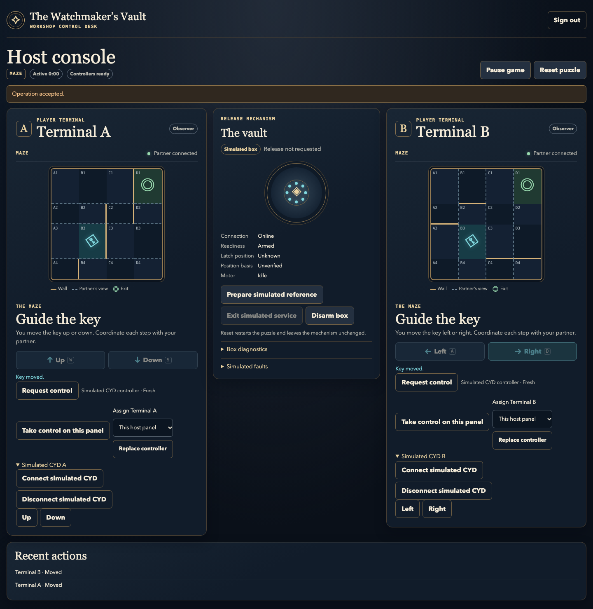
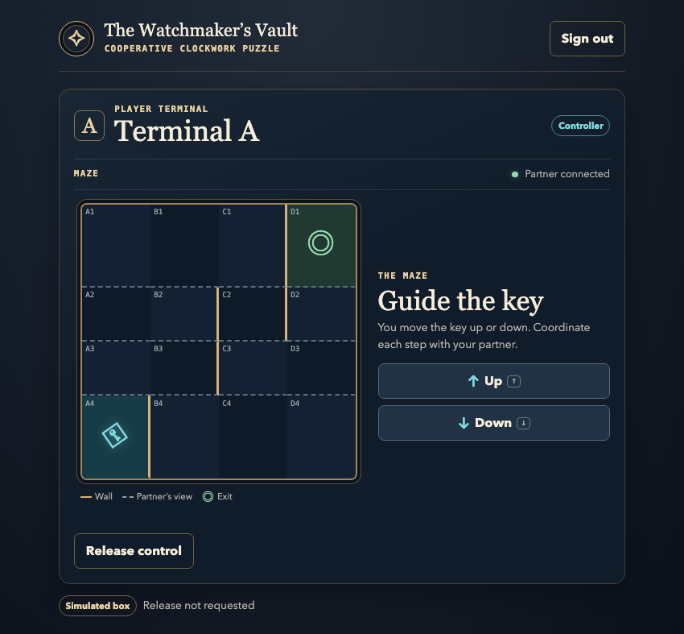

# The Watchmaker’s Vault

One key, two players, and a maze neither can see in full. Terminal A sees one set of walls and moves the key up or down. Terminal B sees the other set and moves it left or right. At the final seal, each player gets the clue their partner needs. Compare clues, choose your runes, and hold both inputs together to open the vault.

The Elixir server runs one shared game session. Phoenix LiveView keeps the host console and each player's view in sync. You can play the whole round on a laptop with the simulated box and two virtual CYD controllers, or give each player their own browser.

## Run locally

Install the Erlang/OTP and Elixir versions in [`.tool-versions`](.tool-versions) with your version manager. If you use asdf with the Erlang, Elixir, and Node.js plugins installed, run `asdf install`. From the repository root, set up the application and start Phoenix.

```sh
export MIX_HOME="$PWD/.cache/mix"
export HEX_HOME="$PWD/.cache/hex"
export ELIXIR_MAKE_CACHE_DIR="$PWD/.cache/elixir_make"
tools/bootstrap-elixir
cd server
mix setup
PHX_SERVER=true mix phx.server
```

On first run, `mix setup` builds the browser assets and creates the local game data and credential files. Keep Phoenix running while you play. Sign in as host with the key from `data/host.key` in the repository root. [Host login on port 4000](http://localhost:4000/login)

If port 4000 is busy, start Phoenix on port 4002 from `server/` and open `http://localhost:4002/login`.

```sh
VAULT_PORT=4002 VAULT_ORIGIN=http://localhost:4002 PHX_SERVER=true mix phx.server
```

## Enable the virtual controllers

1. Sign in to the host console with both player roles unclaimed. Under **Terminal A**, expand **Simulated CYD A** and click **Connect simulated CYD**. Repeat under **Terminal B** with **Simulated CYD B**.
2. When the host shows **Controllers ready**, click **Prepare simulated reference**, **Exit simulated service**, **Arm box**, then **Start game**.
3. Use **Up** and **Down** inside the expanded **Simulated CYD A** panel and **Left** and **Right** inside **Simulated CYD B**. Both views update as the key moves.
4. At the final seal, use each terminal's clue to pick the rune for the other terminal. Click **Press simulated seal** once in each panel and leave both pressed for two seconds to open the simulated box.



## Play in separate browsers

1. Use three separate browser profiles or containers for the host and the two players. Each player joins with the corresponding token from `data/player-a.key` or `data/player-b.key`. [Player join on port 4000](http://localhost:4000/join)
2. Each player clicks **Request control** to claim a free role. In the host console, click **Prepare simulated reference**, **Exit simulated service**, **Arm box**, then **Start game**.
3. Talk through the walls you can each see. At the seal, tell your partner the rune shown on your screen and select the rune they give you. Keep the **Hold seal** buttons pressed on both screens for two seconds.



For replaying a round, replacing a controller, or recovery after an interrupted release, see the [operator runbook](docs/runbook.md).

## Verify

From the repository root, run `tools/test-server`. It runs the pure M0 gate, prepares isolated fixture stores, and runs the application, raw protocol, failure and simulator suites. For Chromium coverage, follow the [browser verification commands](docs/testing/browser-cases.md).

For the independent contract check, set up the Python 3.13 environment once:

```sh
python3.13 -m venv .venv
.venv/bin/python -m pip install -r tools/requirements-checks.lock
.venv/bin/python tools/check-contracts
.venv/bin/python tools/check-json-conformance
```

From `server/`, the original M0 no-start gate still runs independently:

```sh
mix format --check-formatted
MIX_ENV=test mix compile --warnings-as-errors
MIX_ENV=test mix test --no-start --only m0 test/vault/puzzle_test.exs test/vault/projections_test.exs test/vault/contract_test.exs test/vault/json_test.exs test/vault/simulated_box/model_test.exs
```

The M0 test command requires no prepared database, credentials, Vault application, endpoint, or simulator. Mix 1.18 uses a local TCP build lock even for no-start checks. Keep the absolute cache exports from setup when changing directories. See the [toolchain record](docs/toolchain.md) for observed versions and evidence.

## Hardware milestones

The browser demo uses an in-process simulator. The raw `/device/v1` endpoint and independent Mint simulator use the same game authority and box model. Follow the [external simulator runbook](docs/runbook.md#run-the-external-protocol-simulator) for provisioning, local service, and WSS.

- **M3 CYD firmware** supports direction-limited swipes and USB provisioning. Native checks, target builds, and the first unit's verified flash are recorded alongside pending display, touch, network, and power checks. [Firmware overview](firmware/README.md) · [Board audit](docs/hardware/board-audit.md) · [CYD bring-up](docs/hardware/cyd-bringup.md)
- **M4 C5 box firmware** adds local calibration, recovery, and an optional setup knob. Initial USB identity, stable-open, and stop/reboot persistence checks passed. Physical wiring, calibration, and release acceptance are pending. [M4 verification](docs/verification/m4/README.md) · [Physical box service](docs/hardware/box-service.md)

`contracts/` contains the shared schema and fixtures. The server loads the complete maze and rune answers from its private puzzle fixture and sends each LiveView its own projection. Keep runtime data and credential files outside source control. [Game and protocol specs](docs/specs/README.md) · [Implementation and verification status](docs/implementation-status.md)
