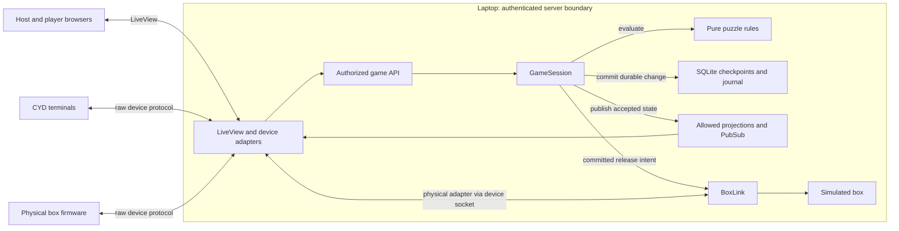

# The Watchmaker’s Vault

- **Author:** Rafael Rose
- **Status:** Approved — finalized after EGM review; all review findings resolved by accepted edits
- **Date:** 2026-11-12
- **Source:** [Implementation specification](../specs/WATCHMAKERS_VAULT_SPEC.md), version 1.0 with [Hardware Update 1](../specs/WATCHMAKERS_VAULT_HARDWARE_UPDATE.md)

## Overview

The Watchmaker’s Vault is a cooperative puzzle for two people. Each player sees different information and controls a different direction of movement for one shared key. They must talk to navigate a fixed maze, exchange clues, and hold their chosen seals together. Completing the puzzle requests release of a prize-box latch; the player lifts the lid by hand.

The first playable delivery is a real Phoenix LiveView application with separate browser controllers for A and B, an authenticated host console, and an explicitly labeled simulated box. It includes the complete maze, final seal, controller ownership and recovery behavior. It remains usable while the physical devices are being identified and tested.

Later milestones add two matching, verified CYD touchscreens and an ESP32-C5 box controller with a calibrated 5V 28BYJ-48 stepper and electrically verified ULN2003AN driver module. The active enclosure is the green PASCAL hinged rigid-cardboard box with a user-reported 90 mm width, 85 mm depth and 70 mm height; installed fit is not yet established. Browser, device and mixed-controller sessions use the same game rules and accepted state. The application runs on one laptop and remains usable without internet access once dependencies are installed.

This document converts the existing specification into a standard design and an ordered implementation plan. It records the selected software mechanisms, file changes, verification cases and hardware gates for each milestone. Its single `Detailed Implementation Plan` section separates architectural decisions from milestone tasks. Dependencies and hardware facts still require the stated implementation-time checks; this finalized design does not claim those checks have run.

## The Problem

The puzzle depends on two people having incomplete information about a shared situation. If either participant receives the entire maze or their own hidden seal answer, the software removes the need to cooperate. If their displays disagree about the key’s position or who may control it, the players cannot tell whether a move failed because of the puzzle or the software.

Network interruptions and physical actuation create a second problem. A delayed press must not become a new action after a controller changes. A missing release message must not leave a seal held indefinitely. A lost motor acknowledgement must not cause the latch to move again automatically. Players need preserved progress, and the operator needs a clear distinction between a solved puzzle, a requested release, completed motor motion and an observed physical position.

The project must demonstrate those behaviors through a playable game and reproducible tests. A static screen, successful compile or simulated latch animation cannot establish that the complete application or physical mechanism works. The milestone plan must let software reach a usable state while reserving physical claims for actual observations.

## Goals

1. **Deliver the complete browser game before requiring hardware.** After the M0 contract and test foundations, M1 provides separate A/B participant sessions and a host console for one shared game. Players can navigate the maze, enter the seal, complete the joint hold and observe a simulated release. Reloading a view does not create another game. Start requires an authorized host, both assigned fresh controllers and an armed, ready simulated box. Acceptance: M1-01, M1-02 and M1-06.

2. **Preserve cooperation and player privacy.** Use the specified 4 × 4 maze from A4 to D1. A controls Up/Down and sees the internal vertical walls; B controls Left/Right and sees the internal horizontal walls. Unknown boundaries remain visibly unknown. Each role receives only its own permitted map, its clue for the partner, its own selection and shared public facts. No participant HTML, events, assets or error response exposes the complete map, route or hidden expected answer. Acceptance: M0-02 and M1-03.

3. **Make control and progress unambiguous.** Exactly one controller owns each role. Host observers and extra tabs cannot act without an explicit grant. Browser/browser, browser/CYD, CYD/browser and CYD/CYD play use the same authoritative decisions. The host mirror shows accepted actions and held states. Each direction press attempts one move; a stale or rejected move leaves progress unchanged. Acceptance: M1-02, M1-04, M1-05 and M3-04.

4. **Qualify the seal from fresh shared input.** Players select a rune and use a separate hold control. The server qualifies the puzzle only after both required selections have remained freshly held for 2,000 ms of overlapping server-observed time. Release, stale input, pause or ownership loss cancels partial progress. The interface does not identify an individual selection as right or wrong. Acceptance: M1-06, M1-07 and M2-T1–M2-T7.

5. **Recover without losing committed progress or repeating motion automatically.** Interruptions preserve the committed puzzle state, clear held input and require deliberate recovery. A completed solve has one durable release identity. Missing acknowledgements and restarts trigger reconciliation; they do not authorize an automatic second actuation. Puzzle reset never moves the mechanism. The interface distinguishes simulated motion, physical motion completion, confirmed latch position and unknown lid state. Acceptance: M2-02, M2-04–M2-06 and M4-02–M4-06.

6. **Add physical devices against the shared contract.** Preserve the raw device protocol and shared public fixtures across the server, simulators and firmware. Keep the private maze and answer fixture on the server and in tests. Complete independent software and firmware host tests while board details are unresolved. Require evidence-backed profiles, calibration, a known starting position and current arm authorization before real actuation. Acceptance: M0-03, M0-04 and M3–M4.

7. **Make the controls readable and usable.** Fit the game screens on the specified 240 × 320 logical portrait canvas without scrolling during play. Use touch targets of at least 44 × 44 logical pixels and explain paused, offline and error states with text or icons as well as color. Verify the mapping on the selected displays and distinguish stale views from active controls. These are design targets to verify on the chosen hardware. Acceptance: M1-07 and M3-02–M3-03.

8. **Make delivery and verification reproducible.** Follow M0 contracts and foundations, M1 browser game, M2 device conformance and recovery, M3 CYDs, M4 box bench work and M5 enclosure integration. Keep the browser demonstration runnable as later targets progress. Record each acceptance case as Passed, Failed, Blocked or Not run, with commands and evidence after each milestone. Distinguish unit-tested, simulated, compiled, flashed and physically observed results. Physical acceptance includes ten release/local-service-reset cycles and a 30-minute connected run. Supply launch, provisioning, recovery, local service and demonstration instructions, with evidence explaining process ownership, pure rules, scoped views, fresh input and the command journal. Acceptance: M0-01 and M5-01–M5-04.

## Non-Goals

- Four-player gameplay, procedural layouts, a second maze, changing clues, time penalties or additional puzzle stages in the MVP.
- Cloud hosting, multiple application nodes, external messaging services, MQTT or an embedded BEAM runtime.
- A static JavaScript demonstration in place of the required Phoenix application.
- Cameras, motion-sensor puzzles, joystick or potentiometer controls, OTA updates or a separate mobile application.
- Remote calibration, jogging, homing, manual position confirmation or relocking. Physical service remains local over USB/serial.
- Automatic lid opening, an unsupplied lid sensor, or physical-position claims inferred solely from commanded step counts.
- Invented GPIO mappings, board profiles, display/touch drivers, motor travel or sensing capabilities. Optional lighting, sound and hints must not delay the first playable milestone.

### Source and drafting boundaries

The source package is located in `docs/specs/` in this workspace. Its older `docs/spec/` references were corrected during the hardware update. References in this draft use the existing paths. The package remains the basis for the plan:

- [Start instructions](../specs/CODEX_START_HERE.md) and [package README](../specs/README.md) define the delivery order and use of the complete context.
- [Master specification](../specs/WATCHMAKERS_VAULT_SPEC.md) defines required behavior and architecture.
- [Hardware Update 1](../specs/WATCHMAKERS_VAULT_HARDWARE_UPDATE.md) supplies the authorized enclosure, component and power corrections, with remaining evidence separated in the [board audit](../hardware/board-audit.md).
- [Protocol v1](../specs/PROTOCOL_V1.md) defines wire names, ordering, ownership, freshness and recovery; the [schema](../specs/contracts/protocol-v1.schema.json) defines structural validation.
- [Private puzzle fixture](../specs/fixtures/maze-v1.private.json), [protocol examples](../specs/fixtures/protocol-examples.json) and [timing cases](../specs/fixtures/timing-cases.json) provide shared test inputs. The private fixture must never become a browser or firmware asset.
- [Acceptance plan](../specs/ACCEPTANCE.md) defines the required milestone evidence. The [hardware audit](../specs/HARDWARE_AUDIT.md) defines unresolved physical facts and the local service sequence.

The current specification already selects Phoenix, SQLite, one authoritative game process, a pure rules engine, normal LiveView browser transport and raw JSON device WebSockets. Hardware Update 1 supplies enclosure dimensions and component identification, and selects a 5 V power plan. Exact board profiles, display/touch drivers, GPIOs, electrical compatibility, sensing and calibrated latch travel still need evidence. Tested dependency versions remain work for M0. The update's reported markings and dimensions are user-supplied evidence, not measurements or photo inspection performed in this session.

The Overview, Problem, Goals, Non-Goals, Technical Plan, Alternatives Considered and Detailed Implementation Plan were approved on 2026-11-12. The user authorized Hardware Update 1, selected D1–D6 below, and requested finalization at `docs/designs/watchmakers-vault.md` followed by interactive EGM review. No application behavior or physical verification is claimed by this document.

## Open Questions

D1–D6 are settled; the remaining dependencies are tested versions and hardware evidence. These checks establish implementation facts and do not reopen the approved software choices:

- **Tested toolchain:** Which installed Elixir/OTP, Phoenix dependencies, browser-test tooling and ESP-IDF/component versions pass the M0 compatibility checks? Record tested locks and unavailable tools before claiming a reproducible build. Board-dependent display/driver locks require the chosen hardware baseline.
- **Hardware identity:** The observed yellow PCB is marked ESP32-2432S028 with Micro-USB, USB-C, CH340C and TPM408-2.8 panel marking. Does the second unit match, and which working driver/pin configuration applies? The documented ESP32-2432S028Rv3 ST7789/XPT2046 profile is a candidate only. Exact C5 board, flash/PSRAM and both targets' pins remain unresolved. Candidate profiles cannot enable a hardware build.
- **Mechanism and sensing:** ULN2003AN and the 5 V 28BYJ-48 are identified in the update; module jumper/wiring, supply load, actual reference method, optional sensors and travel remain unverified. The Samsung EP-TA20JWE is selected in normal 5 V mode, while the Clutch bank model/connector/ratings need confirmation. The plan requires local service and current starting-position verification.

## Critical User Journeys (CUJs)

### CUJ 1: Play the complete game in two browsers

- **Given:** One initialized local game, an authenticated host, separate scoped A/B browser sessions, explicit control grants, fresh released inputs and an armed simulated box.
- **When:** The host starts the game; players use their complementary maps to move the key to D1, exchange clues, select their runes and hold together.
- **Then:** All views reflect accepted server state. The maze exit starts the seal without release. After 2,000 ms of fresh qualifying overlap, the server commits one solved outcome and release intent. The simulated box reports acceptance and motion completion, with simulation labels and no physical-position claim.

### CUJ 2: Recover from a controller interruption or handover

- **Given:** A maze or seal game with progress and one owner per role.
- **When:** A controlling browser/CYD disconnects, becomes silent or is deliberately replaced by the host.
- **Then:** Relevant input authority is invalidated, progress is preserved and the game pauses for recovery. Reconnection or assignment establishes current ownership and fresh neutral input. The host restores box readiness, arms while paused if needed, and explicitly resumes. A finger or key that stayed down does not become a new press. Closing a host observer alone does not interrupt other owners.

### CUJ 3: Recover a restarted game process

- **Given:** A committed checkpoint and, if already solved, its existing release identity.
- **When:** GameSession or Phoenix restarts.
- **Then:** The checkpoint is loaded into a new paused session. Old sockets and input contexts are invalidated; no live lease is restored. The system queries any existing release outcome. It does not resend motion automatically or create a replacement release identity. An unresolved release can be explicitly closed without replay after the local service and boot/session fence below; its unknown historical execution remains visible.

### CUJ 4: Operate verified physical terminals and box

- **Given:** Evidence-backed board profiles, tested firmware, an accessible mechanism, bounded calibration, a currently verified locked start and the current connection/session.
- **When:** The operator leaves local service mode, arms from the host and players complete the game using CYDs or mixed controls.
- **Then:** The box records the release identity before stepping, consumes the arm, enforces local limits and reports its actual knowledge. The player lifts the lid manually. Another game requires the separate local service/relock procedure and fresh verification after the new session is established; puzzle reset itself causes no movement.

## Technical Plan (Architecture)

### 1. System boundary and data flow

Use one Phoenix application under `server/`, one local Elixir node, one active two-player game and a file-backed SQLite database. Phoenix LiveView provides the host and participant pages. CYDs and the physical box use raw JSON WebSockets at `/device/v1`; they do not use Phoenix Channels framing. Two ESP-IDF applications share C++ protocol and transport components. These choices come from the existing specification.

The server owns puzzle truth, controller grants and the decision to release. CYDs own local touch sampling and display updates. The box owns its journal and bounded motor execution. A transport connection is evidence of neither controller ownership nor actuator readiness.

Box mode selects either the simulator or the authenticated physical adapter for the active game. The two paths never actuate for the same game. Arrows show ownership and message flow, not a requirement for a process per diagram box. Responses return through the originating adapter; durable changes become externally accepted only after their transaction commits.

### 2. Components and planned source locations

The workspace currently contains the specification package and draft documents. The application and firmware components below are new. This table identifies the main architecture files; the later Detailed Implementation Plan will enumerate configuration, migrations, assets, tests, tools and documentation individually.

| Component | Planned location | Responsibility and boundary |
| --- | --- | --- |
| Application supervision | `server/lib/vault/application.ex` | Acquire the local startup/maintenance guard, then start the repository, PubSub, registries, game and box-link supervisors, recovery coordinator and endpoint. Helpers that do not own an independent lifecycle remain functions. |
| Authorized game API | `server/lib/vault/games.ex` | Resolve an existing durable game ID, validate the caller's capabilities and route operations to its GameSession. Creation is an explicit host/setup operation. |
| Authoritative game process | `server/lib/vault/game_session.ex` | Serialize accepted actions, maintain bindings and freshness, schedule qualification, persist durable changes and coordinate permitted effects. Register by durable game ID to prevent duplicate authorities. |
| Pure game rules | `server/lib/vault/puzzle.ex` | Evaluate the fixed maze, permitted movement, phase transitions and rune selections from explicit inputs. Return proposed state and typed effects without clocks, I/O or processes. |
| Persistence boundary | `server/lib/vault/game_store.ex` | Own checkpoint and actuator-record transactions through Ecto, including release uniqueness and checkpoint compatibility. |
| Controller authorization | `server/lib/vault/controllers.ex` | Represent authenticated identities, allowed roles and ownership checks. Active grants remain under GameSession ownership. |
| Allowed views | `server/lib/vault/projections.ex` | Build separate A, B, host, public and box data structures from allowlists. Never obtain privacy by removing a few fields from an unrestricted state dump. |
| Box coordination | `server/lib/vault/box_link.ex` | Manage the selected box connection, permission-only arm/disarm, queries, committed release dispatch and reported outcomes. It cannot declare a solve or invent a new intent. |
| Simulated box | `server/lib/vault/simulated_box.ex` | Own the in-process runtime, independent model instance, scheduling and durable store connection; delegate box-local transitions to the shared pure model. |
| Shared simulated box model | `server/lib/vault/simulated_box/model.ex` | Evaluate box-local state/events/time into proposed state and typed effects without I/O, processes or scheduling; serve both simulated runtimes. |
| Raw device entry point | `server/lib/vault_web/device_upgrade.ex`, `server/lib/vault_web/device_socket.ex` | Authenticate before upgrade; enforce protocol limits and identity/class bindings; translate device traffic into the shared game/box APIs. |
| Browser pages | `server/lib/vault_web/live/player_live.ex`, `server/lib/vault_web/live/host_live.ex` | Authorize mount and events, subscribe before fetching state, render only permitted data and submit actions through the shared API. |
| Browser rendering and input | `server/lib/vault_web/components/terminal_components.ex`, `server/assets/js/hooks/controller.js` | Reuse the terminal layout in participant and host views. Handle pointer/keyboard lifecycle, challenge replies and local presentation without granting authority or declaring outcomes. |
| Firmware applications | `firmware/apps/cyd/`, `firmware/apps/box/` | Compose the shared components with the explicitly selected board and application-specific display or actuator interfaces. |
| Shared firmware components | `firmware/components/vault_protocol/`, `vault_transport/`, `vault_device/`, `vault_display/`, `vault_actuator/` beneath `firmware/components/` | Separate validated protocol state, network lifecycle, device context, display/touch and local actuation. Common code contains no board GPIO defaults. |
| Contracts, tools and hardware evidence | `contracts/`, `tools/`, `firmware/boards/`, `docs/hardware/` | Supply shared public test fixtures, explicit simulator/build/flash/provision tools, verified profiles and measured physical evidence. These are not browser-served asset directories. |

Game processes start through a DynamicSupervisor and are registered and looked up by their durable IDs. A page mount may locate or restart an existing game from its checkpoint, but never create a new playthrough. A replacement process must enter the documented recovery path; supervision alone does not restore authority or memory.

### 3. API and trust boundaries

All browser, simulated-controller and CYD actions pass through the same authorized game API. Controller operations are claim, release, move, select rune, request permitted state and report complete held-input state. Start, pause, resume, reset, deliberate replacement, Begin release recovery and Close release without replay are host operations. The two recovery operations remain available when ordinary Pause/Reset is disabled. A client-supplied role, actor ID or device capability cannot grant permission. Freeze the required A/B participant set when the round starts; a disconnect never reduces the number of players needed to finish.

Provide `/games/:id/host`, `/games/:id/play/a` and `/games/:id/play/b`. One local host login and separate role-scoped join credentials protect browser access. Exchange a join token for a scoped session and redirect to a clean URL. Recheck access at routes, LiveView mounts/events and the game API. The host can observe both roles, but must obtain a distinct controller grant for each role it operates. Opening another tab does not steal a grant.

**D3 — Selected by the author: generated host access key.** Local setup creates 32 cryptographically random bytes encoded as unpadded Base64url. Store only its SHA-256 digest, enabled state and durable authentication epoch in the host credential record. Write the plaintext only to the explicitly requested protected local output file, created exclusively with owner-only permissions; never print the key, overwrite an existing destination, follow a destination symlink or place it in source control. The host key, player join tokens, per-device bearer secrets and Phoenix session-signing secret are independent values with distinct purposes.

The host pastes the key into an ordinary CSRF-protected login form. Submit it in a bounded POST body, filter it from request/error logs, verify the digest with constant-time comparison, renew the browser session and redirect to a clean host route. Keep origin checks and signed/encrypted, HttpOnly, SameSite cookies; require Secure cookies in HTTPS mode. Store a nonsecret credential ID, its authentication epoch and a server-checked eight-hour absolute expiry in the session, never the access key itself. Login attempts use bounded throttling, generic failure responses and a strict key-format/length check. Logout clears the browser session and disconnects its LiveViews/controller actors; logging out one browser does not rotate the shared host key.

`mix vault.init` creates missing setup only and never silently rotates an existing key. Explicit local `mix vault.host.rotate --output PATH` replaces the host key only during stopped/disarmed maintenance. One local startup/maintenance guard excludes running Vault applications and competing credential tasks. Replacement durably writes a new protected output file before committing its digest and incremented authentication epoch; retain both files when activation is uncertain and inspect the active record without exposing secrets. Restart follows paused-session recovery and rejects old host sessions by their persisted epoch. Rotation preserves independent credentials, assignments and release history; it neither cancels motion nor closes uncertainty. Ordinary authorization, private-view checks, session expiry and logout remain enforced; expiry/logout of a required host controller clears its holds and invokes recovery pause. Host-key rotation adds no epoch comparison to gameplay or winning transactions. The [D3 maintenance boundary](#d3-maintenance-boundary) defines exclusion, lost-key preparation and crash recovery.

Devices authenticate with their own provisioned bearer credentials before the WebSocket upgrade. Match `hello` identity and class to registration, and derive allowed roles from that registration. The server-generated connection identity is bound to the authenticated handler. Replacement connections invalidate the old handler and its queued input. `hello` is due within five seconds; gameplay remains disabled until welcome, current projection, grant and fresh neutral input are established.

Development defaults to loopback and a simulated box. LAN access is an explicit configuration with permitted origins. Plain HTTP/WS is restricted to the explicitly enabled trusted-LAN development mode and provides no transport confidentiality. Configured HTTPS/WSS retains certificate verification. Secrets remain outside committed code, logs, screenshots and projections.

### 4. State ownership, persistence and accepted transitions

Keep game phase (`lobby`, `maze`, `seal`, `solved`), pause state and release outcome separate. The durable `game_id` locates the game; `session_id` fences reset/recovery; `round_id` identifies a maze attempt; `puzzle_revision` identifies the rules; `board_version` orders accepted maze moves; `state_revision` orders visible changes. Connection and controller epoch identify live authority. A heartbeat refresh changes neither the board nor the published state revision by itself.

| State | Durable contents | Restart behavior |
| --- | --- | --- |
| Game checkpoint | Schema version, game/session/round/rule identities, phase, position, board version, selected runes, pause/recovery state, active-time accumulator and release identity | Preserve committed progress; commit a new session and recovery pause before allowing new authority. Reject incompatible checkpoints visibly. |
| Registration and desired assignments | Enabled identities, credential hashes, class, allowed roles, permitted capabilities and intended role assignments | Reauthenticate and reauthorize; a saved assignment is not a live controller grant. |
| Browser credentials | Independent host/player credential digests, scope, enabled flag and durable authentication epoch | Preserve explicit revocation across process restarts; a browser session must match the current record and expiry. This authentication epoch is distinct from game/session and controller epochs. |
| Actuator intent and observations | Original command/fingerprint and intended box, originating game/session/round, observations, permanent dispatch retirement, recovery progress, separate disposition and non-pruned evidence | Preserve identity, uncertainty and administrative closure independently; restart restores no live arm, connection or current inspection evidence. |
| Live authority and timing | Socket/process bindings, connection IDs, controller epochs, challenge records, leases, pressed state, timer generations and connection-scoped acknowledgement caches are volatile | Clear them; no restored hold, deadline, retry or arm is effective authority. The durable browser authentication epoch above is not a live controller grant. |

For a durable transition, GameSession validates the authenticated context, asks the pure rules for the proposed change, commits through GameStore, adopts the result, then acknowledges, publishes and dispatches effects. Durable fields such as movement, selections, phase and operator decisions must match the accepted checkpoint. Heartbeat refreshes and animation ticks do not become database writes.

For the win, the solved/release-pending checkpoint and one release intent commit in the same transaction. The database enforces one release for the originating solved attempt. Only this commit permits initial dispatch. A failure before commit produces neither accepted state nor actuation. A failure after commit preserves the identity even if dispatch or acknowledgement is unknown.

Use short SQLite transactions, foreign keys, a checkpoint schema version and explicit synchronous durability with `:full` for the actuator journal. Begin with the specified 100 ms busy timeout and measure the complete transaction path against the 400 ms lease budget. Do not hold a transaction open while waiting for transport or motion. A failed write causes a visible volatile recovery pause with a storage-error diagnostic; it cannot acknowledge an uncommitted result. Document the actual storage guarantee and keep timing authority in the server's monotonic clock, not persisted timestamps.

### 5. Movement, snapshots and privacy

The server loads the golden puzzle privately. Each move validates ownership, current session/round/rules, unpaused maze phase, observed board version, permitted axis, bounds and walls. A successful move advances position and board version once. The first of two moves based on the same board can succeed; the other is rejected as stale and requires a new player decision. Entering the goal commits the maze result and opens the seal without releasing the box.

Construct each audience's state independently. A receives its vertical-wall information, Up/Down controls and clue for B; B receives the complementary view. Public/unclaimed and box projections contain no maze, seal, hold or board-version fields. Host visibility is separately authenticated. Keep full puzzle data out of initial participant HTML, diffs, events, errors, DOM attributes, source maps and served assets. Public rune names and the player's chosen rune are permitted; privacy tests check fields and wall sets, not blanket word absence.

**D1 — Selected by the author: audience-specific snapshots.** GameSession publishes complete allowlisted projections on separate internal topics scoped to the game, session and authorized audience. Player A, player B, host, public/unclaimed and box views never share an unrestricted payload. Topic membership is derived from the server-authenticated principal and current permitted scope; a client-supplied role or topic name cannot grant access. The shared delivery helper handles topic construction, subscription and revision checks without becoming a second state owner. Per-connection challenges, grants and protocol envelopes stay with the authenticated adapter rather than being broadcast to other subscribers.

Authorize and subscribe before the initial snapshot fetch. That bootstrap/reconnect fetch remains even though ordinary updates carry snapshots directly. Apply complete snapshots within the authenticated session, ignore older revisions, and ignore unsolicited equal-revision duplicates. An explicit bootstrap/request may refresh equal-revision state. A different-session snapshot cannot authorize a session switch; reset/recovery uses the adapter's explicit rebind or a new device welcome. On an authorization-scope change, unsubscribe the old scope and fence its queued snapshots before subscribing/fetching the newly permitted view. Controller-grant changes independently fence input; observing a role never establishes control authority.

Coalesce obsolete presentation state to at most 10 Hz. Preserve discrete action results and lifecycle events. The host mirror uses accepted action IDs, selections, current owner/source and live held state; a one-shot movement is not evidence that a direction remains held. Local feedback may appear immediately, while the key position and outcome follow server acceptance. Progress animation follows `hold.active`, so an active attempt at zero elapsed time differs from no attempt, and stops short of declaring completion until the server qualifies it.

### 6. Held input and browser lifecycle

Browser hooks and CYDs implement the same freshness rules. The server issues challenges every 100 ms. A valid response grants a lease strictly before challenge issue time plus 400 ms; receipt time does not extend that deadline. Samples carry complete current context and monotonically increasing input sequences. Dedicated seal presses have increasing press IDs; movement and rune taps do not count as held seal input.

Shared qualification starts only when both current owners have fresh, correctly selected presses. At its 2,000 ms deadline, the session first expires overdue leases, then rechecks the attempt identity, context, ownership, selections, press IDs, phase and readiness. Generation-tagged timers make canceled or duplicate completion messages harmless. Equality with a lease deadline is expired. Use one injectable monotonic clock/scheduler for deterministic boundary tests.

A normal release or changed selection clears the affected hold and joint progress; changing a rune requires a new press. Expiry of a held input, pause, context change, reconnect or ownership replacement additionally requires a released baseline and a new press; stale true samples cannot restart an attempt. Explicit connection loss pauses immediately. An open but silent required connection adds its offline and recovery reasons after 1,500 ms. The existence of a LiveView process is not proof of browser freshness.

The hook clears local input on pointer release/cancel, lost capture, blur, hidden document, navigation/destruction and disconnection. It ignores repeat keydown and does not intercept form typing. Normal player shortcuts are Up/Down plus Space for A and Left/Right plus Space for B. The combined host demonstration uses separate A/B actor contexts and the specified labeled W/S, A/D and Q/P mappings. Reconnect cannot replay a held key or pointer.

### 7. Pause, recovery and release reconciliation

Pause preserves phase, position and rune selections while clearing holds and shared progress and invalidating input epochs. Required-controller or box loss adds an offline reason and a recovery latch. Restored freshness clears the offline reason only. Resume is host-only after readiness is restored; it clears operator/recovery reasons and requires input appropriate to the refreshed control context.

Before a committed solve, entering pause disarms release permission once. Recovery proceeds by restoring fresh neutral controllers, establishing box reference and verified locked start where physical, arming while still paused, waiting for the sequenced readiness report, then resuming. Resume and repeated paused snapshots do not disarm the newly restored permission.

On GameSession restart, load the checkpoint, commit a new session and recovery pause, close old raw sockets with code 4003, clear volatile state and explicitly rebind browser controllers. Keep an existing solved state and release command ID. Query the authenticated box about that ID; pending rows and missing acknowledgements do not cause automatic motion delivery. A readiness-only report updates current facts without overwriting the persisted release outcome. Conflicting observations remain diagnostic evidence rather than silently establishing certainty. A recovered intent remains query-only; explicit release recovery retires it permanently rather than reissuing it.

Keep the reported release outcome separate from a durable administrative disposition. **Begin release recovery** and **Close release without replay** are authenticated host operations available while ordinary Pause/Reset is disabled. Closing an intent as `closed_no_replay` records that the operator has handled its recovery and permanently retired its delivery; it does not assert whether its original motion happened. Preserve the original command/fingerprint, intended box, originating game/session/round, observations, confirmation and conflicting evidence. An uncertain outcome stays uncertain. The disposition is host-only administrative data, not a new v1 field, release status or physical confirmation.

Begin recovery commits a recovery ID, permanent dispatch retirement and a new paused session while preserving the solved checkpoint and original intent. Then fence old handlers, queued effects, input and arms. BoxLink never re-envelopes an old effect under replacement bindings. Recovery is query, local service and explicit closure only; neither automatic nor operator-requested redelivery of the original intent is offered. An already transmitted command may act before the local stop, so beginning recovery is not a cancellation claim. The operator uses local service/manual release if access to the prize is needed.

For a physical box, enter USB recovery service: immediately inhibit gameplay arming/admission and queued or reserved gameplay work, stop at a bounded step boundary, disable outputs and close the old connection. Persist the service inhibit before acknowledging successful entry; check it again before any first step. Service-inhibit, seal, reconciliation and clear-authorization records carry an explicit storage version. A failed write leaves the device faulted and unable to arm; missing, corrupt or unsupported required recovery records fail closed. Service remains available for deliberate bounded local operations under its existing limits.

Record a bounded local reconciliation entry: recovery ID, original command/fingerprint and intended box, actual journal observation, operator observation and service epoch. For an absent ID, record only “not present in the current journal”; absence proves no historical execution result. Reboot with the inhibit and entry retained. Require a new boot ID and authenticated connection to the committed recovery session. Re-establish any current reference/position evidence locally after that reboot; do not restore old verification. After any bounded restoration, **Seal recovery evidence** durably freezes all motion, including USB jog/example/local, invalidates queued/reserved movement, stops/disables outputs and binds the local entry to the current recovery ID, boot and session. Enforce the freeze at execution boundaries. The operator compares that sealed serial entry with the host intent. Only then obtain a fresh sequenced query result for the exact command/box/boot/connection/session, with `motor_active:false` and no arm. Reboot or binding changes preserve the freeze but invalidate its evidence binding; refresh/reseal against current bindings before closure.

Close release without replay requires explicit host confirmation of that matching local evidence. Commit `closed_no_replay` with the recovery ID, original intent, operator, reason, local record reference, current binding/status evidence and timestamps; recheck host authorization and recovery generation in the transaction. No transaction waits for USB, network or inspection. Readiness-only reports and elapsed time cannot close an intent. If a reply is lost, read back the same durable disposition; do not create a replacement intent. Any preclosure boot/connection/session change invalidates current evidence and requires it to be refreshed. Restart preserves retirement/disposition but restores no live authority.

The operator then verifies the committed host disposition in USB service and records its identifier on the matching local reconciliation entry. This is an authorized operator attestation across the host UI and USB service, not a cryptographic or wire-level proof. A failed or uncertain host/local write keeps recovery service, motion and history clearing inhibited until durable records are read back. Local acknowledgement gates unfreezing, leaving recovery service and clearing uncertain history. Reset may occur after the host closure while that local step is pending because the box remains frozen; it cannot enable another arm.

If more local motion is needed before closure, explicitly restart preparation through Begin release recovery with the expected prior recovery ID. Serialize this transaction against Close: a successful restart replaces the recovery ID/session and makes the old generation ineligible for closure while retaining permanent dispatch retirement; a previously committed Close instead requires its normal disposition-acknowledgement path. Verify the committed replacement locally before unfreezing into preparation. Local invalidation alone cannot defeat a concurrent host Close. Ordinary request retries read back their original recovery ID rather than creating a new generation.

| Observation | Retained history | Completion path |
| --- | --- | --- |
| Commit before dispatch; query returns `unknown_command` | Original intent and uncertainty; absence is only a current journal observation. | Full stopped-service/reboot/inspection/query procedure, then explicit `closed_no_replay`; never redeliver the old ID. |
| Accepted command interrupted, or device journal lost | Original acceptance/outcome evidence remains; missing device history does not prove no motion. | Same closure path; local restoration establishes current condition only. |
| `motion_complete`, valid `position_confirmed`, or terminal `failed` | Preserve exactly the reported outcome; completion proves no lid state. | If recovery has not begun, use the terminal-and-idle Reset path. Once Begin recovery exists, finish its host Close and local acknowledgement even if a later terminal observation arrives; it cannot bypass that recovery. |
| Conflicting historical outcomes for the same verified identity | Retain the conflict without promoting certainty. | Full recovery fence plus explicit operator acknowledgement may close delivery while execution remains unresolved. |
| Wrong device/fingerprint, contradictory current stopped/armed evidence, or unavailable intended box | Keep diagnostics; do not adopt the disputed observation. | Refuse closure until the intended identity and stopped/disarmed condition are established. |
| Server intent/disposition store unavailable or lost | No empty-game fallback or invented replacement intent. | Restore the original durable records; otherwise leave the box quarantined. |

Reset is available after a known terminal result and idle mechanism only if release recovery has not begun; once recovery begins, require durable `closed_no_replay` and the stopped/disarmed recovery evidence above, including when a late terminal outcome arrives. Reset preserves actuator history, creates a new puzzle context and performs no motor operation. For another physical game, establish the new welcome/session, finish local service acknowledgement, relock/reference and verify the current locked start, deliberately leave service, obtain a new arm and confirm readiness. Only a newly solved attempt can create a new release identity. The host labels an uncertain closed record “Release outcome unknown — recovery closed; original command will not be sent again.”

### 8. Box adapter and simulation

Select `VAULT_BOX_MODE=simulated|physical` at application startup, defaulting to simulation for development. Changing mode requires a new or deliberately reset game context and cleared leases; it does not bypass the unresolved-release reset restriction. Only the server-selected simulator can set `simulated:true`. Physical firmware cannot claim that flag or use modeled readiness to evade physical checks.

Both adapters require explicit arm permission, deduplicate command identities and distinguish accepted, motion-complete, confirmed, uncertain and failed outcomes. The simulator models reference/locked readiness through a clearly labeled host action, consumes its arm on command acceptance and supports disconnect, reboot, lost-acknowledgement and interrupted-motion injection. It keeps physical position unknown, basis unverified and command confirmation null; it never reports physical position confirmation. Its lid animation is presentation only. The simulated implementations model the box-local recovery service, reconciliation and reboot fences; host administrative closure remains in GameSession/GameStore. Modeled service actions never claim physical observations. Host-only disposition controls remain outside the unchanged v1 box DTO.

Both simulated runtimes use the compiled pure `Vault.SimulatedBox.Model`, with separate state instances, durable databases and lifecycles. The model owns box-local readiness, arm consumption, command identity/deduplication and capacity, deadline-first motion/interruption, reboot restoration and local recovery-service/seal/reconciliation/clear transitions. It returns proposed state and typed effects from validated events and current local monotonic time; it performs no I/O or scheduling.

GameSession/GameStore retain puzzle qualification, release identity creation, dispatch retirement, host authorization, closed_no_replay, Close/preparation arbitration and Reset eligibility. The model records only the local operator attestation of a host disposition or replacement preparation; it cannot create that host authorization. Runtime adapters execute effects with independent timers and storage ownership; transport adapters own wire validation, authentication, status retries and connection generations. Neither adapter duplicates box-local transition decisions. Simulation selection and truthful v1 projections remain unchanged.

Use a thin compiled `Vault.SimulatedBox.Store` over Exqlite/SQLite for the bounded durable subset, with one separate file/connection per box instance outside the server checkpoint. Explicit initialization creates a new store; reopening an expected store never silently replaces missing, corrupt or unsupported history. Run the same protocol-derived traces with literal expected observations through both adapters; agreement between adapters alone is insufficient because the model is shared.

The physical adapter accepts readiness and results only from the configured, authenticated box with current transport/boot/session bindings. Arm/disarm authorizes or removes permission without movement. Keep historic command confirmation separate from current latch position and readiness. A known release can remain historically confirmed after a later local relock; querying it restores neither old position nor authority. No protocol field establishes that the lid is open.

### 9. Raw device contract and shared fixtures

Keep protocol v1's message names and envelopes unchanged. Validate assembled JSON messages, including fragmented input, before routing. Limits are 4,096 bytes device-to-server, 8,192 bytes server-to-device, depth eight, and 30 device messages per second with burst ten. Reject binary application frames, malformed values and unsupported versions without creating atoms from input. Unknown top-level extension fields remain allowed; nested objects follow the strict schema.

Discrete commands and heartbeat samples have independent counters. Retain 128 command/result pairs per connection: consume expected sequences for both applied commands and domain rejections, return prior results for identical duplicates, reject changed duplicates, do not advance on gaps and never execute an expired result again. Allow one unacknowledged discrete device command. On the same connection it can retry the identical envelope after 500 ms up to three times; reconnect discards the pending action and obtains current state. Heartbeats continue independently. Status acknowledgements have their separate sequence/cache/retry rules and never trigger actuation replay.

Use the selected bounded OTP `:json`/yyjson parsing and finite hand-written v1 validators in [JSON validation](../specs/JSON_VALIDATION.md). Phoenix retains Jason for its framework codec. Preserve exact mathematical-integer checks, UTF-8 and decoded-key uniqueness, top-level extensions and the schema's capability-object extension exceptions; use independent schema-oracle and literal boundary tests without adding a runtime schema engine. Share the public schema and conformance examples between server, protocol simulator and firmware host tests. Use the timing vectors through the same validation path as real inputs. Keep the private maze/solution/answers under a server/test-only location, planned as `server/priv/puzzles/maze-v1.private.json`; do not copy it into browser assets or firmware. Conformance fixtures are test data, not data bundled into device or browser runtime images. The later implementation list will name the contract copies and checks that keep their versions aligned with the source package.

**D6 — Selected by the author: Mint.WebSocket for Elixir simulator clients.** The external test clients impersonate registered CYD controllers or a box through the actual `/device/v1` endpoint. Keep `mint` and `mint_web_socket` as development/test tooling dependencies in the server's Mix project, locked by the same `mix.lock`, with explicit startup by the simulator runner. The wrapper loads that locked environment and the compiled shared model/store without starting the Phoenix application or server Repo in the client process. One client process exclusively owns its Mint connection/WebSocket structures, protocol context and client timers; a functional transport module updates those structures. The runner monitors transport-operation deadlines. An external fake box has a separate runtime for modeled actuation, watchdog, readiness and journal transitions, which never waits for a transport call or acknowledgement. Use HTTP/1.1 upgrade, bearer authentication, verified TLS for WSS, and only explicitly enabled trusted-LAN WS. No connection credentials enter a URL or diagnostic output.

The simulator owns upgrade validation, ping/pong, close handling and reconnect scheduling. Use Mint's active-once socket delivery and tagged timer messages for receive processing; enforce the separate bounded-write policy below. Limit handshake/upgrade/welcome waits, bound pending work and serialized data, and reject oversize assembled messages before retaining unbounded decoder state. An incremental frame-size/fragment guard runs before decoding; it tracks cumulative data-message bytes without counting interleaved control frames as puzzle data. Normal outbound JSON stays within 4,096 bytes, incoming messages within 8,192 bytes and depth eight, and generated traffic observes 30 messages/second with burst ten. Do not request compression extensions. The selected dependency's documented frame API handles normal traffic; it does not supply arbitrary fragmentation or malformed framing for negative tests.

Bound simulator writes with socket timeouts, independently supervised operation/teardown deadlines, and finite producer admission and encoded queues. A send error, timeout or operation overrun retires the connection generation and pending authority as ambiguous delivery; failed bytes are never retried, and reconnect waits for the old transport owner to exit. The fake-box runtime retains independent motion/watchdog ownership through these failures. The [D6 bounded-write implementation in Detailed Implementation Plan §3](#d6-bounded-write-implementation) specifies the budgets, registration/completion handshake, loop fairness and teardown sequencing, with required WS/WSS verification; those budgets cannot extend protocol freshness or motion deadlines.

Reply to actual server heartbeat challenges with complete current input; ping/pong is never game freshness. Keep the one-pending-command rule and identical 500 ms retries capped at three, then close/reconnect and discard the pending action. A new connection or session clears pending input, challenges and timers, obtains welcome/current state, and requires a neutral baseline plus a new scenario press before holding again. Tag timers and incoming socket state by connection generation so queued old work cannot revive input. Server-side 400 ms challenge-issued leases and 2,000 ms qualification remain authoritative; the client cannot extend a lease from packet arrival time. The modeled box applies the 1,500 ms authenticated-server-silence rule and never resumes interrupted motion automatically.

A separate external fake-box runtime owns modeled motion, its independent watchdog/step timers, readiness and journal transitions; the Mint owner never owns that actuator deadline. Communicate through bounded asynchronous, generation-tagged events. The runtime monitors transport loss and receives authenticated-challenge events with their client-recorded monotonic receive time, so mailbox delay does not renew freshness. Before command acceptance, each step, the first step after intent persistence, and any completion, expire watchdog/travel deadlines and check current authority. Stop at the next bounded modeled step boundary on known transport loss or 1,500 ms of authenticated-server silence; deactivate motion without waiting for a status send. A late heartbeat or queued completion cannot revive an interrupted stroke or overwrite uncertainty with success.

Journal I/O occurs only while modeled motion is inactive: persist intent before the first step and recheck authority/time afterward; deactivate motion before recording terminal/interrupted outcomes. Transport-owner replacement retains the runtime and journal, clears arm authority, and never resumes a stroke. A simulated box reboot changes boot identity and reloads inhibited/inactive state and retained history. Queries may report that history under new transport bindings, but neither reconnection nor reboot replays an actuation.

Keep normal protocol clients separate from a bounded raw fault transport for deliberately fragmented/malformed frames, interleaved controls, byte splitting, stopped reads and selective acknowledgement loss. Isolated scenario fixtures bind a fake box as the server-selected simulator before connecting it; the client cannot obtain simulated readiness by claiming a wire flag. Only one selected box adapter is active for a game. The fake box uses its own protected fixture-owned SQLite database through the shared Store, separate from the server checkpoint and in-process simulator store; tests preserve it across simulated reboot and inject storage/interruption failures. Model no physical sensing: projections retain `simulated:true`, unknown latch position and unverified basis. The raw harness and test-only setup never expose physical GPIO or a production control endpoint.

### 10. Firmware and physical service boundaries

Use the source-specified ESP-IDF applications and common components. Transport owns connection lifecycle, bounded frame assembly and reconnect scheduling. Device state owns authenticated context and input validity. One UI owner controls rendering and touch state. One actuator owner controls steps and limits. These are ownership boundaries, not a requirement for a separate task per helper. Timer/interrupt callbacks defer substantial work to bounded queues.

Start with 32 small typed queue entries and a replaceable latest snapshot. Cosmetic updates may be coalesced; releases, role changes and actuator results cannot disappear silently. If required traffic cannot be queued, clear local input and reset the connection. Reconnect discards old input and retries, obtains a current welcome/grant/snapshot and requires actual lift/repress. Map the 240 × 320 logical UI and touch coordinates through the same verified board transform. Prefer the specified supported display stack or a proven vendor baseline, with the chosen combination locked after verification.

A board profile is the single source of target, pins, buses, orientation, memory, capabilities and calibration compatibility. An unresolved profile rejects that target build; host fakes remain available. Build/flash tools require explicit application, profile and serial port, produce versioned manifests and checksums, and refuse detected-chip mismatches. Provision identity, Wi-Fi, endpoint and credentials through local serial service without committing or echoing secrets.

**D2 — Selected by the author: generate firmware configuration from the reviewed profile.** This applies to both CYD and C5 firmware. Confirmed matching CYDs can share a hardware profile; the C5 uses a separate profile. Human-reviewed `profile.json` files are the authoritative hardware settings. A deterministic generator validates the selected application/profile, then emits a header, CMake settings, board SDK defaults and partition table into that build's ignored output directory. There is no independently edited header containing a second pin map. Per-device identity, credentials, touch calibration and measured actuator calibration remain provisioned records, with compatibility bound to the profile where required.

Every physical build regenerates from validated inputs and records the profile, generator and output hashes. Missing evidence, unresolved fields, conflicting assignments, an incompatible application/target or a resolved SDK configuration that contradicts the profile stops the build. An old generated file cannot rescue a failed generation. This establishes configuration provenance; it does not prove that the supplied pin map, display controller or mechanism has been physically verified.

Physical box motion requires valid calibration and current locked-start evidence, a fresh arm bound to connection/boot/session, bounded travel/rate and an unexpired challenge. Persist command intent and consume permission before movement; after that write and immediately before the first step, recheck reserved authority and freshness. A failed durable write allows no step. Record final outcomes, retain up to 32 accepted command identities without automatic eviction, and return existing outcomes without moving again. A full journal rejects new motion. Clearing it requires local stopped/disarmed service after uncertain records are reconciled, followed by reboot and a new host session.

Recovery-service inhibit survives reboot and is checked at gameplay admission and immediately before the first step. It rejects gameplay arms/commands and invalidates queued or reserved work; it does not prohibit stopped, bounded local service. Read-only queries remain available.

Queries and stopped service remain available at the 32-entry limit. Reconciliation metadata attaches to existing accepted entries and consumes no additional accepted-command slot. An absent queried ID uses one bounded active recovery record outside that capacity; it does not become a fabricated accepted command. An uncertain entry is administratively reconciled only after local metadata records the operator's verification of its matching durable host `closed_no_replay` disposition. Its recorded execution outcome remains uncertain.

History clearing is a separate explicit USB operation, never puzzle Reset or routine service. Require stopped/disarmed recovery service, no active reservation, retained server history and every uncertain entry administratively reconciled. Before erasure, persist a versioned clear-pending record outside the erased journal: operation identity, pre-clear session and a bounded complete copy of the matching verified dispositions/local acknowledgements needed to authorize exit, including those attached to entries about to be erased. Validate that durable copy before erasure; never reconstruct authorization from an empty journal. Preserve credentials, calibration configuration, service inhibition and motion-freeze state. A partial erase or restart remains inhibited. Missing, corrupt or unsupported required recovery/clear records fail closed. Reboot and establish a different host session before recording completion of that fence. In order: complete the reboot/new-session fence; use the retained authorization to deliberately unfreeze into preparation; establish fresh reference/locked verification while gameplay remains inhibited; deliberately leave service; obtain a new arm. Retain the completed clear authorization until service exit is durably recorded, so interruption of any step cannot erase permission evidence or bypass a remaining gate. Server command identities and retirement records remain permanent. Old envelopes and retired intents never gain new bindings or permission.

Local motion limits remain effective independently of Phoenix. Explicit transport loss stops at the next step boundary; authenticated-server silence trips the 1,500 ms watchdog. De-energize coils and record uncertainty after interruption. Boot starts with inactive outputs and never resumes an interrupted move. Use measured travel with the specified three-second stroke target and eight-second absolute timeout; do not catch up missed steps in a burst. Calibration, bounded jogging, supported homing, position confirmation and relocking remain USB/serial operations with gameplay disarmed. Sensor absence is explicit; commanded step counts and an unasserted home switch cannot prove a released position.

Release-travel, speed and motion-timeout bounds are always required. Homing-travel/deadline bounds apply only when a home sensor is installed, verified and homing is enabled. Without it, homing is unavailable and local manual alignment/reference applies. Puzzle reset is a host action; physical relocking uses local USB/serial maintenance. Neither reset nor reconnection moves the motor.

Hardware Update 1 identifies the Freenove 8 RGB LED Module as the documented eight-WS2812 family, with IN/OUT S/V/G connectors and GRB as the documented example order. Plan a suitable 3.3 V-to-5 V data buffer unless verified input thresholds establish adequate direct-drive margin. Supply the C5's documented power input, ULN2003 motor branch and LED branch in parallel from the selected normal 5 V USB rail with common ground. Do not request 9 V or join independent powered 5 V sources without verified isolation. Check simultaneous Wi-Fi, motor and LED load; neither the 2 A label nor an illustrative 0.48 A LED allowance is a load measurement. Each terminal uses its own confirmed 5 V USB bank, with sustained and idle-operation checks.

The 90 × 85 mm floor and 70 mm height are nominal user-reported limits. Dry-fit actual boards, motor ears/shaft/coupler, full cam sweep, connectors, cable bends, reinforcement and prize before defining holes or a false floor. Use a rigid insert or load-spreading supports and a manual release accessible with the lid closed. Cardboard does not itself require the antenna outside; retain clearance from motor/metal/wiring and test closed-lid connectivity. An optional lid contact indicates lid seating only, cannot populate latch `endstop` evidence, and adds no v1 capability or field.

### 11. Delivery dependencies and verification seams

M0 establishes the pure rules, shared contract checks, controllable time and hardware interfaces. M1 builds on those foundations to deliver the entire browser game with authentication, ownership, lease-based holds, committed state and a simulated box. These mechanisms are needed by the runnable milestone; M2 is not permission to defer them as placeholders. M2 completes the external raw transport, protocol clients and exhaustive persistence/reconnect/backpressure failure cases before firmware development depends on the frozen contract.

Use focused agents with explicit file ownership once implementation begins: game rules/session/store, browser views/input, and protocol/simulator work can be separated where their agreed interfaces permit it. Integrate and verify each milestone before marking it complete. After M2, shared firmware core and independent UI/box work can proceed against the same fixtures. Missing board evidence holds only affected target builds and physical tests.

Pure rules run without Phoenix, sockets or a database. Domain timing tests use injected time; store tests exercise transaction failure and crash points; LiveView tests check authorization and permitted rendering; real-browser tests exercise actual input cancellation and reconnect behavior. Protocol simulators exercise wire limits, ordering, status reconciliation and slow consumers. Firmware host fakes substitute clock, transport, touch, storage and actuation. Physical verification separately establishes display/touch mapping, power/mechanical limits and actual motion.

**D4 — Selected by the author: automated browser checks with Playwright.** Keep the test runner in `tools/browser/`, with its own exact npm lock and the matching Chromium revision recorded after an actual M0 compatibility check. Use JavaScript tests and a single worker initially, with isolated A, B, host, observer and unauthenticated browser contexts. Each scenario gets a fresh temporary database, generated test credentials, explicit loopback port and simulated box. Authenticate through the real login/join routes and obtain control through normal grants. Never reuse host cookies for player tests or connect the harness to a developer's live game or physical box.

Exercise browser/browser gameplay, partial information, access boundaries, ownership, seal input and recovery through production hooks and server decisions. Hold both players concurrently using browser input APIs while normal hooks answer actual server challenges; assert one committed solve and release identity. Do not inject leases, mark a role correct, advance server time or force success in browser acceptance. Keep exact 1,999/2,000 ms and 399/400 ms boundary proofs in deterministic server tests. Browser checks wait for observable results within bounded deadlines and preserve the original failure if a later diagnostic rerun succeeds.

Run pointer release/capture, keyboard-repeat, form-focus, navigation and verified transport-loss scenarios, checking local clearing and server cancellation followed by neutral-then-fresh-press recovery. Separate synthesized handler events from actual browser/OS lifecycle evidence. Playwright's active-page behavior means another tab or `bringToFront` alone does not prove a hidden tab or OS blur. Include a headed observation procedure for real window blur, visibility changes and native pointer cancellation; where the environment cannot produce a case, record it blocked instead of substituting `dispatchEvent` or a mocked visibility property. Automated browser checks remain the repeatable suite, with these named native gaps explicitly tracked before M1-07 sign-off.

A fixture-owned child process runs a test-only stdin harness to start the real Phoenix application, inspect nonsecret committed outcomes and terminate a chosen GameSession for recovery tests. It is enabled only in the test environment with an isolated database, loopback endpoint and simulated box; it introduces no production HTTP route or gameplay bypass. Server integration tests still own controlled snapshot reordering/mount races. Verify actual GameSession restart-to-paused and explicit browser rebind, including stale queued input; restarting the entire server alone does not cover that case.

Use a custom sanitized case reporter. Disable automatic traces, video, storage-state export, raw network dumps and console/DOM attachments by default: cookies and authenticated request headers can expose credentials even after login. Keep authentication inputs out of screenshots and record only approved game/status views after secret checks. Any optional diagnostic trace stays in protected scratch storage until it is sanitized and inspected; omit it if safe retention cannot be established. Retained evidence names acceptance IDs, browser/Node/Playwright versions, source revision, scenario outcomes and actual limitations. A test script's existence, an injected event or a passing headless run does not establish a physical touchscreen or native OS result.

**D5 — Selected by the author: Phoenix-managed asset builds.** Use the Elixir esbuild wrapper from Mix for the application JavaScript and plain CSS. Pin the tested wrapper through `mix.lock` and the tested esbuild executable version in `config/config.exs`; preserve version checking and avoid reliance on a global executable. Bundle explicit `assets/js/app.js` and `assets/css/app.css` entries into the dedicated generated `priv/static/assets/` directory. Resolve the Phoenix, LiveView and Phoenix HTML browser clients from their locked Mix dependencies. The root layout loads the generated JavaScript and stylesheet; the application needs no npm-owned asset package or separate JavaScript build script. Playwright retains its own npm package under `tools/browser/`.

Define `mix assets.setup` to install the configured executable if needed, `mix assets.build` to build the development assets, and `mix assets.deploy` to clean only dedicated generated asset outputs, build minified release bundles and run Phoenix digest generation. `mix setup` includes asset setup/build, and the development endpoint runs the configured esbuild watcher. Development source maps are explicit generated outputs; release deployment omits them and removes stale generated maps. Keep hand-authored static resources outside the generated output directory. Emit build-input metadata and check that only application asset sources and the selected dependencies' browser client files entered the bundle; reject server/test/private puzzle paths. Inspect both served bundles and available development maps under M1-03. These are planned aliases and checks, not executed build results.

Retain the latest 200 host diagnostic events and distinguish server health from game readiness. Do not log tokens or heartbeat streams. After each milestone, update `docs/implementation-status.md` with acceptance IDs, exact commands, evidence, limitations and the next concrete step. Dependency locks and source/firmware manifests record what was actually tested; this draft supplies no unverified version claims.

### 12. Constraints and costs of the specified approach

The single game process makes accepted state and timing decisions understandable, but short synchronous database writes can delay input handling. The plan therefore requires bounded busy waits, measured transaction latency and rechecking leases at qualification. It does not promise hard real-time timing or add a second puzzle authority to hide contention.

Freshness leases prevent a lost release from remaining effective indefinitely, but short network stalls can cancel a hold or pause play. That interruption is part of the specified cooperative game behavior. Clients provide visible feedback and explicit recovery instead of treating a stale connection as live input.

Durable command identities prevent automatic repetition within the documented journal lifecycle, but power loss can leave physical execution unobservable. Reconciliation and local inspection cost operator time. Simulation and host fakes let software progress through those failures, while measured hardware evidence remains necessary to establish physical behavior.

## Alternatives Considered

This section records alternatives already excluded or deferred by the supplied specification and the approved Technical Plan. “Rejected by author” refers to those recorded project decisions. The benefits and costs explain the trade-offs; they do not claim that a comparative prototype or performance test has been run. Choices that the source deliberately leaves open remain open at the end of this section.

### A. Deliver a static browser demo in place of Phoenix

**Mechanism and benefit:** Implement the puzzle and presentation in browser JavaScript, with a local visual box simulation. This could establish the visual layout and basic puzzle interaction without first building the Phoenix runtime.

**Cost and failure conditions:** A static demonstration alone cannot establish the required shared server authority, separate authorized participants, durable recovery or integration with authenticated devices. Adding those capabilities later would still require the application boundaries and protocol work in this plan. A visual success screen would not demonstrate a committed game outcome or release intent.

**Rejected by author:** M1 must be a runnable Phoenix LiveView game with the full puzzle and simulated box. A static concept may be a visual reference, but cannot replace the deliverable. The selected approach costs more initial application work and provides the same domain API that later devices must use. Basis: [start instructions](../specs/CODEX_START_HERE.md), paragraphs on M0/M1 and the prohibition on a static JavaScript replacement; [master specification](../specs/WATCHMAKERS_VAULT_SPEC.md), §§1.1 and 5.1.

### B. Use Phoenix Channels framing for the device connection

**Mechanism and benefit:** Make the ESP32 firmware speak a Phoenix Channels protocol rather than the specified raw JSON envelope. The attraction would be using the server framework's channel abstraction for device communication as well as its browser application.

**Cost and failure conditions:** Firmware would need a different framing contract and corresponding client behavior. The supplied raw-message fixtures would no longer describe what devices send on the wire. Changing framing would not remove the game's separate requirements for actor binding, sequence handling, fresh inputs, bounded queues or actuator reconciliation.

**Rejected by author:** Devices use `/device/v1` with the raw v1 JSON protocol; browsers retain normal LiveView transport. Keeping the device contract independent requires an explicit adapter and conformance tests. It preserves one documented wire format for the server, simulators and firmware. Basis: [protocol](../specs/PROTOCOL_V1.md), §1; [master specification](../specs/WATCHMAKERS_VAULT_SPEC.md), §§5.1 and 6, Raw WebSocket integration.

### C. Add MQTT, cloud hosting or a cluster to the MVP

**Mechanism and benefit:** An MQTT broker would sit between the host and devices; a hosted or clustered service would move or replicate the game backend beyond the one laptop. Such approaches could be considered for a later deployment involving remote access, many installations or different availability requirements.

**Cost and failure conditions:** Each introduces deployment and recovery responsibilities outside the specified local demonstration. Requiring an internet service would prevent the promised offline-after-installation operation. A broker or additional node would not by itself solve controller ownership, stale messages, private views or physical-command uncertainty; those remain domain responsibilities.

**Rejected by author for this MVP:** Run one local Phoenix node, one active game, ordinary Wi-Fi and local SQLite without required external services. This limits the demonstration to the laptop's availability and deliberately leaves remote access and scaling outside scope. MQTT, cloud hosting and clustered nodes remain separate future changes, not hidden prerequisites. Basis: [package README](../specs/README.md), Project boundary; [master specification](../specs/WATCHMAKERS_VAULT_SPEC.md), §§1.1–1.2, 2.2 and 5.1.

### D. Introduce a full event-sourcing framework

**Mechanism and benefit:** Make a durable event stream the primary representation from which game state is reconstructed. This could support a more extensive history of past state transitions and alternate diagnostic views.

**Cost and failure conditions:** The application would need event compatibility, replay rules and reconstruction tests as well as the durable actuator journal. Replaying a game event cannot authorize replaying a physical effect, and live holds or monotonic leases still cannot be restored as current input. The MVP requires recovery of a small current checkpoint and command outcomes, rather than a general historical reconstruction system.

**Rejected by author:** Use versioned checkpoints, durable release records and bounded diagnostic history; the source explicitly calls an event-sourcing framework unnecessary. This sacrifices arbitrary reconstruction from a complete event history while preserving the required restart and command-reconciliation evidence. In-memory-only persistence is also excluded outside tests because it cannot restore committed state after process or machine loss. Basis: [master specification](../specs/WATCHMAKERS_VAULT_SPEC.md), §§5.5–5.6 and 7.1.

### E. Run an embedded BEAM runtime on the devices

**Mechanism and benefit:** Pursue an embedded Elixir/BEAM-oriented device stack, such as the AtomVM or Nerves directions named in the source, rather than the specified ESP-IDF firmware. The attraction would be a more uniform programming model across server and device work.

**Cost and failure conditions:** Target support, driver integration, resource behavior and local motor scheduling would require a different evidence and toolchain effort. Using a shared language would not eliminate the ownership boundary: devices still cannot become another puzzle authority. This draft makes no claim that either named runtime supports the unidentified boards.

**Rejected by author for this MVP:** Use conventional ESP-IDF with common C++ protocol/transport components and narrow hardware interfaces. This retains a separate firmware language and requires cross-language contract tests, while following the selected device workflow and allowing reuse of verified vendor drivers. Basis: [master specification](../specs/WATCHMAKERS_VAULT_SPEC.md), §1.2 and §6, Scope and responsibility boundary and Repository structure and build contract.

### F. Automatically resend a release after a missing acknowledgement or restart

**Mechanism and benefit:** Treat a pending journal row or missing acknowledgement as a retryable delivery failure and resend until an acknowledgement arrives. When a message truly never reached a device, that approach can reduce operator intervention.

**Cost and failure conditions:** An absent acknowledgement does not establish that movement never started. The box may have accepted, partially executed or completed the command before communication or power failed. Issuing another identity would bypass deduplication, while restoring an old command cannot restore its expired boot, connection or arm authorization. A generic retry policy would therefore confuse uncertain execution with permission for new motion.

**Rejected by author:** Recovery queries the original durable identity and keeps unknown results visible. The same accepted identity never starts movement again. Explicit recovery is query, stopped local service and administrative closure; it permanently retires the original intent instead of authorizing renewed delivery. This creates deliberate inspection and service work after ambiguous failures. Identical discrete-input retries on a current connection and sequenced status-report retries remain allowed as specified; they are not blanket permission to resend actuation. Basis: [protocol](../specs/PROTOCOL_V1.md), §8; [master specification](../specs/WATCHMAKERS_VAULT_SPEC.md), §§5.5 and 7.1–7.2.

### G. Wait for all hardware identification before building the game

**Mechanism and benefit:** Establish exact boards, drivers and mechanism measurements before starting software, then build against the final equipment. This could reduce provisional hardware-adapter work.

**Cost and failure conditions:** Board identification would become a prerequisite for the browser demonstration, pure puzzle tests, protocol work and deterministic recovery tests even though none needs real GPIO assignments or motor travel. It would also leave the project without a usable demonstration whenever one physical target remained unavailable.

**Rejected by author:** Deliver M0/M1 software and the explicitly simulated box first, continue independent work, and block only the physical target whose evidence is missing. The cost is maintaining simulator and fake implementations and then proving their limits against actual devices. Shared interfaces and fixtures reduce divergence; they do not establish physical behavior. Basis: [package README](../specs/README.md), First deliverable; [start instructions](../specs/CODEX_START_HERE.md), milestone order; [hardware audit](../specs/HARDWARE_AUDIT.md), initial evidence gate.

### H. Keep presses active until release, or renew leases on packet receipt

**Mechanism and benefit:** Remember a press until its release event arrives, or renew the hold deadline from the arrival time of any input packet. This would reduce challenge tracking and make a delayed network appear less disruptive to the player.

**Cost and failure conditions:** A lost release could leave a player apparently held indefinitely. A buffered old pressed sample could gain a new lease when it finally arrives, although it says nothing fresh about the physical input. Both cases undermine the shared two-second qualification. Merely canceling a timer also cannot neutralize a completion message that is already queued.

**Rejected by author:** Use complete input samples tied to server-issued challenges, deadlines anchored to challenge issuance, and a generation-tagged qualification attempt that rechecks current state. This requires ongoing heartbeat traffic and can cancel progress during a short network stall. It bounds stale observations without claiming instantaneous disconnect detection or exact physical simultaneity. Basis: [master specification](../specs/WATCHMAKERS_VAULT_SPEC.md), §5.10; [protocol](../specs/PROTOCOL_V1.md), §§6–7.

### I. Publish revision notices and fetch each authorized view

**Mechanism and benefit:** Publish a small state-revision notification. Each LiveView or device adapter then requests its authorized projection. Notifications carry no private puzzle data, but every ordinary update adds projection requests and requires ordering their responses.

**Cost and failure conditions:** Bursts can cause redundant fetches; a response that completes late must not overwrite newer state. This mechanism still needs subscription authorization, subscribe-before-bootstrap and explicit session binding.

**Rejected by author:** The author selected audience-specific snapshots after considering both mechanisms. The selected approach sends each audience its permitted view directly and retains a fetch for bootstrap/reconnect. Its corresponding obligation is to maintain and test topic authorization and exact payload allowlists; topic names alone are not access control. Neither option changes the version 1 device protocol.

### J. Maintain a reviewed firmware header alongside the board profile

**Mechanism and benefit:** Developers edit a firmware configuration header directly and validate it against the reviewed board profile before building. Firmware settings are visible in source without a generation step.

**Cost and failure conditions:** Every hardware change must remain consistent across the reviewed facts and header. An incomplete comparison can miss a divergent pin, target or memory setting. Direct edits require the same physical evidence as generated configuration.

**Rejected by author:** The author selected generated configuration for both CYD and C5 profiles. The generator becomes an additional tested build tool, and its mapping errors can affect every target that uses it. Mandatory regeneration, validation of resolved build settings, deterministic-output tests and hash records address that risk; source profiles still require review and actual board evidence.

### K. Use a local username and password for the host

**Mechanism and benefit:** Authenticate one local host account through a username/password form, then establish the same scoped browser session. A chosen password can be remembered instead of retrieved from a protected key file.

**Cost and failure conditions:** Password storage needs a password-specific hashing mechanism, login throttling and a reset procedure. Weak or reused passwords can be guessed. Both login variants still need session expiry, CSRF/origin protections, revocation and permission checks.

**Rejected by author:** The author selected a generated host access key. Setup supplies the random credential and retains only its digest in the database; the operator keeps its protected output file and explicitly replaces it during stopped/disarmed local maintenance after loss or exposure. This avoids a host password/account-management flow while retaining the same local host permissions and separate player/device credentials.

### L. Rely on manual browser procedures for repeatable acceptance

**Mechanism and benefit:** Execute the browser scenarios by hand and record each observed result, keeping no automation dependency or browser-test scripts.

**Cost and failure conditions:** Repeated multi-user, privacy and failure checks require repeated operator effort and can be skipped or performed inconsistently. Native interactions still require observation under either approach.

**Rejected by author:** The author selected automated browser checks with Playwright. The plan adds a pinned runner, isolated actors, controlled test processes and maintained scenarios. Named native lifecycle checks supplement that suite where automation cannot establish the actual event; they do not replace the selected automated regression coverage.

### M. Manage application assets through npm

**Mechanism and benefit:** An application asset package pins esbuild and runs it through npm scripts, while Mix invokes those scripts during setup and deployment. JavaScript tooling and its dependencies stay in a familiar Node package.

**Cost and failure conditions:** The application gains a second package/build configuration that must remain synchronized with Mix and deployment. Missing npm installation or divergent build arguments can produce stale or inconsistent assets.

**Rejected by author:** The author selected Phoenix-managed builds. Mix owns the wrapper, executable version, watcher and setup/build/deploy aliases. This requires verifying wrapper/executable compatibility and output privacy; the separate Playwright npm package remains test infrastructure rather than an application asset build dependency.

### N. Use WebSockex for the simulator connection lifecycle

**Mechanism and benefit:** WebSockex supplies a connection process and frame-handling callbacks. The simulator integrates its protocol state and explicit reconnect policy with that lifecycle, reducing the amount of connection-loop code it owns.

**Cost and failure conditions:** Callback/reconnect behavior and TLS configuration need validation against v1; a reconnect cannot preserve old pressed input or replay pending gameplay. Its normal send API still does not replace raw negative-frame injection.

**Rejected by author:** The author selected Mint.WebSocket and simulator-owned connection lifecycle. This adds explicit ping/pong, close, timer and connection-loop work, which the client tests must cover. The selected transport provides no exemption from authentication, freshness, bounds, TLS verification or a separate raw fault path.

### Deferred scope and evidence-dependent hardware choices

Four-player play, additional/procedural mazes, OTA, cameras and remote motor service are deferred scope, rather than interchangeable implementations of this MVP. No new extension is approved by discussing it here.

The software choices D1–D6 are selected. The remaining source-permitted driver alternatives depend on actual board evidence and must be resolved before their affected target is built:

| Choice | Permitted mechanisms and trade-offs | Decision boundary |
| --- | --- | --- |
| Display integration | Use the preferred `esp_lcd`/touch/`esp_lvgl_port` combination where compatible, or reuse a proven vendor display driver through the hardware interface. A preferred stack still needs a tested compatible version set; a vendor baseline needs a pinned revision and review of its assumptions. | Select from evidence for the actual boards. |

For D4, Playwright's primary documentation describes [isolated contexts and multi-user scenarios](https://playwright.dev/docs/browser-contexts), [authentication state](https://playwright.dev/docs/auth), [page behavior](https://playwright.dev/docs/pages) and [recorded traces](https://playwright.dev/docs/trace-viewer). These inform the selected test arrangement and evidence limits; documentation inspection does not establish that our cases have been implemented or passed. Phoenix's [asset-management guide](https://hexdocs.pm/phoenix/asset_management.html) and the [esbuild wrapper documentation](https://hexdocs.pm/esbuild/Esbuild.html) support the D5 alternatives. Documentation versions are not tested dependency locks.

For D6, a read-only drafting agent checked the primary [Mint.WebSocket API](https://hexdocs.pm/mint_web_socket/Mint.WebSocket.html) and [frame implementation](https://github.com/elixir-mint/mint_web_socket/blob/main/lib/mint/web_socket/frame.ex), plus the alternative [WebSockex API](https://hexdocs.pm/websockex/WebSockex.html), [connection loop](https://github.com/Azolo/websockex/blob/master/lib/websockex.ex) and [connection/TLS options](https://github.com/Azolo/websockex/blob/master/lib/websockex/conn.ex). The selected Mint mechanism was also checked against the documented [Mint.HTTP active-once delivery](https://hexdocs.pm/mint/Mint.HTTP.html). These are documentary checks only; no transport dependency was installed or tested. Incoming fragment assembly is not evidence of arbitrary outgoing FIN/continuation control, and neither the selected client nor a simulator result establishes physical firmware behavior.

Sensing is also evidence-dependent: a home switch is preferred, a released-position sensor is conditional, and the source permits current manual reference/inspection without sensors. None of those facts is resolved by approval of the software plan. Firmware task allocation remains subject to measured responsiveness while preserving the specified owners.

## Detailed Implementation Plan

### Readiness and scope of this plan

This is the approved implementation plan submitted for EGM review, not an executed milestone. The hardware correction/documentation checks are recorded in `docs/implementation-status.md`. Production source, board GPIO assignments and motor output remain unimplemented. The plan uses the actual `docs/specs/` directory and the accepted M0–M5 order.

The implementation choices already fixed by the source remain fixed. **D1 is resolved: use audience-specific snapshots. D2 is resolved: generate firmware configuration from reviewed board profiles. D3 is resolved: use a generated host access key. D4 is resolved: use Playwright automated browser checks. D5 is resolved: use Phoenix-managed asset builds. D6 is resolved: use Mint.WebSocket for simulator clients.** Tested dependency versions are implementation evidence to record in M0; hardware-specific driver/profile selection awaits evidence and blocks its target only.

All paths below are relative to the repository root. Each listed file is either created or updated for the stated reason. Runtime databases, secrets, dependency/build caches, generated compiled assets, measurements and device binaries are outputs, not source to commit. Evidence directories and explicit board/profile output names are identified where the final identity cannot yet be known; this does not authorize guessed profiles. No existing source file is scheduled for deletion.

### 1. M0 — Repository, contracts and pure-rule foundations

First inspect available runtimes and initialize the project structure and source-control ignore rules. M0 is a standalone pure checkpoint under [JSON validation and M0 startup](../specs/JSON_VALIDATION.md#m0-checkpoint-and-later-startup): create the initial pure projections and JSON adapter with their tests, keep model types in M0 source, and run the specified no-start file set. Do not reference M1 stores/schemas/runtime adapters or M2 validators to make M0 compile. Source schema/fixture checks are distinct from future production-output conformance. This workspace was not a Git repository at intake. Establish version control during implementation without inventing a remote or publishing anything. Record installed tools separately from combinations proven by builds: the initial version inspection found Elixir/Mix 1.18.4, OTP 28.0.1, active Node 22.22.0, npm 10.9.4 and Python 3.9.6; the global asdf Node entry was different. A local lock must remove that ambiguity after compatibility testing.

| File | Action | Change and reason |
| --- | --- | --- |
| `.gitignore` | Create | Exclude secrets, configured runtime data directories and guard files, local databases and journals including simulator SQLite/WAL/SHM files, dependency caches, `firmware/build/` including generated board configuration, generated `server/priv/static/assets/` and digest metadata, device provisioning images, browser scratch/auth state and generated `tools/browser/test-results/` so version control preserves reproducible source rather than runtime identity. |
| `.tool-versions` | Create | Pin the locally tested language runtimes after checking availability and compatibility; do not copy global configuration without testing. |
| `.env.example` | Create | Document placeholder bind/origin, database, box-mode and secret-file settings. Use simulated/loopback defaults and no actual credentials. |
| `README.md` | Create | Give tested setup/start commands, roles, current milestone and evidence limits; link the authoritative specs and operating guides. |
| `docs/toolchain.md` | Create | Record installed versus tested versions, Mix/esbuild setup/build/deploy commands, wrapper/executable pins, Playwright/Chromium locks, simulator transport, tested Exqlite/SQLite versions and effective durability settings, OTP `:json` behavior, framework Jason lock and the vendored yyjson revision/hashes, firmware component locks and blocked hardware combinations; record local-filesystem exclusive-create and protected-file durability checks. |
| `docs/implementation-status.md` | Update | Record each acceptance ID, evidence class, commands, outcomes and next action after every milestone; never promote document checks into application or bench passes. |
| `docs/specs/WATCHMAKERS_VAULT_HARDWARE_UPDATE.md` | Preserve | Keep the imported update unchanged as provenance for the user's corrections. |
| `docs/specs/WATCHMAKERS_VAULT_SPEC.md` | Update when needed | Keep behavioral requirements aligned with accepted corrections; resolve any later contract change with the protocol, schema and fixtures together. |
| `docs/specs/README.md` | Update | Keep the reading order and actual paths current. |
| `docs/specs/IMPLEMENTATION_CONTRACTS.md` | Maintain accepted contract | Keep exact internal interfaces, server tables/constraints, bounded durable documents, recovery transaction identities and completion/readback fences aligned with implementation; changes require their affected tests and acceptance checks. |
| `docs/specs/JSON_VALIDATION.md` | Maintain accepted contract | Preserve selected parsers, exact numeric/duplicate handling, structural coverage, dependency wiring and independently executable test-stage boundaries; record compatibility evidence separately. |
| `docs/specs/CODEX_START_HERE.md` | Update | Keep milestone and launch instructions aligned with the implemented repository and enclosure. |
| `docs/specs/ACCEPTANCE.md` | Preserve IDs; clarify as needed | Maintain the case contract and physical evidence requirements without treating implementation results as specification passes. |
| `docs/specs/HARDWARE_AUDIT.md` | Update | Retain the local service procedure and applicable evidence gates from Hardware Update 1. |
| `docs/specs/LOCAL_SERVICE_V1.md` | Preserve accepted contract; implement against it | Freeze the local-only serial framing, exact command/receipt and protected-file shapes, durable operation IDs, paged readback, recovery/clear records and operator procedure independently of protocol v1. |
| `docs/hardware/board-audit.md` | Update | Record known markings, candidate identities, missing target facts and later per-unit bench evidence separately. |
| `docs/hardware/documentary-checks.md` | Update | Record the primary documents supporting candidate components and their limits; documentation does not identify tested physical boards. |
| `contracts/protocol-v1.schema.json` | Create from supplied schema | Establish the shared structural contract used by both language implementations. |
| `contracts/fixtures/protocol-examples.json` | Create from supplied fixture | Share valid/invalid wire examples between server, simulator and firmware host tests without bundling test data into runtime clients. |
| `contracts/fixtures/timing-cases.json` | Create from supplied fixture | Define deterministic timing scenarios independently of wall-clock tests. |
| `server/priv/puzzles/maze-v1.private.json` | Create from private fixture | Supply exact rules and answers to the server and tests only; keep it outside all static asset and firmware packaging paths. |
| `tools/check-contracts` | Create in M0; extend in M1 | M0 checks supplied schema/examples, golden puzzle and exact public/private copy consistency using the existing specification validator; it calls no absent production validator. M1 adds schema-fragment checks of actual produced maze/seal/hold/box projection parts via `tools/conformance/json_oracle.py`; full production wire envelopes belong to M2. |
| `server/mix.exs` | Create in M0; extend in M1 | Lock compatible Phoenix/LiveView, explicit Jason framework codec, Ecto SQLite, Exqlite, WebSockAdapter and esbuild dependencies plus development/test Mint tooling. Require OTP >=27 for the selected stdlib `:json` adapter; add no JSON-schema/numeric runtime dependency. M0 uses normal Mix compilers and no application `:mod` or aliases invoking absent migrations/assets/setup providers. M1 adds the real application callback and functioning setup/assets aliases. Keep `mix test` unaliased; pure no-start and isolated integration preparation follow JSON_VALIDATION.md. |
| `server/mix.lock` | Generate and commit | Record the resolved, tested server dependencies. |
| `server/.formatter.exs` | Create | Define formatting inputs and any framework plugins used by the selected stack. |
| `server/config/config.exs` | Create | Centralize inert defaults and independent simulator paths; retain `config :phoenix, :json_library, Jason`, with device/store JSON decoded through Vault.JSON separately. Pin the tested esbuild executable and configure explicit JS/CSS entries, generated output and metadata using locked Mix browser dependencies; invoke build aliases only once their M1 entries exist. |
| `server/config/dev.exs` | Create | Use persistent local development storage and loopback binding with explicit optional LAN configuration; run the Mix-managed esbuild watcher with explicit development source maps. |
| `server/config/test.exs` | Create | Define isolated test configuration without starting resources. M0 no-start tests load it without a test root; actual M1 application/task startup requires a wrapper-owned VAULT_TEST_ROOT and prepared fixture databases/credentials, with no fallback to development data. |
| `server/config/prod.exs` | Create | Define release settings without embedding secrets or assuming internet hosting. |
| `server/config/runtime.exs` | Create | Parse environment/mode/origin/data-path defaults without I/O or startup. Enforce required operational configuration, canonical owned directory and shared guard path at actual application/credential-task resource admission. M1 test startup additionally validates its owned test root/preparation marker; M0 compilation/no-start tests need neither credentials nor a marker. |
| `server/lib/vault/puzzle.ex` | Create | Implement pure maze/seal/phase rules against the private fixture; take explicit validated action/state inputs and produce proposed state/effects. |
| `server/lib/vault/projections.ex` | Create in M0; expand in M1 | Implement pure role-maze and role-seal projections over explicit puzzle/state inputs, including exact walls/axes, partner clue and own selection. No GameSession, Repo or protocol module is needed in M0. |
| `server/lib/vault/json.ex` | Create | Wrap OTP `:json.decode/3` with selected bounds, duplicate/UTF-8 checks, exact-number tokens, complete decoded comparison encoding and a separate canonical durable encoder; map JSON null to nil and never create input atoms. |
| `server/lib/vault/json/number.ex` | Create | Validate mathematical integer tokens exactly within field bounds before conversion; handle decimal/exponent spellings without floating-point rounding or exponent-sized allocation. |
| `server/test/vault/json_test.exs` | Create | Tag pure cases :m0; check raw malformed/duplicate/UTF-8 inputs, exact numbers, resource limits and canonical encoding against literal expected bytes. |
| `server/lib/vault/clock.ex` | Create | Define monotonic-time and scheduling seams used by the session; keep persisted wall-clock audit values separate. |
| `server/lib/vault/simulated_box/model.ex` | Create | Implement the shared pure box-local state/effect contract with explicit time, binding, persistence completion and recovery inputs; no I/O or process startup. |
| `server/test/vault/simulated_box/model_test.exs` | Create | Exercise deterministic box transition, deadline, identity/capacity and recovery cases against independent literal expectations without Phoenix, storage or sockets. |
| `server/test/test_helper.exs` | Create | Start ExUnit only; never implicitly start :vault, Repo, endpoint, simulator runtime or storage. Integration databases/credentials are prepared by tools/test-server before ordinary Mix application startup; selected M0 files run with --no-start. |
| `server/test/support/fake_clock.ex` | Create | Advance time and deliver timer messages deterministically, including already-queued canceled timers. |
| `server/test/vault/puzzle_test.exs` | Create | Check all 16 cells/15 passages, canonical route, dead-end branch, role axes, rejected moves and phase boundaries. |
| `server/test/vault/projections_test.exs` | Create; expand in M1 | Tag M0 cases :m0 and test the real M0 pure projections against literal permitted walls/axes and clue/selection structures. Add complete audience/phase/privacy tests and produced schema-fragment checks in M1. |
| `server/test/vault/contract_test.exs` | Create; expand in M2 | M0-tagged cases check only schema/example metadata, 15-message example coverage, unique IDs and exact source/copy bytes, including private-copy consistency. Source schema validity remains the supplied Python validator. M2 adds actual production encoder/validator envelopes; no M0 call to a future protocol provider. |

**Verification and exit:** Run `python3 docs/specs/verify_contracts.py` and `tools/check-contracts`. From `server/`, run `MIX_ENV=test mix test --no-start --only m0 test/vault/puzzle_test.exs test/vault/projections_test.exs test/vault/contract_test.exs test/vault/json_test.exs test/vault/simulated_box/model_test.exs`. These are implemented pure files tagged :m0, with no Phoenix/Repo/runtime startup, network or hardware. Check the before/after started applications/registrations to detect accidental startup. Verify private data is outside public asset trees. Record unresolved board/driver facts; physical build rejection and firmware host checks become executed gates when their later wrappers/providers exist. M0 may pass while named physical evidence remains blocked; no untested dependency/firmware version is called verified.

### 2. M1 — Complete Phoenix game and simulated box

Implement the domain/storage boundaries before their pages using [Internal interfaces and durable state, version 1](../specs/IMPLEMENTATION_CONTRACTS.md). Its exact principal/actor, Games, browser-hook, model/event/effect, checkpoint, SQLite and recovery/readback contracts are the handoff for independent consumers; routine implementation must not invent replacements. Move/selection/operator decisions that change durable state follow validate → commit → adopt → acknowledge/publish/effect. Build one full browser playthrough, then the failure cases required to keep that playthrough truthful.

| File | Action | Change and reason |
| --- | --- | --- |
| `server/lib/vault/application.ex` | Create | Acquire the local maintenance guard before supervision and release only after the tree terminates. Supervise repository, PubSub, registries, independent game/box lifecycles, recovery coordinator and endpoint in dependency order. |
| `server/lib/vault/maintenance_guard.ex` | Create | Share exclusive-create admission and ownership-checked orderly cleanup across startup/offline credential tasks; existing/partial markers block, with no automatic stale reclamation or bypass. |
| `server/lib/vault/repo.ex` | Create | Define the Ecto repository with the tested SQLite adapter and durability settings. |
| `server/lib/vault/game_store.ex` | Create | Implement IMPLEMENTATION_CONTRACTS version-one tables and short immediate transactions: checkpoint CAS, immutable original-solve uniqueness, append-only observations, operation receipts, permanent retirement and serialized preparation/Close. Readback never dispatches an old action; no transaction waits for external service. |
| `server/lib/vault/game_store/game.ex` | Create | Define durable game/checkpoint records, schema version and validated retained fields. |
| `server/lib/vault/game_store/device.ex` | Create | Define provisioned identity/class/role allowlists and credential hashes. |
| `server/lib/vault/game_store/browser_credential.ex` | Create | Define host/player credential digests, enabled state, exact scope and durable authentication epoch; constrain the single local host credential separately from game/role join credentials. |
| `server/lib/vault/game_store/assignment.ex` | Create | Store desired role assignments without persisting active authority. |
| `server/lib/vault/game_store/metadata.ex` | Create | Map the singleton schema/store identity and refuse missing or incompatible initialized stores. |
| `server/lib/vault/game_store/release_observation.ex` | Create | Map permanent exact-report rows, including changed-content conflicts under the same status sequence; keep current authority volatile. |
| `server/lib/vault/game_store/recovery_preparation.ex` | Create | Map immutable preparation generations, prior links, original request IDs and historical session/operator evidence. |
| `server/lib/vault/game_store/release_disposition.ex` | Create | Map one immutable closed_no_replay disposition per command with complete reason, evidence and observation reference. |
| `server/lib/vault/game_store/operation.ex` | Create | Map durable request hash/result/checkpoint-revision receipts for exact retry and uncertain-commit readback without effect replay. |
| `server/lib/vault/game_store/actuator_command.ex` | Create | Map immutable command/fingerprint, original game/session/round, intended box, original dispatch binding, monotonic claimed/retired flags and history revision exactly as IMPLEMENTATION_CONTRACTS specifies; observations and administrative dispositions use their separate schemas. |
| `server/priv/repo/migrations/20261112000000_create_vault_state.exs` | Create | Implement the exact ten version-one application tables, PK/FK/CHECK/unique/index definitions, deferred receipt references and immutability triggers in IMPLEMENTATION_CONTRACTS; verify effective WAL/FULL/foreign-key/100 ms settings and fail-closed schema/init behavior. This is planned source, not an executed migration. |
| `server/lib/vault/games.ex` | Create | Implement the fixed signatures, actions/results and request identities in IMPLEMENTATION_CONTRACTS; distinguish same-request Begin readback from explicit expected-generation replacement, with current authorization on every read/action. |
| `server/lib/vault/game_session.ex` | Create | Own accepted game state, bindings, counters, freshness and effects; enforce ordinary authorization, expiry and controller validity. Prepare and close recovery idempotently, preserve solved/original intent state and enforce terminal-or-administratively-closed Reset eligibility. |
| `server/lib/vault/controllers.ex` | Create | Define the exact server-created Principal/Actor/Context/Input structs in IMPLEMENTATION_CONTRACTS; implement one-owner grants, explicit takeover, revocation and neutral/new-press requirements. Client IDs never construct authority. |
| `server/lib/vault/projections.ex` | Expand the M0 implementation | Build complete allowlisted A/B/public/box/host views from the existing pure projection functions. Host-only recovery disposition/evidence must not change v1 box DTO fields or convert uncertain execution into physical confirmation. |
| `server/lib/vault/updates.ex` | Create | Centralize game/session/audience topic derivation from authorized server context, snapshot publication/subscription, scope fences and revision checks. Keep connection-specific grants/challenges out of broadcasts; this helper owns no puzzle process or state. |
| `server/lib/vault/recovery.ex` | Create | Restore paused checkpoints and new session fences; implement preparation/retirement and explicit host closure. Serialize explicit preparation replacement against Close, invalidate stale evidence/generations and read back idempotent request outcomes after lost replies. |
| `server/lib/vault/box_link.ex` | Create | Select the adapter and manage arm/query/status. Dispatch only eligible newly committed intents; never dispatch a retired ID or re-envelope a queued old effect with replacement bindings. Bridge current binding/challenge events and replies for the in-process adapter without renewing timestamps or authority. |
| `server/lib/vault/simulated_box.ex` | Create | Own the in-process runtime, independent model instance/store connection and timers; execute shared-model effects through normal box interfaces, preserving simulated truthfulness and GameSession-independent lifecycle. |
| `server/lib/vault/simulated_box/store.ex` | Create | Implement the exact independent schema-one singleton and <=512 KiB bounded JSON document in IMPLEMENTATION_CONTRACTS using Exqlite, explicit init_new/open_existing, one in-flight CAS patch, operation/revision/hash readback and inactive-only writes. Never overwrite newer evidence or restore old authority from completion. |
| `server/lib/vault/credentials.ex` | Create | Generate independent credentials, verify key digests and scope/epoch/expiry, and replace host credentials only under stopped maintenance. Own protected output, activation/readback and login throttling; redact secrets and fail closed on storage errors. |
| `server/lib/mix/tasks/vault.init.ex` | Create | Acquire the shared maintenance guard before task-owned storage; initialize missing setup/protected credential output without starting Phoenix or implicitly replacing credentials. |
| `server/lib/mix/tasks/vault.host.rotate.ex` | Create | Acquire stopped-maintenance admission before task-owned storage; make protected-file durability precede digest/epoch activation. Provide read-only file matching and uncertain-commit recovery; require no possession of a lost old key. |
| `server/lib/mix/tasks/vault.device.add.ex` | Create | Use the same maintenance admission boundary; add/rotate only the explicitly named device registration and protected secret file without logging its bearer token. |
| `server/lib/mix/tasks/vault.assets.check.ex` | Create | Require explicit development/release mode; audit emitted build-input metadata, bundles and source maps for allowed browser source roots and forbidden server/test/private puzzle inclusion, and reject maps in release output. Report paths and failures without leaking credential contents. |
| `server/lib/vault_web.ex` | Create | Define the Phoenix web-module entry points used by routers, controllers, components and LiveViews. |
| `server/lib/vault_web/endpoint.ex` | Create | Configure normal LiveView transport, session/CSRF/origin protection, permitted static paths and runtime bindings. |
| `server/lib/vault_web/router.ex` | Create | Protect host/player login and scoped game routes independently of URL parameters; add the raw upgrade route in M2. |
| `server/lib/vault_web/auth.ex` | Create | Validate scoped session credential ID/epoch and expiry at HTTP/LiveView/domain boundaries and before outgoing private views; derive principals from current records and invalidate stale actor bindings. |
| `server/lib/vault_web/controllers/session_controller.ex` | Create | Exchange POSTed host keys/join tokens for renewed scoped sessions, retain CSRF/origin protections, reject malformed/over-limit attempts, redirect without secrets and clear/disconnect the current browser session on sign-out. |
| `server/lib/vault_web/controllers/session_html.ex` | Create | Render the host-key and player-join forms without retaining submitted secrets in failed responses. |
| `server/lib/vault_web/controllers/session_html/new.html.heex` | Create | Provide a masked key/token input and generic validation feedback with CSRF protection; explain where the operator obtains the generated host key. |
| `server/lib/vault_web/controllers/error_html.ex` | Create | Render bounded HTML failures without secrets or puzzle-private state. |
| `server/lib/vault_web/controllers/error_json.ex` | Create | Render bounded JSON failures without internal process state or credentials. |
| `server/lib/vault_web/live/host_live.ex` | Create | Subscribe before bootstrap, render mirrors and authenticated controls with independent role actors. Add Begin release recovery and Close release without replay, explicit local-evidence attestation and a distinct uncertain-but-closed display. |
| `server/lib/vault_web/live/player_live.ex` | Create | Subscribe only to the authenticated role's snapshot scope before bootstrap, render its permitted state, establish explicit control, and route input through the same API. Fence old-scope queued snapshots on authorization changes. |
| `server/lib/vault_web/components/layouts.ex` | Create | Share document/layout functions and secure asset references. |
| `server/lib/vault_web/components/layouts/root.html.heex` | Create | Supply the accessible page shell with generated/digested app.js and app.css references, without participant-private data in attributes or global scripts. |
| `server/lib/vault_web/components/terminal_components.ex` | Create | Share portrait maze/rune controls, vector icons, known/unknown walls and pause/offline presentation between host and participants. |
| `server/assets/css/app.css` | Create | Implement the specified navy/ivory/brass/cyan palette, responsive panels, readable states and touch target sizes. |
| `server/assets/js/app.js` | Create | Initialize the selected normal LiveView browser client and controller hook; contain no puzzle solution. |
| `server/assets/js/hooks/controller.js` | Create | Implement IMPLEMENTATION_CONTRACTS vault:rebind/challenge/input/command/result/invalidate payloads and limits with separate host actors, connection counters, press IDs and complete pointer/keyboard/cancel/visibility/reconnect clearing. |
| `tools/test-server` | Create | Create a protected per-run temporary root, export explicit test/simulated/loopback settings, run mix vault.test.prepare before ordinary mix test, and clean only its own processes/root while preserving sanitized evidence. |
| `server/lib/mix/tasks/vault.test.prepare.ex` | Create | Test-only guarded fixture initialization: validate owned root, start only required dependencies/task-owned stores, migrate and initialize scoped credentials/game/simulator state through production APIs, close resources and release the guard, then write a nonsecret preparation marker. Never start :vault or endpoint. |
| `tools/conformance/json_oracle.py` | Create | Use existing development-only Python jsonschema for actual M1 projection fragments; extend in M2 with exact-decimal/raw-case structural comparison independent of production validators. |
| `server/test/support/data_case.ex` | Create | Isolate Ecto tests and their databases/transactions. |
| `server/test/support/conn_case.ex` | Create | Build authenticated and unauthenticated browser test contexts. |
| `server/test/support/actors.ex` | Create | Drive browser and simulated-CYD identities through the public API without bypassing ownership or freshness validation. |
| `server/test/vault/game_session_test.exs` | Create | Prove one authority, correct movement/holds, takeover, stale contexts, pause/resume and duplicate completion handling. |
| `server/test/vault/game_store_test.exs` | Create | Assert actual schema/constraints, original-solve uniqueness across recovery sessions, strict checkpoint validation, operation receipt identity and append-only conflicting observations; verify commit-before-ack and atomic solve/intent, then expand crashes in M2. |
| `server/test/vault/credentials_test.exs` | Create | Verify separate scopes, digests, format rejection, expiry, throttling, persisted epoch rejection after restart and storage errors; preserve independent credentials and ordinary logout/expiry behavior. |
| `server/test/vault/credential_tasks_test.exs` | Create | Exercise protected idempotent setup, file/DB crash boundaries, stopped replacement, read-only status and uncertain-commit readback; tasks never start Phoenix or print retained credentials. |
| `server/test/vault/maintenance_guard_test.exs` | Create | Exercise competing OS-process startup/tasks, shutdown ordering, crash/partial markers, canonical directory reuse and explicit offline recovery on the actual runtime/filesystem. |
| `server/test/mix/tasks/vault_assets_check_test.exs` | Create | Reject builds importing private/server/test paths and stale deployment source maps while accepting the planned public client inputs; cover the privacy boundary without blanket bans on legitimate rune names. |
| `server/test/vault/updates_test.exs` | Create | Verify exact audience payloads, cross-game/session isolation, denial of forged topic/role subscriptions, scope revocation and absence of other connections' grants/challenges. |
| `server/test/vault/simulated_box_test.exs` | Create | Run literal protocol-derived conformance through the in-process adapter with independent clock/store/effect instrumentation; include actual reloads and GameSession-independent lifecycle. |
| `server/test/vault/simulated_box/store_test.exs` | Create | Exercise exact singleton/record size and cardinality limits, full-journal recovery plus complete clear-copy budget, explicit initialization, missing/version/corruption refusal, CAS conflict, late completions, commit/readback failures, receipt aging without replay and isolated crash/reload. |
| `server/test/support/box_conformance.ex` | Create | Define protocol-derived event traces and literal observable expectations for both adapters; never call the model to generate expected outcomes. |
| `server/test/vault_web/auth_test.exs` | Create | Verify forged-role/access rejection, key POST, redirects, session renewal, CSRF, expiry/logout and log filtering. After stopped rotation/restart reject old host sessions/views/actions, preserve independent credentials, and prevent expired/logged-out actors finishing holds. |
| `server/test/vault_web/player_live_test.exs` | Create | Verify permitted initial HTML/diffs/events and controller lifecycle through LiveView. |
| `server/test/vault_web/host_live_test.exs` | Create | Verify read-only observer behavior, separate host actors, mirror convergence and disabled actions for unresolved release. |
| `tools/browser/package.json` | Create | Declare Playwright Test as a development dependency with scripts for the selected Chromium headless and headed runs; keep test dependencies outside served application assets. |
| `tools/browser/package-lock.json` | Generate and commit | Lock the tested browser-runner dependency graph; record its associated installed Chromium revision in toolchain evidence. |
| `tools/browser/playwright.config.js` | Create | Use isolated projects, one worker, no automatic retries, bounded scenario/expectation timeouts and the custom reporter. Disable automatic trace/video/screenshots and auth-state exports; never reuse an existing application server. |
| `tools/browser/fixtures.js` | Create | Create per-scenario temporary DB/secret files and explicit loopback ports; spawn/stop only fixture-owned server processes and independent browser actors. Log in through production routes and keep credentials/cookies only in protected transient storage. |
| `tools/browser/server_harness.exs` | Create | Start the real application only in the isolated test/simulated environment. Accept bounded commands over the fixture-owned stdin channel for GameSession termination and nonsecret committed-outcome inspection; expose no production network control endpoint or success/lease setter. |
| `tools/browser/evidence_reporter.js` | Create | Emit sanitized case IDs/results, versions and failure descriptions; redact known credentials/cookies and prohibit unsafe automatic attachments or raw request/DOM logs. |
| `tools/browser/tests/gameplay.spec.js` | Create | Cover M1-01/M1-02/M1-06 through real routes/controls: shared game/reloads, movement/rejections, separate fresh overlapping holds and one committed simulated release. |
| `tools/browser/tests/privacy_auth.spec.js` | Create | Cover M1-03/M1-04 allowlists, served surfaces, unauthorized/forged access and login; use fixture-owned stop/rotate/restart to reject stale host sessions without retaining secrets or unrestricted payloads. |
| `tools/browser/tests/ownership.spec.js` | Create | Cover observer behavior, explicit takeover, independent host actors and stale-owner rejection; add mixed simulator roles when the matching transport is implemented. |
| `tools/browser/tests/input_lifecycle.spec.js` | Create | Cover actual browser keyboard/pointer/form/navigation/disconnection behavior and neutral-then-press recovery; label synthetic handler probes separately from native lifecycle evidence. |
| `tools/browser/tests/recovery.spec.js` | Create in M1; expand in M2 | Verify preserved state/reload and later real GameSession termination, paused restoration, explicit rebind and rejection of stale queued inputs through the test-only process harness. |
| `docs/testing/browser-cases.md` | Create | Map M1/M2 IDs to Playwright scenarios and exact commands; define the headed native-event procedure, blocked-case rules, secret-safe evidence and versions. Distinguish browser checks, deterministic server timing and physical CYD acceptance. |
| `docs/runbook.md` | Create | Document protected setup/login/expiry/logout, stopped/disarmed rotation, lost-key local stopping, stale-guard recovery after every Vault VM/task is stopped, file/DB readback and paused release recovery; include scoped browser play, simulated service/arm and reset. |

#### D3 maintenance boundary

Use one persistent guard file, `vault.owner`, in the canonical owner-controlled local data directory containing the server database. All supported Vault application starts and local credential-mutating tasks derive the same guard; no alternate path or bypass is supported. Acquire it by exclusive creation before the supervision tree or task-owned mutation resources start. An existing, partial or unreadable marker blocks admission. Store a nonsecret ownership token and diagnostic process information; PID or age never authorizes stealing it. Use a local filesystem with verified exclusive-create behavior.

`Vault.Application.start/2` acquires the guard before repository, game processes and endpoint startup. `stop/1` removes its own marker only after the supervision tree has terminated. A credential task acquires first, starts only required configuration/dependencies and task-owned storage, never starts Phoenix or :vault, and releases only after work/resources close. Abnormal exit or uncertain cleanup leaves the marker. Recovery requires an operator to stop every Vault VM and credential task using that directory and then explicitly remove the stale marker. No automatic reclamation is attempted. This deliberately sacrifices automatic restart after abnormal application exit; verify competing OS-process admission, orderly shutdown and partial/crashed markers on the selected runtime/filesystem before M1 acceptance. Do not hold a transaction on the gameplay database for the application lifetime.

Before maintenance, pause/disarm an unsolved game where host access is available. For a configured physical box, use local USB service to establish persisted gameplay inhibition, stopped motion and disabled outputs without reconciling command history. This stopping operation remains available when the host key is lost or ordinary Pause is disabled. Stop Vault before replacement. An already transmitted command may have acted before the local stop. Preserve known terminal outcomes and their Reset rules; retain pending/active/uncertain intents and recovery metadata without requiring closure before credential replacement. After restart/new login, Begin or continue the unchanged release-recovery procedure and refresh binding evidence. Rotation supplies no motion, cancellation claim, host disposition, local acknowledgement, reboot fence or permission to redeliver. If the physical stopped/disarmed condition cannot be established, keep that installation out of service; independent simulated software work remains available.

Under the guard, create the new protected key file exclusively. Complete and verify file and directory-entry durability before the short digest/epoch activation transaction; never overwrite/delete the prior output file. Known precommit failure/rollback leaves the prior credential active. A crash before activation may leave an inactive replacement; after commit the replacement is active. An uncertain result preserves both files and requires reading the active digest/epoch before retrying. Read-only status compares a supplied file without printing contents or activating an orphan. File/directory synchronization and SQLite durability need actual implementation evidence, not a claim of immunity to storage failure.

Host credential digest/epoch mutation is unavailable while Vault runs. Restart loads the committed credential and rejects old host cookies before private views or actions. Ordinary scope/enabled/expiry checks and qualification-time controller validity remain, including after waits; an expired or logged-out actor cannot complete a hold. Restart's new game session independently clears queued input, leases and arms. Player/device credentials and desired assignments remain, while live grants must be re-established normally. Test the lost-key path with terminal and unresolved simulated histories, and retain separate M4 physical stopping evidence.

#### Shared simulated-box model and persistence

Implement the complete box-local contract for M1; M2 adds the external adapter and transport conformance, not a second semantic model. A pure model transition takes state, a validated event and current local monotonic time. Adapters establish event provenance; the model checks supplied boot/session/connection/generation, command freshness and recovery context. Volatile bindings, arms, reservations, motion, challenge times and timer generations never reload as authority. Persist accepted identities/outcomes and versioned service/reconciliation/clear state; historical binding references remain evidence only. The exact State/Event/Effect and persistence patch/completion shapes, size/cardinality budgets and generation/readback rules are normative in [Internal interfaces and durable state](../specs/IMPLEMENTATION_CONTRACTS.md#pure-simulated-box-interface). The M0 model defines its own pure nested types and depends on no M1 process, Repo or Games struct. Adapter completion adopts only committed durable changes, never an old volatile state snapshot.

Expire watchdog/travel deadlines before acceptance, steps, persistence-completion and motion-completion events. A newly accepted command creates an inactive reservation and a persistence effect. Only a matching successful durable result may advance that reservation; immediately before the first step, recheck time, freshness, bindings, arm reservation, inhibit and freeze. Failed or ambiguous writes authorize zero steps. Stop/deactivate modeled motion before terminal or interrupted persistence; no store write runs while motion is active. Reboot changes boot identity, clears live authority and restores unfinished accepted intents as interrupted/uncertain without continuation. Transport replacement retains the runtime/store but clears arm and old-generation authority and interrupts motion; GameSession restart cannot erase box history. Preserve the service, seal, acknowledgement, capacity, absent-ID and clear-authorization requirements in [Technical Plan §7](#7-pause-recovery-and-release-reconciliation), [Technical Plan §10](#10-firmware-and-physical-service-boundaries) and [Protocol v1 administrative recovery and history clearing](../specs/PROTOCOL_V1.md#administrative-release-recovery).

`Vault.SimulatedBox` is supervised independently of GameSession and owns its instance, scheduler and store connection. The external runtime owns another instance, scheduler and store connection independently of the Mint owner/runner. Both enforce the 1,500 ms server-silence deadline by the next bounded modeled step. Effects and their completions are generation-tagged and bounded; a late heartbeat or completion cannot revive a stroke. Scheduling and persistence adapters execute decisions rather than reimplementing readiness, deduplication or recovery policy.

For the in-process adapter, GameSession's normal 100 ms challenge scheduler supplies actual challenge events through BoxLink, bound to the selected simulator and current committed session. Preserve each challenge's original monotonic issuance/enqueue time and binding generation across the internal queue; delayed delivery cannot refresh that timestamp. The runtime accepts these trusted internal events only from its bound server owner, applies deadline checks before processing them, and returns actual challenge replies through BoxLink for normal server freshness validation. Monitor owner loss and deliver explicit session/rebind invalidation without rebooting the box runtime. Model step timers, snapshots, queries and the existence of a process never manufacture heartbeat freshness. This uses typed internal messages with no additional network transport.

Use the explicit locked Exqlite dependency for a versioned bounded singleton state record in a separate file-backed SQLite database per box instance. Validate the durable payload and preserve a store revision/operation identity for commit readback. Use short transactions, WAL, synchronous=FULL and an initial 100 ms busy timeout; verify effective settings and actual write/failure latency on the selected stack. The busy timeout does not bound all disk I/O or establish physical durability. The in-process demo uses a persistent configured path; external fixtures use protected independent files retained across intended reboots. An ambiguous commit keeps the runtime inactive/inhibited until readback; it cannot restore permission for an old stroke. Clear authorization is persisted and verified outside the journal subset before entry erasure, and remains through the required reboot/new-session fence and durable service exit even if both subsets occupy the same database record. No shared GameStore connection, custom atomic JSON-file replacement protocol or empty-history fallback is introduced.

`server/test/support/box_conformance.ex` contains hand-authored events and literal observable expectations derived from protocol v1 and the acceptance cases, never expectations calculated by calling the model. Exercise each adapter through its public boundary with distinct state, clock, database and effect instrumentation. Cover readiness/arm consumption, fingerprints/capacity, commit-before-first-step and ambiguous writes, independent transport/box/GameSession restart, 1,499/1,500 ms silence, late completion before queued timeout delivery, expiry during persistence, full recovery/clear fences and v1 truthfulness. Stall the in-process challenge producer and deliver queued old-generation/old-timestamp challenges; the independent runtime must expire silence and reject revival. Observe modeled-step counts, emitted statuses, persistence traces and actual database reloads. Shared-code agreement cannot independently validate the model; retain actual external WS/WSS/fault tests and later independent firmware host checks as separate evidence.

**D1 implementation order:** Establish allowlisted projections and the shared `updates.ex` helper first. GameSession publishes adopted visible state using those projections, after commit when a durable transition is involved. Player/host LiveViews and later device sockets authorize their scope, subscribe once, then fetch bootstrap state and consume direct snapshots. Coalescing keeps only the newest permitted presentation state per scope while preserving required results and lifecycle events. Authorization-scope changes fence queued old-scope messages, and session changes require explicit rebind/welcome. Tests cover update-during-mount, unsolicited equal/older revisions, cross-role/cross-game leakage and old-scope delivery. Heartbeats alone publish no full snapshots. No second puzzle state owner or change to the raw wire contract is introduced.

**D5 generated outputs:** esbuild emits `server/priv/static/assets/app.js`, `app.css` and explicit development `.map` files beneath that directory. Build metadata lives at `server/_build/assets-meta.json`. Deployment emits fingerprinted JS/CSS under the same generated directory plus `server/priv/static/cache_manifest.json`; source maps are absent after the deployment clean/build. These are build artifacts, not committed source. All source entry points, Mix aliases/configuration, layout references and the asset audit task are enumerated above; no application `assets/package.json`, npm lock or separate JS build script is planned.

**Verification and exit:** Run formatter checks and `tools/test-server` from the repository root (it prepares isolated stores before invoking ordinary `mix test`), then the Playwright suite for M1-01–M1-07 and the named headed native-lifecycle observations. Walk the golden route through real role controls and demonstrate one committed simulated intent. Prove the 1,999/2,000 ms boundary separately with injected server time. Inspect delivered HTML/diffs/events/assets for hidden information. Confirm a host observer closing does not pause independent role owners. Record the exact browser commands, original failures, native gaps and sanitized evidence; a headless or synthetic-event result cannot close an unobserved native case. Leave a runnable launch command and clearly labeled simulation available.

### 3. M2 — Raw protocol, durable failure handling and simulators

Complete the device endpoint and reusable protocol validation only after the domain API is working. Do not weaken v1 to accommodate a client shortcut. Drive production validators with shared fixtures and enforce byte, depth, string, sequence, rate and ownership limits before domain work.

| File | Action | Change and reason |
| --- | --- | --- |
| `server/lib/vault/protocol.ex` | Create | Compose Vault.JSON bounded decode, Vault.Protocol.V1 structural validation and fixed action conversion without dynamic atoms; preserve a bounded complete decoded comparison value including extensions before creating routed allowlists. Build typed outbound objects and validate encoded size. |
| `server/lib/vault/protocol/v1.ex` | Create | Implement the finite hand-written validator for every schema branch/conditional in JSON_VALIDATION.md, preserving extension locations, strict nested DTOs, mathematical integer semantics and null-vs-missing. |
| `tools/check-json-conformance` | Create | Compare actual Elixir and later firmware validators with the independent oracle over unchanged shared fixtures and bounded additional raw cases. |
| `tools/conformance/json_cases.py` | Create | Supply literal raw-byte and bounded schema-branch mutations, including duplicate keys/UTF-8 and exact integer boundary spellings that parsed fixtures cannot represent. |
| `tools/conformance/elixir_runner.exs` | Create | Load the locked compiled production JSON/v1 validator with mix run --no-start; emit bounded acceptance/normalized observations for public test cases only. |
| `server/lib/vault_web/device_upgrade.ex` | Create | Reject invalid credentials before the raw WebSockAdapter upgrade; bind the handler to its registered class/roles. |
| `server/lib/vault_web/device_socket.ex` | Create | Enforce handshake, assembled-frame and output limits, bounded queues, heartbeat/command/status flows and socket closure/fencing. Authorize audience-topic membership, subscribe before bootstrap, and wrap permitted snapshots in the current connection's protocol envelope. |
| `server/lib/vault/protocol/command_window.ex` | Create | Retain 128 complete decoded comparison/result pairs including permitted extensions, with bounded typed comparison bytes from Vault.JSON; consume expected domain rejections, reject changed content (including extensions), preserve mathematical number equality, and handle gaps/expired results without replay. |
| `server/lib/vault/protocol/status_window.ex` | Create | Retain 16 complete decoded status-comparison/ack pairs including permitted extensions; use the same bounded exact typed comparison, allow permitted gaps, replay identical acknowledgements and reject changed/stale reports. |
| `server/lib/vault/protocol/challenges.ex` | Create | Bound challenge records and validate sequence/context against server issue time without renewing a lease on duplicate/stale input. |
| `server/lib/vault/box_link.ex` | Update | Integrate raw physical status/query and durable intent bindings; enforce permanent retirement and original effect generations, with query-only recovery and no old-ID redelivery. |
| `server/lib/vault/game_session.ex` | Update | Apply external connection fencing, exact cache/lease rules, bounded presentation emission and storage-error recovery without changing puzzle truth. |
| `server/lib/vault_web/router.ex` | Update | Add authenticated raw `/device/v1` without routing it through Phoenix Channels. |
| `tools/device-simulator` | Create | Launch the locked development/test Mix project from server/ using mix run --no-start --no-halt ../tools/simulator/cli.exs and scenario args; require isolated endpoint/identity/credential inputs and an independent box DB path for fake-box scenarios. No Mix.install or second Mix project. |
| `tools/simulator/cli.exs` | Create | Validate bounded args and explicitly start only required client/storage applications and dependencies; load the compiled shared model/store without :vault, Phoenix endpoint, GameSession supervisors or server Repo, and never output credentials. Monitor each Mint owner, enforce 200 ms whole-write and 100 ms teardown deadlines without blocking I/O/scenario waits, and restart transport only after the old owner exits. |
| `tools/simulator/client.exs` | Create | Own connection generation, protocol context, one pending command, retries and challenge replies. Bound producer admission/encoded queues, perform one write per turn with deadline sweeps, and fatally invalidate ambiguous sends; deliver bounded generation-tagged events asynchronously to the box runtime. |
| `tools/simulator/mint_transport.exs` | Create | Wrap exclusive Mint HTTP/1.1 WS/WSS state, active-once receive, verified TLS, bounds, handshake/control framing and 100 ms TCP/TLS send_timeout. Register whole-operation start/completion with the runner and expose fatal teardown; never reuse failed-generation state. |
| `tools/simulator/frame_limits.exs` | Create | Bound incoming frame headers/payload declarations and cumulative fragmented-message bytes before decoder retention; permit bounded interleaved control frames and reject unsupported extensions/oversize or invalid framing. |
| `tools/simulator/box_runtime.exs` | Create | Own an external shared-model instance, independent store connection, watchdog/step timers and bounded generation-tagged effects. Monitor transport, stop before persistence/reporting, and revalidate persistence completions/current time without duplicating model policy. |
| `tools/simulator/fault_transport.exs` | Create | Provide a separate bounded test-only raw connection path for deliberate fragmentation/control interleaving, malformed framing/masking, byte splitting, stopped reads and selective loss. It cannot be mistaken for normal client-library behavior or production firmware. |
| `tools/simulator/scenarios.exs` | Create | Exercise claims, golden gameplay through authorized role inputs, stale/duplicate/reordered data and box reconciliation failures. |
| `server/test/support/simulator_fixture.ex` | Create | Provision isolated endpoint/identity/state and server-selected simulation, never physical mode. Provide protected per-instance SQLite files, literal shared conformance traces, controlled WS/WSS pressure peers, bounded byte/time setup, operation/queue instrumentation and a blocked transport stub for independent runtime watchdog tests. |
| `server/test/vault/simulator_client_test.exs` | Create | Test actual WS/WSS send saturation, 100/200/100 ms write/operation/teardown policy, several queued writes, timer fairness, overflow, late returns, generation fences, no old-envelope replay, TLS rejection and bounded socket cleanup on owner termination. |
| `server/test/vault/simulator_box_test.exs` | Create | Prove the independent 1,500 ms watchdog under a live blocked transport stub, deadline-first step/completion decisions, inactive-only journal I/O, transport replacement versus reboot and retained outcomes. Also run the literal conformance traces externally, verify independent box/transport/GameSession termination and reload, and complete recovery close-out/new round without physical-position claims. |
| `server/test/support/failing_store.ex` | Create | Inject failure before commit, after commit and around dispatch without substituting unvalidated state. |
| `server/test/support/timing_cases.ex` | Create | Expand the ten timing fixtures through the same validation functions as live input using the fake clock. |
| `server/test/vault/timing_test.exs` | Create | Run all timing vectors and M2-T1–M2-T7, including expiry/completion ties and canceled timers. |
| `server/test/vault/recovery_test.exs` | Create | Assert exact Begin/replacement/Close receipts and predicates, same-request retry after supersession, Close/replacement races and restart resealing through current host context; preserve original identity, all late conflicting observations, retirement/disposition and local inhibition. |
| `server/test/vault/storage_failure_test.exs` | Create | Hold a real SQLite write lock and inject failures; measure the bounded error path and prove no uncommitted acknowledgement/effect escapes. |
| `server/test/vault/reconciliation_test.exs` | Create | Exercise unknown/interrupted/conflicting outcomes through service/reboot/closure/Reset/new round. Preserve the original uncertainty and ID; reject readiness-only closure and wrong identity; inject preparation/closure/ack failures and delayed old envelopes. |
| `server/test/vault_web/device_socket_test.exs` | Create | Test pre-upgrade auth, class/identity spoofing, framing/fragmentation, limits and session fencing against the real endpoint. |
| `server/test/vault/protocol_fault_test.exs` | Create | Test valid/invalid fixtures, sequence caches, retry limits, malformed/generated boundary cases and rate floods; use the separate raw fault transport where a conforming client library would normalize or reject the intended traffic. |
| `server/test/vault_web/subscription_test.exs` | Create | Publish during mount, reorder/duplicate snapshots and change authorized scope to prove both browser and device subscribers retain only their newest permitted state. |
| `server/test/vault_web/backpressure_test.exs` | Create | Slow clients and verify bounded coalescing without dropping required results or turning status retries into motion. |
| `docs/protocol-conformance.md` | Create | Map v1 and recovery requirements to executed tests; record frozen wire hashes, tested Mint/OTP/OS versions, queue/socket options, separate actual WS/WSS backpressure evidence, independent fake-box watchdog results, per-adapter conformance and shared-code evidence limits. |
| `docs/runbook.md` | Update | Add raw-device provisioning, LAN/WSS, database backup/shutdown, explicit uncertain-command close-out, crash/readback cases and original-ID retirement. Explain that local/current inspection does not establish historical execution. |

#### D6 bounded-write implementation

Mint's active-once mode controls receiving; writes can still block. Configure `send_timeout: 100` milliseconds through `transport_opts` for both WS and verified WSS, covering upgrade/request, data and control writes. Before entering a write call, obtain the runner's acknowledgement that its operation ID, connection generation and absolute monotonic deadline are registered. The runner, which performs no socket/journal I/O or blocking scenario waits, enforces a separate 200 ms whole-operation deadline. It checks that deadline before accepting completion; a late completion cannot defeat expiry because it precedes a timeout message in the mailbox. The owner must obtain completion acceptance before further protocol work. At expiry the runner retires the generation and terminates the owner immediately. These are proposed simulator budgets to verify on the locked TCP/TLS stack; they do not extend any protocol freshness or motion deadline.

Admit at most one active write and nine queued frames, totaling at most 41,280 encoded bytes. Bound producer admission as well as the internal queue so asynchronous producers cannot grow an unbounded mailbox. Overflow is a connection fault, not permission to discard required commands/results/statuses. Keep at most one replaceable heartbeat work item and sample complete current input when dispatching it. Keep identical envelopes only for the specified same-connection retries. Perform one write per loop turn, then service input and expire deadlines; do not drain a queue as one write batch or send catch-up retries. Sweep monotonic deadlines before and after transport operations and before queued input/retry/completion events.

Any send error, socket timeout or whole-operation overrun is an ambiguous-delivery failure. Invalidate the generation and pending authority before teardown; do not retry the failed bytes, reuse that connection or add a WebSocket close-frame write. For a returned send error or socket timeout, permit local close under a further 100 ms runner deadline, then terminate the owner if necessary. Whole-operation overruns terminate immediately at their 200 ms deadline without another close window. Reconnect only after the old owner is down, using a new generation, welcome, current state and neutral/new-press input. Old results, socket events, frames and timers cannot regain authority. A lost acknowledgement does not establish that the original action failed to execute.

**Verification and exit:** Execute M2-T1–M2-T7 and M2-01–M2-08, not just structural schema validation. Measure the actual storage-lock error latency. Prove recovery after each commit/dispatch/ack crash boundary preserves the same intent without automatic resend. Repeat the browser demo after integration. Freeze the wire contract only after observed conformance, with shared schema/fixtures checked unchanged unless a separately accepted change is recorded. Include complete unknown/interrupted recovery through closure and a new round. For WS and WSS separately, demonstrate actual backed-up sends within finite setup limits; inability to induce pressure is incomplete, not a pass. Independently block a live transport stub beyond 1,500 ms to prove the runtime watchdog rather than only an earlier send timeout. Exercise queued writes, delayed completions and journal/write failure boundaries. Record each adapter against the same independent expected traces, its own durable store/crash probes and client no-start isolation. Shared-model agreement alone is not proof of semantic correctness.

### 4. Shared firmware core and build/service tooling — independent work after M2

Develop the host-testable core before selecting any unknown pins. Use explicit interfaces for network, clock, input, nonvolatile storage, display and step output. A candidate profile records evidence and missing values; build tooling must reject it for a physical image until verified.

| File | Action | Change and reason |
| --- | --- | --- |
| `firmware/CMakeLists.txt` | Create | Build the portable host test target without importing hardware drivers or guessed pins. |
| `firmware/README.md` | Create | Document applications, profile gates, host tests, explicit build/flash/provision syntax and evidence distinctions. |
| `firmware/components/vault_protocol/CMakeLists.txt` | Create | Register shared protocol sources and require the local vault_json component for both ESP-IDF and native builds. |
| `firmware/components/vault_protocol/idf_component.yml` | Create | Declare tested ESP-IDF compatibility. The JSON choice is the separately vendored yyjson-backed local vault_json component wired by CMake, not an unresolved managed parser dependency. |
| `firmware/third_party/yyjson/yyjson.c`, `yyjson.h`, `LICENSE`, `UPSTREAM.json` in that directory | Vendor and record | Preserve selected upstream C parser/header/license; record reviewed revision/hashes and actual native/target compatibility. Builds never fetch a floating parser. |
| `firmware/components/vault_json/CMakeLists.txt` | Create | Compile the same vendored yyjson and wrapper once for native/IDF, with strict UTF-8 and disabled nonstandard/file/utility features; publish the shared local dependency. |
| `firmware/components/vault_json/include/vault_json.hpp` | Create | Define bounded parse/encode/complete-comparison/canonical interfaces, caller-owned workspace and typed failures without board/IDF dependencies; keep arbitrary-extension comparison separate from the integer-only durable codec. |
| `firmware/components/vault_json/vault_json.cpp` | Create | Implement byte/depth preflight, exact-length raw-number parsing, duplicate decoded-key rejection, fixed pool ownership and bounded encoding shared by protocol and USB service. |
| `firmware/components/vault_json/json_number.cpp` | Create | Implement exact decimal/exponent mathematical-integer validation without double conversion or exponent expansion. |
| `firmware/components/vault_protocol/include/vault_protocol.hpp` | Create | Define typed envelopes, bounded fields and validation results for v1 without puzzle answers. |
| `firmware/components/vault_protocol/vault_protocol.cpp` | Create | Apply the finite hand-written v1 structural validator after vault_json decode, serialize typed validated objects, and run unchanged fixtures plus independent schema/boundary cases. All schema conditionals and capability-extension exceptions are required. |
| `firmware/components/vault_transport/CMakeLists.txt` | Create | Register the transport and its tested managed WebSocket client. |
| `firmware/components/vault_transport/idf_component.yml` | Create | Pin the verified WebSocket dependency set. |
| `firmware/components/vault_transport/include/vault_transport.hpp` | Create | Define bounded send/receive and lifecycle callbacks separate from game logic. |
| `firmware/components/vault_transport/vault_transport.cpp` | Create | Assemble fragmented messages, distinguish control frames, bound queues, handle verified TLS/LAN modes and reconnect without stale replay. |
| `firmware/components/vault_device/CMakeLists.txt` | Create | Register device/provisioning sources and require vault_json for the same bounded local-service parser; do not introduce a second JSON library. |
| `firmware/components/vault_device/include/vault_device.hpp` | Create | Define boot/connection/session/grant context, input neutralization, counters and retry state. |
| `firmware/components/vault_device/vault_device.cpp` | Create | Apply hello/welcome/snapshot ordering, challenge echoes, actual fresh-press gating and current-context command/status retries. |
| `firmware/components/vault_device/include/vault_storage.hpp` | Create | Define failure-reporting durable storage/provisioning interfaces used by host fakes and NVS adapters. |
| `firmware/components/vault_device/vault_storage.cpp` | Create | Persist versioned provision/calibration/journal data, service inhibit, reconciliation and clear-pending metadata with explicit failures and credential redaction; malformed required recovery state fails closed. |
| `firmware/components/vault_device/include/vault_service.hpp` | Create | Define the exact typed LOCAL_SERVICE_V1 requests/results, provision file, bounded inspect pages and durable service receipt/control records; USB metadata grants no remote authority. |
| `firmware/components/vault_device/vault_service.cpp` | Create | Implement LOCAL_SERVICE_V1 framing and strict bounded decoding through vault_json, redacted provision transfer, serialized operation-ID/revision admission and readback, with stop independent of ordinary queued work. |
| `firmware/boards/profile.schema.json` | Create | Describe evidence status/sources, supported applications, target, pins, bus settings, memory/partition layout, orientation, capabilities and calibration compatibility. Unresolved values are not usable defaults; candidate profiles cannot generate physical configuration. |
| `firmware/boards/cyd-yellow-candidate/profile.json` | Create | Record observed ESP32-2432S028 markings and the Rv3 candidate separately; leave GPIO/driver/target validation unresolved and `verified:false`. |
| `firmware/boards/box-c5-candidate/profile.json` | Create | Record C5 family and identified peripheral facts without choosing its unverified development-board pin map or power input. |
| `tools/fw-build` | Create | Require application/profile, validate and regenerate configuration in an isolated build directory, select locked dependencies, verify resolved settings against the profile and emit a manifest. Abort on generation/validation failure without reusing stale output. |
| `tools/fw-flash` | Create | Require manifest and explicit port, verify chip identity/checksums and refuse a mismatch before any write. |
| `tools/fw-provision` | Create | Implement the exact LOCAL_SERVICE_V1 provisioning syntax through tools/firmware/local_service.py; require explicit device/port and protected source/operation files, preserve identity/history, and never log credentials or silently replay an uncertain write. |
| `tools/box-service` | Create | Expose every LOCAL_SERVICE_V1 inspect, stop, reboot, recovery/seal/attestation, clear/fence, preparation/reference/calibration/motion and exit command with its exact documented args-file and operation-file syntax. |
| `tools/firmware/local_service.py` | Create | Share strict serial framing, identity/boot/revision checks, protected-file handling and bounded readback between both wrappers; never automatically retry motion. |
| `tools/firmware/requirements.txt` | Create and lock after verification | Select pyserial for the shared Python serial helper and record its tested exact version; this does not establish actual adapter/reset-line behavior. |
| `tools/firmware/tests/local_service_test.py` | Create | Exercise exact wrapper mappings, frame limits, redaction, protected files, paged inspection, durable operation files and ambiguous-commit/no-motion-retry handling against a serial fake. |
| `tools/firmware/profile_config.py` | Create | Validate reviewed application/profile inputs, emit deterministic header/CMake/SDK-default/partition outputs and their hash record, and check that resolved SDK settings preserve authoritative hardware values. Publish a complete generated set only after validation succeeds. |
| `tools/firmware/build_manifest.py` | Create | Record source/dirty state, profile/generator/generated/resolved-config/toolchain/managed-lock hashes, vendored yyjson revision/source hashes, target, memory/partitions, protocol version and binary checksums. |
| `firmware/tests/CMakeLists.txt` | Create | Build/register portable conformance and failure tests against the same core. |
| `firmware/tests/fakes.hpp` | Create | Substitute deterministic clock, transport, touch, nonvolatile storage, display and actuator outputs; permit dropped input/write failures. |
| `firmware/tests/json_test.cpp` | Create | Test actual shared parser on raw malformed/duplicate/UTF-8, exact integer, complete typed comparison including arbitrary extension numbers, byte/depth, canonical and fixed-pool exhaustion cases. |
| `firmware/tests/json_conformance_runner.cpp` | Create | Native-only runner for actual production JSON/v1 validation against the independent oracle; never bundle it or fixtures into target runtime images. |
| `firmware/tests/protocol_test.cpp` | Create | Run shared wire fixtures and malformed/fragmented/oversized boundary cases. |
| `firmware/tests/device_test.cpp` | Create | Test reconnect/epoch/snapshot handling, retry counters, fresh neutral baseline and no retained held input. |
| `firmware/tests/profile_tools_test.py` | Create | Prove incomplete/conflicting profiles, wrong targets and mismatched manifests/ports fail before flashing. Verify deterministic generation, changes to source inputs, resolved-setting conflicts, isolation across profiles and refusal to reuse output after failed regeneration. Synthetic cases are host tests, never approved physical profiles. |

**Generated configuration ownership:** For explicit application `<app>` and profile `<profile-id>`, use `firmware/build/<app>/<profile-id>/<profile-sha256>/` as the isolated output root. The following are generated artifacts, not independently edited or committed source:

| Output beneath the build root | Purpose |
| --- | --- |
| `generated/board_config.h` | Typed hardware settings consumed through the board-facing interfaces; no common-component pin constants. |
| `generated/board_config.cmake` | Selected target and board configuration paths for the chosen application. |
| `generated/sdkconfig.board.defaults` | Verified board-specific SDK settings, combined with application defaults and checked against the resolved configuration. |
| `generated/partitions.csv` | Validated application partition layout within the profile's evidenced flash capacity. |
| `generated/profile-manifest.json` | Profile identity/hash, application, generator/input hashes and checksums of the generated outputs. |
| `idf/` | Isolated ESP-IDF build products, including resolved `sdkconfig` and binaries; never inherit another profile's cached configuration. |
| `build-manifest.json` | Final build provenance and binary paths/checksums used by the explicit-port flash wrapper. |

Generated layout names are fixed by D2; actual target values and approved profile identities remain evidence-dependent. Application CMake files require the generated paths supplied by the wrapper and fail clearly when they are missing. A failed validation cannot fall back to a checked-in header or previous build. Re-running with a changed generator/defaults must regenerate and verify outputs even if the hardware profile hash is unchanged. Firmware common code and host tests remain independent of physical identity.

### 5. M3 — Verified CYD targets and mixed controls

Use the yellow pair as the reported baseline, subject to confirming the second unit matches. Obtain a working vendor configuration and verify LCD/touch/flash/memory/rotation; neither ILI9341 nor ST7789 is selected merely from a family name or connector layout. Keep the black S3 boards as a separately identified alternative.

| File | Action | Change and reason |
| --- | --- | --- |
| `firmware/apps/cyd/CMakeLists.txt` | Create | Select the CYD application and required components; require the generated board settings/partition paths and isolated build configuration. |
| `firmware/apps/cyd/main/CMakeLists.txt` | Create | Register the application entry point. |
| `firmware/apps/cyd/main/app_main.cpp` | Create | Compose provisioned transport/device/display/input interfaces and start with neutral controls. |
| `firmware/apps/cyd/sdkconfig.defaults` | Create | Record tested defaults without unverified pin/memory overrides. |
| `firmware/apps/cyd/dependencies.lock` | Generate after resolution | Lock the target's tested managed component set. |
| `firmware/components/vault_display/CMakeLists.txt` | Create | Register the selected verified display/touch adapter and portable UI/input code. |
| `firmware/components/vault_display/idf_component.yml` | Create after driver selection | Pin the working driver/LVGL combination instead of a floating latest dependency. |
| `firmware/components/vault_display/include/vault_display.hpp` | Create | Define portrait rendering, calibrated touch and self-test interfaces separate from board pins. |
| `firmware/components/vault_display/vault_display.cpp` | Create | Render permitted maze/rune/status projections, connecting/offline overlays and readable unknown boundaries without local puzzle authority. |
| `firmware/components/vault_display/touch_state.cpp` | Create | Implement stable down/up input, one action per tap, drag suppression, touch-loss clearing and observed neutral interval before rearming. |
| `firmware/components/vault_display/self_test.cpp` | Create | Provide colors, orientation marks, corner/center targets and profile-bound calibration records. |
| `firmware/tests/touch_test.cpp` | Create | Test single taps, dragging, lost samples, held contact through reconnect and profile changes with fake touch. |
| `docs/hardware/cyd-bringup.md` | Create | Record per-unit identity, actual driver revision, profile hash, power-bank rating/connector and physical self-test results. |
| `docs/hardware/board-audit.md` | Update | Promote only facts proved by evidence; distinguish candidate, compiled, flashed and physically observed results. |

Update the selected profile with evidenced values only after identity resolution. Record the final profile/adapter files in this manifest before enabling the build; the source filename cannot truthfully encode a verified board revision yet. Then run M3-01–M3-04: build/manifest mismatch refusal, actual display/touch tests, lift/repress through failures and all controller combinations. Check sustained/idle power-bank operation. A successful compile cannot pass a physical case.

### 6. M4 — Box service, bounded actuator and bench evidence

Before peripheral activation, verify the C5 board profile/input/pins, ULN2003AN module wiring and jumper, ground/power and USB-source isolation, inactive boot outputs, signal compatibility and accessible manual release. Then use bounded local-service movement to establish calibration under the staged [hardware procedure](../specs/HARDWARE_AUDIT.md). Measured release travel/rate/time limits and current locked-position verification are required before gameplay motion. Keep all earlier software checks runnable with the fake actuator.

| File | Action | Change and reason |
| --- | --- | --- |
| `firmware/apps/box/CMakeLists.txt` | Create | Select the box application and required components; require the generated board settings/partition paths and isolated build configuration. |
| `firmware/apps/box/main/CMakeLists.txt` | Create | Register the box entry point. |
| `firmware/apps/box/main/app_main.cpp` | Create | Compose device state, serial service, journal and one actuator owner. Boot with outputs disabled and retained service/clear inhibition; no missing or invalid recovery record can enable gameplay. |
| `firmware/apps/box/sdkconfig.defaults` | Create | Preserve watchdogs and verified resource defaults without assumed pins or sensing. |
| `firmware/apps/box/dependencies.lock` | Generate after resolution | Lock the tested box component set. |
| `firmware/components/vault_actuator/CMakeLists.txt` | Create | Register the portable actuator and only verified physical adapters. |
| `firmware/components/vault_actuator/include/vault_actuator.hpp` | Create | Define bounded calibrated motion, current position evidence, stop conditions and hardware I/O interfaces. |
| `firmware/components/vault_actuator/vault_actuator.cpp` | Create | Execute one bounded locally scheduled motion; check recovery inhibit at admission and before the first step, invalidate reservations on service entry, stop at a bounded boundary and never catch up delayed steps. |
| `firmware/components/vault_actuator/include/vault_journal.hpp` | Create | Define immutable command identity/outcome, 32 accepted-entry capacity, separate per-entry reconciliation metadata and one bounded absent-ID recovery record plus clear-pending fence. |
| `firmware/components/vault_actuator/vault_journal.cpp` | Create | Write intent before steps; preserve outcomes and deduplication across reboot. Reconcile at capacity without a 33rd accepted entry. Before erasure, copy verified disposition/acknowledgement evidence into versioned external clear authorization; retain it through the boot/session fence and durable service exit. |
| `firmware/components/vault_actuator/box_service.cpp` | Create | Implement LOCAL_SERVICE_V1 operations and durable ServiceControl/Reconciliation/Clear records through the single actuator owner: stop/inhibit, exact-ID inspection, reboot, seal, operator-attested host closure/replacement, fenced clearing and deliberate exit. Preserve historical outcomes and all network recovery invariants. |
| `firmware/components/vault_actuator/feedback.cpp` | Create | Apply semantic LED/sound modes with sequence/TTL deduplication, bounded brightness and no motor effects. Enable drivers only after electrical verification. |
| `firmware/tests/actuator_test.cpp` | Create | Inject stale bindings/challenges, write failure before first step, transport loss, watchdog, travel/deadline and sensor faults. |
| `firmware/tests/journal_test.cpp` | Create | Verify duplicate/changed identities, capacity, reboot outcomes, full-journal reconciliation without extra accepted entries, absent-ID metadata, failed attestation writes and interrupted clear/reboot/new-session fencing. |
| `firmware/tests/service_test.cpp` | Create | Implement LOCAL_SERVICE_V1 exact request/result and framing tests, persistent receipt aging/CAS/readback, provision redaction, queued/reserved/moving stop/seal, reboot/session reseal, attestation races, lost-host-key stop, interrupted clear and deliberate exit. Assert no motion replay, no invented absent command, unchanged historical uncertainty and no-sensor homing refusal. |
| `firmware/tests/feedback_test.cpp` | Create | Test TTL expiry and duplicate sound suppression without motor or position effects. |
| `docs/hardware/box-service.md` | Create | Publish LOCAL_SERVICE_V1 exact wrapper commands and operator args-file examples with measured per-device values and protected-file handling. Show Begin/readback, stopped entry/reboot/restoration/seal, fresh host query/Close, local attestation and replacement/readback; separately show clear/new-boot/new-session/preparation/exit, final locked verification and explicit host arm. Retain operator-attestation evidence limits. |
| `docs/hardware/power-and-wiring.md` | Create from evidence | Record verified C5 power input, four driver phases, jumper, 5 V branches/ground/isolation, LED data buffer and measured load. Until evidence exists, explicitly block wiring/pin assignments. |
| `docs/hardware/box-calibration.md` | Create from measurements | Record coil sequence/units, direction, release travel/rate/deadline, calibration/profile hash and homing bounds only when a verified home sensor enables it. |
| `docs/hardware/bench-log.md` | Create | Record device/command IDs, manifests, actual motion, fault/recovery observations and remaining uncertainty without equating step counts to position. |

Run M4-01–M4-06 first with host fakes, then the gated physical cases. Inspect the 5 V rail before activation, validate simultaneous loads and computer-service power isolation, and prove outputs inactive at boot. Missing sensor/driver evidence cannot be replaced by a projection flag. Pause/reconnect disarm without continuous canceling of a deliberate restored arm; completed motion reports no unsensed endpoint or lid claim.

### 7. M5 — Cardboard enclosure integration and handoff

Use the PASCAL nominal envelope with actual measured components. Complete the dry-fit before choosing mounting holes, reinforcement or false-floor dimensions; keep the mains adapter outside. Load-spreading supports must keep motor/catch alignment independent of cardboard flex. Keep cables away from cam/hinge motion and manual release accessible with the lid closed. Mounting changes require renewed calibration/reference checks.

| File | Action | Change and reason |
| --- | --- | --- |
| `docs/hardware/enclosure-layout.md` | Create after dry-fit | Record actual occupied envelope, mounting/support decisions, full cam sweep, cable routing, antenna clearance, lid travel and prize allowance with evidence; no invented mounting coordinates. |
| `docs/hardware/bench-log.md` | Update | Record ten release/local-service-reset cycles, installed-mechanism checks and actual closed-lid radio/power behavior. |
| `docs/demo-checklist.md` | Create | Script normal play, deliberate controller loss, fresh recovery and paused GameSession restart, using simulation for destructive fault injection. |
| `docs/operations.md` | Create | Consolidate launch, binding, credentials, explicit build/flash/provision, local service, arm/reconcile/reset, shutdown and manual release procedures. |
| `docs/verification-report.md` | Create | Map every M0–M5 acceptance case to evidence/status; distinguish simulator, compile, flash and physical results. |
| `README.md` | Update | Point to the runnable browser fallback, verified hardware targets, current limitations and operator/demo guides. |
| `docs/implementation-status.md` | Update | Record final observed milestone boundaries and next steps without masking unfinished physical cases. |

Run M5-01–M5-04: repeated cycles, a 30-minute connected session with disconnect/reconnect and memory/queue/watchdog observations, and a concise actual demonstration. Preserve a recording only after a real run and label its mode. The cardboard enclosure removes the blanket exterior-antenna rule, not the need for radio clearance and a closed-lid test. Optional lid buttons are outside v1 telemetry and must not be wired into latch endpoint semantics.

### 8. Work allocation and integration gates

The coordinating agent owns the accepted API/contracts, integration and evidence record. During M0/M1, delegate pure rules/fixtures, persistence/session and browser/input in bounded tasks with explicit owned files, sequencing work that shares `game_session.ex`. Integrate storage and actor contracts before parallel UI consumers. A separate protocol/simulator task can proceed after those boundaries exist. After M2 conformance, separate CYD and actuator work can share the frozen firmware protocol through host tests. Hardware identification delays only target-dependent work.

After each task, inspect the diff, run the tests relevant to changed behavior and update milestone evidence. Do not mark a milestone passed from a launched agent, proposed command or generated report. Require actual observed command results and distinguish the tests an agent ran from those merely listed.

### 9. Verification commands and evidence rules

The only commands below already executed in this design session are version inspection and `python3 docs/specs/verify_contracts.py`. The implementation must create and verify the proposed wrapper/alias syntax before it becomes an operator instruction.

| Boundary | Planned command or procedure | Evidence required |
| --- | --- | --- |
| Source contracts | `python3 docs/specs/verify_contracts.py` | Existing validator passes; this alone proves neither game timing nor transport behavior. |
| Server setup | From `server/`: `mix setup`, `mix vault.init`, then `VAULT_BOX_MODE=simulated mix phx.server` | Test exact setup/task arguments and protected credential paths from a clean environment; verify shared startup/maintenance exclusion and stopped-rotation/stale-marker recovery on isolated data before publishing the launch recipe. |
| M0 pure checks | From `server/`: `MIX_ENV=test mix test --no-start --only m0 test/vault/puzzle_test.exs test/vault/projections_test.exs test/vault/contract_test.exs test/vault/json_test.exs test/vault/simulated_box/model_test.exs` | Actual M0 modules compile and literal pure cases pass with no :vault/Repo/endpoint/store startup; source fixture validation is separate. |
| Server static/behavior checks | From `server/`: `mix format --check-formatted`; from repository root: `tools/test-server` | The wrapper prepares owned isolated test stores/credentials before ordinary mix test starts :vault. Run all relevant ExUnit/LiveView/timing/storage/protocol cases; no implicit developer-data setup. |
| Application assets | From `server/`: `mix assets.setup`, `mix assets.build`, `mix vault.assets.check --mode development`, then `mix assets.deploy` and `mix vault.assets.check --mode release` | Verify wrapper/executable pins, dev/release JS/CSS and layout loading, allowed bundle inputs, removed release source maps and digest manifest. These aliases/tasks must be implemented and executed before recording a pass. |
| Browser dependency setup | From `tools/browser/`: `npm ci`, then `npm exec -- playwright install chromium` | Tested Node/package lock and corresponding Chromium installed; no reliance on an unpinned global runner. |
| Automated browsers | From `tools/browser/`: `npm run test:e2e`; use `npm run test:e2e:headed` for headed investigation/native observations | The scripts run `playwright test --project=chromium` and `playwright test --project=chromium-headed` respectively. Record actual scenario outcomes and native observation limits; a headed run alone does not prove OS events occurred. Framework and deterministic timing tests are separate. |
| Raw protocol simulators | `tools/device-simulator --endpoint URL --device-id ID --credentials-file FILE --scenario NAME` against an isolated provisioned fixture | Run actual v1 controller/box scenarios with locked Mint dependencies; record authentication/freshness, exact retries, reconnect, journal recovery and separate raw-frame fault results. Never pass the secret itself as an argument or treat a fake-box observation as physical evidence. |
| Firmware host tests | `cmake -S firmware -B firmware/build-host`, `cmake --build firmware/build-host`, `ctest --test-dir firmware/build-host --output-on-failure` | The planned CMake files/toolchain must exist and run against shared fixtures and fakes before a pass is recorded. |
| Physical build/flash | `tools/fw-build --app cyd\|box --board PROFILE`; `tools/fw-flash --manifest FILE --port PORT` | Operators choose one application, an actually verified profile and explicit port. Record manifest/checksums, detected chip and flash result separately. |
| Physical acceptance | M3/M4/M5 runbooks and dated device-specific logs | Actual display/touch, calibrated movement, voltage/load, fit, closed-lid radio and long-run observations. |

Store verification outputs in the documented evidence location with secrets redacted. Update the per-case matrix as Passed, Failed, Blocked or Not run; use a specific missing fact for each blocked hardware case. Preserve the current accepted protocol/schema/fixture baseline. A separately accepted contract change must update affected prose, schema, fixtures and both language tests together; record that change and its verification in the status file.

### Selected decisions and remaining verification

D1–D6 are fixed in the [plan scope](#readiness-and-scope-of-this-plan); their implementation mechanisms and verification gates are specified beside the corresponding M0–M4 tasks.

All milestone verification remains pending: pure-rule, application, storage/recovery, deterministic timing, protocol/simulator, browser, firmware-host, build and physical checks. Toolchain compatibility and board identity/profile/calibration/fit evidence are particular dependencies. Name final driver/profile files when their evidence exists and update the affected manifest before building that target. Hardware-specific gaps block their affected target; independent browser, simulator and portable firmware work can proceed after the design review. Record executed results per acceptance case before claiming a passed milestone.

*Drafted with EGM*
