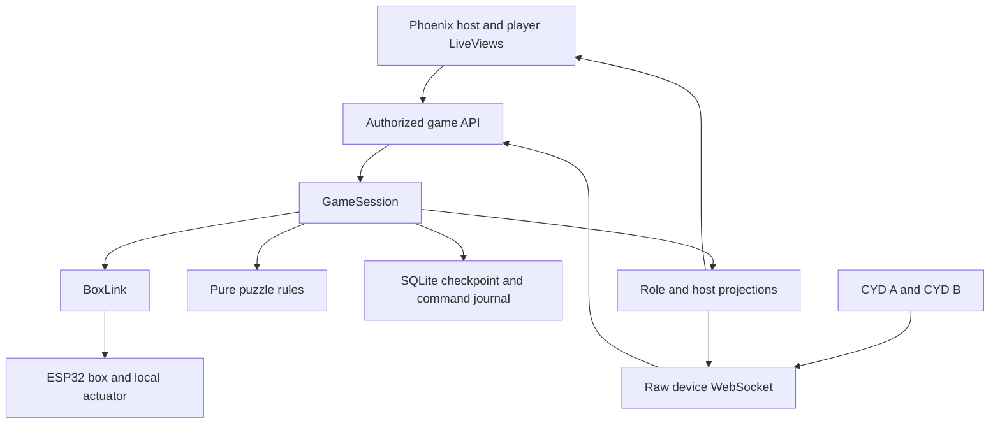

# The Watchmaker’s Vault implementation specification

Version 1.0 — 12 November 2026  
Audience: Rafa and Codex implementing the project.  
Status: build specification; application and hardware verification are future implementation work.

Hardware corrections from [Hardware update 1](WATCHMAKERS_VAULT_HARDWARE_UPDATE.md) are incorporated below. Component markings and dimensions are supplied evidence, not measurements or bench tests performed by Codex. The fixed puzzle and version 1 protocol are unchanged.

## 1. Outcome and scope

Build a small cooperative escape-room puzzle around a green PASCAL rigid cardboard presentation box with an existing hinged lid. Two people each use a CYD touchscreen. They guide one shared key through a maze using complementary controls and map information, then exchange seal clues and hold the correct runes together. An Elixir application owns the game, and Phoenix LiveView displays both terminals, connection state and box behavior. An ESP32 in the box receives one explicit command to release a light latch; the player lifts the lid to collect the prize.

The project should demonstrate clear Elixir process ownership, message handling, a pure rules engine, LiveView updates, controlled side effects and recovery from disconnected devices. These properties must also improve the game: no lost progress on a brief interruption, no conflicting clients controlling the same role and no unintended second motor movement.

### 1.1 Required MVP

- Two roles, A and B, one shared maze, one final seal and one prize box.
- Two physical yellow CYDs, subject to confirming the second unit matches the observed PCB/USB layout and verifying their board profile; the unidentified ESP32-S3 pair remains an alternative.
- One ESP32-C5 box controller, the photographed 28BYJ-48 5V stepper and identified ULN2003AN driver board, with electrical compatibility and wiring still to verify.
- Elixir/Phoenix on a laptop, normal Wi-Fi, local SQLite persistence and no external service requirement.
- LiveView host console plus independent participant pages. Either role can use its CYD or an explicitly assigned browser controller.
- A simulated box and two-browser mode for development and demonstrations before hardware is connected.
- Explicit handling of reconnects, stale input, lost releases, controller replacement and uncertain actuator outcomes.
- Exact build, run, provision, flash, calibrate and demonstration instructions.

### 1.2 Outside the MVP

Four-player play, procedural mazes, a second maze, the flashing-code opener, cameras, motion-sensor challenges, joystick/potentiometer controls, OTA updates, MQTT, internet hosting, clustered BEAM nodes, embedded Elixir runtimes, remote motor servicing and a mobile app are extensions. Keep data and module boundaries open to expansion, but do not implement these features during the first delivery.

### 1.3 Normative language and defaults

“Must” describes required behavior. “Should” describes the preferred implementation unless verified constraints justify a documented alternative. Timing, buffer and UI figures are project defaults, not claims about every ESP32 board. Record measured adjustments in configuration and tests. Change the contract and fixtures together when a verified requirement changes.

`PROTOCOL_V1.md` defines exact JSON fields and sequence rules. The supplied schema validates structure; the prose defines stateful behavior. The private fixture defines the golden puzzle. Source URLs at the end of each technical chapter support framework/hardware facts; the game and protocol are original project design decisions.

## 2. Hardware and deployment

### 2.1 Inventory and evidence

| Item | Evidence available | Planned use or verification |
| --- | --- | --- |
| 2 classic ESP32 CYDs | One supplied photo set identifies ESP32-2432S028, Micro-USB plus USB-C, CH340C and front marking TPM408-2.8 | Baseline player pair; second-unit match, exact revision, LCD/touch, pins, flash and PSRAM remain unverified. |
| 2 ESP32-S3 CYDs | User inventory; exact PCB models unrecorded | Alternative matching pair if vendor support is stronger. |
| 3 ESP32-C5 boards | User inventory; advertised with an external antenna | One box controller; exact development-board model/revision, power input, dimensions, connector and pins remain unresolved. |
| ESP32-S3 camera board | User inventory | Unused in MVP. |
| 28BYJ-48 stepper | Photo label reads 5V DC | Latch cam, calibrated on the actual mechanism. |
| ULN2003AN driver board | ULN2003AN marking and TI logo confirmed in supplied update; IN1–IN4 populated, five-pin socket, four LEDs, −/+ and 5–12 V supply markings; jumper fitted | Verify module wiring, jumper function, input compatibility and actual coil current before outputs. The motor remains 5 V. |
| Freenove 8 RGB LED Module | Printed name, eight pixels and IN/OUT S/V/G labels confirmed in supplied update; Freenove documents the WS2812 family, 3.5–5.5 V supply and GRB example order | Plan 5 V feedback with verified data levels and color order; exact LED silicon revision is unconfirmed. |
| Samsung EP-TA20JWE | Supplied label states 5 V / 2 A or 9 V / 1.67 A | Selected box supply in normal 5 V USB mode; no 9 V trigger. Voltage and combined load are untested. |
| Separate terminal USB power banks | Each CYD uses its own bank; photographed brand is Clutch | Exact Clutch model, output, capacity and connector are unreadable; confirm ratings and test each CYD/bank combination. |
| Sounder/speakers/audio board | Visible in photos; exact types unverified | Optional sound feedback; start with the simplest verified sounder. |
| Existing red/blue plunger switches and larger colored pushbuttons | Supplied inventory; momentary/latching behavior and contact pairs untested | Optional lid contact only after testing and mounting verification; not latch-position evidence or a version 1 protocol addition. |
| Blue microservo, DC motor, LEDs, resistors and other optional sensors | Supplied inventory | Spares; no new puzzle or change to the selected stepper design is required. |
| Green PASCAL hinged rigid cardboard box | Rafa reports nominal internal 90 mm W × 85 mm D × 70 mm H; floor 90 × 85 mm | Dry-fit the complete assembly with reinforcement, connectors and full motion clearance; installed fit is not proven. |

The supplied update distinguishes observed identification, user-reported dimensions and documented candidates from compiled firmware and physical verification. The Sunton ESP32-2432S028Rv3 dual-USB profile with ST7789 display and XPT2046 resistive touch is a candidate, not proof of the actual chips, revision or pins. Do not default to ILI9341 or mark ST7789 as tested from connector layout. Confirm the second yellow unit's PCB/USB match; a typed confirmation is sufficient if it matches. A different unit needs its own profile.

This is enough to specify the software and firmware interfaces. It is not enough to publish a trustworthy GPIO wiring diagram. Resolve each profile from actual board/vendor evidence or an existing working configuration, then perform the display/touch self-test. Request only the specific missing evidence for a ready hardware step; no general drawer-photo restart is needed. Missing physical evidence must not block independent software work.

### 2.2 Local deployment

Run one Phoenix application and one active game on Rafa’s laptop. Store persistent data under a configurable local data directory. Use the same 2.4 GHz network for the first mixed-board demonstration. The browser can open `http://localhost:4000`; real devices need the laptop’s reachable LAN address, configured explicitly. Do not require hostname discovery to make the first build work.

Default development listening should be loopback. Document the explicit LAN-bind setting and permitted origins for hardware mode. Use normal LiveView browser connections and raw device WebSockets at `/device/v1`. The host must be usable without an internet connection after dependencies are installed.

### 2.3 Architecture



The server owns puzzle truth. A CYD owns touch sampling and rendering. The box owns bounded, local motor timing. No firmware endpoint is another authoritative copy of the puzzle.

## 3. Exact puzzle rules

### 3.1 Story and opening instructions

Title: **The Watchmaker’s Vault**. Opening copy: “One key. Two incomplete maps. Tell your partner what you can see, guide the key to the exit, then hold the two seals together.”

The host introduces A and B, assigns controllers and starts when both players and the selected box mode are ready. There is no failure countdown. The host may display elapsed active time for interest, but it does not alter the rules. A wrong move never destroys progress.

### 3.2 Shared maze and complementary roles

The board is 4 × 4. Columns A–D run left to right; rows 1–4 run top to bottom. Both screens use the same orientation. Cells use zero-based row-major indices for the protocol: `cell = row_index * 4 + column_index`. The shared key begins at A4 (`12`), and the exit is D1 (`3`).

| Role | Buttons controlled | Information visible | Cooperation required |
| --- | --- | --- | --- |
| A | Up and Down | Internal vertical wall segments, which block left/right travel | A tells B which horizontal moves are open. |
| B | Left and Right | Internal horizontal wall segments, which block up/down travel | B tells A which vertical moves are open. |

Each role sees every boundary of its known orientation: a solid segment for a wall and a clear gap for an opening. Boundaries of the other orientation are dotted to mean unknown. Draw exterior boundaries as solid for everyone. Do not render unknown boundaries as open. Both players see the current key position, destination and coordinates.

Each accepted down-press attempts one cell of movement. Held direction controls do not repeat. A move requires the correct role, active ownership, current session/round/puzzle, unpaused maze phase and the board version that the player observed. Validate its allowed axis, bounds and wall passage on the server. Reject blocked moves without changing position or `board_version`; show a short “Wall” response. Reject an out-of-date board with “Board changed; try again” and the new projection. Do not automatically retry the player’s old choice from a new cell.

### 3.3 Golden maze

Only consecutive pairs in these two lists are open passages; every other internal edge is closed:

```json
{
  "main_path": [12, 8, 9, 5, 4, 0, 1, 2, 6, 10, 11, 7, 3],
  "branch": [9, 13, 14, 15]
}
```

This makes 16 connected cells with 15 open passages and a unique start-to-exit route. The branch from B3 through B4 and C4 to D4 is a dead end. Do not include the solution path in runtime player payloads or frontend assets.

| Step | Role | Direction | Resulting cell |
| --- | --- | --- | --- |
| 0 | — | Start | A4 / 12 |
| 1 | A | Up | A3 / 8 |
| 2 | B | Right | B3 / 9 |
| 3 | A | Up | B2 / 5 |
| 4 | B | Left | A2 / 4 |
| 5 | A | Up | A1 / 0 |
| 6 | B | Right | B1 / 1 |
| 7 | B | Right | C1 / 2 |
| 8 | A | Down | C2 / 6 |
| 9 | A | Down | C3 / 10 |
| 10 | B | Right | D3 / 11 |
| 11 | A | Up | D2 / 7 |
| 12 | A | Up | D1 / 3 |

Expected role projections are A’s closed right edges `[2, 5, 6, 9, 12]` and B’s closed bottom edges `[1, 4, 10, 11]`. Right edges at the last column and bottom edges at the last row are exterior, drawn separately.

Entering the exit commits the final maze move and transitions to `seal`. It does not unlock the box. Keep the final board and move history server-side for diagnostics. The CYD replaces its maze panel with the seal panel.

### 3.4 Final seal

There are four labeled options on each terminal: **STAR, MOON, SUN, WAVE**. Use a simple vector icon and text for each, avoiding reliance on emoji glyph availability.

| Screen | Clue shown on that screen | Correct local selection, server/test only |
| --- | --- | --- |
| A | “Tell B: hold MOON.” | STAR |
| B | “Tell A: hold STAR.” | MOON |

Initially no rune is selected. Tap an option to select it, then press and hold a separate large **HOLD SEAL** control. This supports a single-touch CYD. Rune choice persists on pause; pressed state and partial shared progress do not. Changing a rune invalidates that role’s existing hold and requires a new press.

The two correct held states must overlap continuously for **2,000 ms of server-observed time**. The presses may start at different moments; the shared timer starts when the second valid correct hold becomes active. An early release, stale lease, wrong selection, pause, ownership change or disconnect clears the shared timer. A player who remains freshly held may wait for the partner to press again, unless a pause/expiry/context reset requires both to establish new input baselines.

Do not reveal an individual player’s correctness with an “incorrect rune” label, hidden-answer field or a green/red correctness indicator. A selected option and an accepted physical hold are visible facts. Shared progress starts only when the joint condition holds. Show “Exchange clues, choose your seal, then hold together.”

Only GameSession declares qualification. Clients may animate the shared progress from the latest server start/elapsed information; they must not announce completion from their local timer. Details of lease expiry and stale samples are normative in `PROTOCOL_V1.md`.

### 3.5 Phases, pause and release

| State or operation | Required behavior |
| --- | --- |
| `lobby` | Show assignments/readiness; movement and seal controls disabled. |
| Start | Host only; require both assigned fresh controllers and a ready simulated box or an armed physical box. Enter `maze`. |
| `maze` | Accept valid role moves and preserve progress. |
| Enter goal | Commit final move, enter `seal`, clear input baselines. |
| `seal` | Accept selections and fresh held states; preserve maze completion. |
| Qualify | Recheck identity, timing, readiness and ownership; commit `solved` plus one durable release intent atomically. |
| `solved` | Puzzle outcome is final; release status continues independently. Do not unsolve or automatically relock. |
| Pause | Preserve phase, position and selections; clear held states and shared progress, invalidate control epochs and disarm uncommitted physical release permission. |
| Resume | Host only after readiness is restored; clear operator/recovery pause reasons, refresh authorization and require new neutral-then-press input. |
| Reset puzzle | New session and maze attempt; clear puzzle progress and fence old inputs. Never issue motor movement. |

`paused` is orthogonal to phase. Offline causes remain visible until actually resolved. Reconnection restores the current view but does not silently resume the game. A recovery pause remains until the host resumes. A host observer closing their browser does not pause hardware-owned player roles.

After a solve has committed a release intent, Pause/Reset must not imply cancellation of motion in transit. Keep them disabled while pending, moving or unreconciled. With no recovery begun, a known terminal-and-idle result permits Reset. Once recovery begins, Reset requires durable closed_no_replay and protocol v1 stopped/disarmed evidence even if a late terminal result arrives. Administrative closure preserves the historical outcome; subsequent local service and fresh verification prepare another game.

### 3.6 Hints and difficulty

For the MVP, support an authenticated host **Show cooperation hint** action that displays one generic instruction: “You can see the walls your partner needs. Describe the next boundary before moving.” The hint must not reveal the solution or add an alternate win path. It is optional UI polish and must not delay M1.

Do not add random layouts, progressively changing clues or time penalties. A first run should be brief enough to demonstrate during an interview; actual duration is a play-test result, not a guarantee. Use the exact golden maze until the synchronization behavior is reliable.

## 4. CYD and Phoenix user experience

### 4.1 Visual language

Use a restrained watchmaker/instrument-panel theme: very dark navy background, warm ivory text, muted brass borders, cyan active controls and a clear green completion accent. Error/paused states require text and an icon, not color alone. Use readable sans-serif text and a compact monospace style for coordinates/status. Do not spend the week on decorative animation.

The device logical canvas is **240 × 320 portrait**, scaled or letterboxed to a verified physical screen. Target a minimum 44 × 44 logical pixels for touch controls. Do not assume a landscape-native LCD uses matching raw touch coordinates.

### 4.2 Terminal screen layouts

| Screen | Content and layout |
| --- | --- |
| Connecting | Vault title, device identity, connection/provisioning status; no active game controls. |
| Unclaimed | Authorized role choices and Claim action; show occupied roles without permitting theft. |
| Lobby | Role A/B, control responsibility, partner status, “Waiting for host.” |
| Maze | 28 px header; compact role instruction; 192 × 192 maze with 48 px cells; two 96 × 44 direction buttons; short status/footer. Use margins within the 240 px width. |
| Seal | Role/header; two-line partner clue; 2 × 2 rune selector with 44 px or larger targets; shared progress bar; full-width HOLD SEAL control at least 52 px high; short status. |
| Paused | Retain the underlying map/selection; clear pressed highlights; overlay reason and “Release controls; waiting to resume.” |
| Solved | “Puzzle solved” plus actual release state: requested, accepted, motion completed, confirmed released or needs inspection. |
| Offline | Visible overlay immediately after known loss; controls disabled; last picture is visibly stale. |

The exact pixel allocations may be adjusted after rendering on the chosen display, but no screen may depend on scrolling during play. When space is tight, keep the maze and touch targets large and shorten explanatory copy. Use a 4 × 4 grid component shared by both player roles.

Pointer/touch down gives immediate local pressed feedback. Accepted movement changes the key only after server acknowledgement/snapshot. A 120–180 ms transition is optional. Invalid/stale moves get brief text feedback without shaking the whole screen or blocking later inputs.

### 4.3 Phoenix host console

The host view has three main areas: a terminal A panel, a shared vault/status panel and a terminal B panel. On small browser windows, stack these vertically. Each terminal panel uses the same layout, icons, coordinates and game state as its physical CYD.

Above the panels show stage, paused/recovery reason, elapsed active time and controller assignments. Below them show a bounded recent-actions list. The central vault panel represents the eight-LED ring, latch command progress and measured or unknown physical state. Animation illustrates reported state; it must not invent lid opening.

Required host controls are Create/load game, Start, Pause, Resume, Reset puzzle, explicit per-role controller assignment/takeover, and a box-readiness/arm action. Show the effect of reset: “Restart puzzle; mechanism is unchanged.” Keep physical calibration and relocking in the local serial procedure. Provide a read-only box diagnostic area with command ID/status, boot identity, arming state, last contact and any failure. Add Begin release recovery (including explicit replacement preparation) and Close release without replay, with authenticated operator evidence and a separate host-only administrative disposition display. These controls never create a physical-position claim.

A hardware-owned panel is a live mirror. It is read-only until the host explicitly takes over that role. Browser-owned mode uses the same controls and API. The host may control both roles in a demonstration, with separate A and B controller identities; observer access alone grants neither.

### 4.4 Participant pages and keyboard input

Provide separate `/games/:id/play/a` and `/games/:id/play/b` routes, protected by scoped player sessions. Do not let role selection in a URL grant access. Render only that role’s permitted view; the host route is separately authenticated.

Participant keyboard defaults: A uses Up/Down and Space to hold; B uses Left/Right and Space to hold. Only the currently controlling participant page handles those keys. Ignore repeated keydown. Do not intercept keys while typing in a form. Keyboard release, blur, hidden tab and lost pointer capture clear the held state. The combined host demonstration may use W/S for A moves, A/D for B moves and Q/P for the two holds, with the mapping visibly labeled and scoped to that console.

At entry or reconnection, request/establish control explicitly. Opening another tab does not steal an existing role. Observers can watch permitted state but cannot send effective gameplay inputs.

### 4.5 Box feedback mapping

Light and sound are cosmetic and may be omitted if their hardware is unverified. They must never use the latch motor to create a rumble or vibration. Exact brightness and volume are local bounded configuration.

| Event/state | Wire `light_mode` and local LED behavior | Wire `sound` |
| --- | --- | --- |
| Lobby/maze idle | `idle`: gentle cyan pulse | `none` |
| Both players ready | `idle`: retain the cyan pattern | `tick`, once |
| Accepted move | `idle`: retain the pattern | Optional `tick`, once |
| Wall collision | `error`: brief amber indication, then restore current mode | `error`, rate-limited |
| Maze complete | `idle`: retain cyan until the seal starts | `tick`, once |
| Paused/offline | `paused`: slow amber pulse | `none` |
| Seal overlap | `progress`: fill 0–8 LEDs from `progress_percent` | `none` |
| Puzzle solved/release pending | `success`: green pattern for puzzle completion | `success`, once |
| Motion complete or confirmed release | `success`: retain green; host text distinguishes the physical result | `none` |
| Uncertain/failed mechanism | `error`: amber alternating, diagnostic text in host | `error`, once |

Use ordered feedback messages and identifiers so a retransmitted state does not replay a sound. A new connection should receive the current steady mode without replaying historical effects. Do not infer a percent-complete maze from shortest-path distance; that would leak puzzle information. There are no intermediate mandatory checkpoints in this MVP.

Use only the wire modes/cues in `PROTOCOL_V1.md`. Refresh a steady desired mode with `sound:none` before its TTL expires; a cue is sent once with a new sequence. A short wall-error indication can be followed by the current state’s steady mode. Green means the puzzle is solved; it does not assert that an unsensed latch reached its endpoint.

## 5. Phoenix and server specification

The next chapter defines the server implementation. Exact transport names remain in `PROTOCOL_V1.md`.

### 5.1. Deployment and implementation boundaries

Build one Phoenix application running on Rafa’s computer, on one Elixir node, with Phoenix LiveView, Phoenix PubSub, Ecto, the SQLite adapter, and WebSockAdapter. Use compatible stable versions, commit `mix.lock`, and document the tested Elixir/OTP versions. The first working milestone must be playable with two browser participant pages and a simulated box. It must not require an ESP32, cloud account, MQTT broker, or internet connection after dependencies are installed.

The real CYDs and box connect over the same local network. ESP32 firmware does not run Phoenix or a BEAM node. Expose the documented raw WebSocket endpoint `/device/v1`; it is not a Phoenix Channels endpoint. WebSockAdapter supplies the Plug-to-WebSock upgrade mechanism, including supported connection options; validate the chosen HTTP adapter’s supported options rather than assuming every option is enforced.[1]

Keep the existing static HTML concept as a visual reference. Deliver a real Phoenix application with executable tests and documented launch instructions. Do not describe a static preview as an implemented LiveView application.

### 5.2. Module responsibilities

| Module or boundary | Responsibility |
|---|---|
| `Vault.Games` | Public game API; resolves a durable game ID, checks caller capabilities, and routes requests to its process. |
| `Vault.GameSession` | One GenServer per active game; owns current state, input ordering, bindings, leases, timers, and accepted transitions. |
| `Vault.Puzzle` | Pure reducer and rule functions; validates movement, stage progression, seal selection, and public outcomes. No database, sockets, timers, or device I/O. |
| `Vault.GameStore` | Ecto schemas, migrations, checkpoints, durable command records, and transactions. |
| `Vault.Projections` | Constructs allowlisted player A, player B, host, and box DTOs. |
| `Vault.Controllers` | Authenticated principals and active controller bindings; may be ordinary functions around GameSession state rather than another process. |
| `Vault.BoxLink` | Box connection lifecycle, read-only recovery queries and eligible committed dispatch. Never decides a solve, re-envelopes stale effects or dispatches permanently retired intents. Explicit administrative closure belongs to the authorized game/session transaction. |
| `VaultWeb.DeviceUpgrade` / `DeviceSocket` | Authentication, WebSocket upgrade, bounded JSON parsing, schema validation, protocol replies, and transport lifecycle. |
| `VaultWeb.PlayerLive` / `HostLive` | Render authorized projections and submit actions through the same game API. |

Use processes for independent lifecycles and state ownership, not one process per rule or helper. This follows Elixir’s guidance to use GenServer for runtime properties rather than code organization.[2] Keep hardware transport and database code outside the pure puzzle reducer so the whole game can be tested deterministically.

### 5.3. Supervision and session lifecycle

Start the repository, PubSub, registries, game supervisor, box-link supervisor, recovery coordinator, and web endpoint under the application supervisor. Use a Registry key derived from the durable game ID so concurrent callers cannot create two authoritative processes. Start game processes through a DynamicSupervisor; its children are created on demand.[3]

Create a game through an explicit host action or setup task. Mounting a participant page, reconnecting a socket, or reloading the host console must never create a new game. A lookup may start the already-existing game process from its checkpoint, idempotently.

On any GameSession restart, including a supervised crash, reload the committed checkpoint, generate and commit a new `session_id`, preserve the recovered phase and existing release `command_id`, and set `paused: true` with a recovery reason. Fence and close existing raw device handlers with code 4003 so a fresh welcome authorizes the replacement session. LiveView adapters explicitly clear/rebind their controller context; an arbitrary different-session snapshot cannot do so. Keep recovered puzzle progress, but clear all volatile connections, pressed controls, lease deadlines, timer generations, and pending client acknowledgements. Reauthenticate clients, revalidate role bindings, inspect box status, and require an explicit host resume. A supervisor restart does not restore lost memory without this store.

Monitor controller and box transports. A host observer is not a controller; its disappearance has no effect on roles owned by CYDs or other browsers. Their failure must not crash the game process. When a participant disappears, revoke its effective hold immediately when detected and pause play according to the protocol. The host should see the reason. Box loss leaves puzzle progress intact but prevents a new physical release.

### 5.4. State and version semantics

Use the protocol’s distinct identifiers; do not collapse them into one revision:

- `game_id` identifies the durable game record.
- `session_id` changes on restart, reset or explicit Begin release recovery/replacement preparation and invalidates old inputs, effect bindings and arms.
- `round_id` changes for a new maze attempt, not for the maze-to-seal transition.
- `puzzle_revision` changes when rules, layout, or clues change within a round.
- `board_version` changes only when an accepted move changes the maze position.
- `state_revision` orders snapshots and visible UI changes, including connection changes and hold start/stop; heartbeat-only refreshes do not advance it.
- `connection_id` identifies an authenticated WebSocket connection; `control_epoch` identifies the current owner of a player role.

Use `command_seq`, `input_seq`, `press_id`, and heartbeat identifiers exactly as defined in the protocol. Never let a heartbeat increment `board_version` or make a valid move stale merely because an unrelated UI status changed.

Use exactly four game phases: `lobby | maze | seal | solved`. Keep `paused` and `pause_reasons` orthogonal to phase. Track release independently as `not_requested | pending | accepted | motion_complete | position_confirmed | uncertain | failed`. In particular, `solved` does not mean the mechanism moved or the lid is open. Store administrative recovery/disposition separately from this unchanged wire outcome enum; closed_no_replay does not make uncertain execution known.

GameSession accepts inputs sequentially, validates their identity and applicable versions, and invokes the pure reducer. Validate the maze version against the input’s observed board as required by the protocol: two simultaneous moves based on the same position cannot silently become a different two-step route. Reject a stale action with an authoritative snapshot, allowing the player to choose a fresh action.

A snapshot is complete for its audience. Clients apply it as a replacement rather than merging private fragments or guessing missing state. A new authenticated session replaces the old revision namespace and clears queued old inputs.

### 5.5. Commit, acknowledge, publish, and act

The reducer returns proposed state plus typed effects. GameSession validates a proposed transition, commits any durable changes, adopts the state, and only then acknowledges acceptance, publishes projections, and performs permitted effects. A failed database transaction must not produce a success acknowledgement or an actuator command.

Persist accepted maze movement, stage changes, start/pause/reset decisions, and release intent before confirming them. Do not write every heartbeat, visual countdown tick, or pressed-state refresh to SQLite. A low-volume local game can use short synchronous checkpoint transactions; never keep one open while waiting for the network or motor.

For the winning transition, atomically store the solved/release-pending checkpoint and one opaque `command_id` with its intended box, operation, originating game/session/round, status, and timestamps. Enforce uniqueness for the release action associated with that solved attempt. Only after commit may BoxLink dispatch that command. Dispatch retirement is durable and checked before effects; queued effects keep their original binding and cannot acquire a replacement connection/session.

A crash between commit and dispatch leaves a durable pending command. A crash after dispatch but before acknowledgement leaves an uncertain outcome. Neither condition authorizes automatic actuator replay. On recovery, ask the authenticated box for status and its remembered command outcome. Present unresolved cases to the host. The firmware’s duplicate-command handling is necessary, but must not be represented as a universal exactly-once guarantee for physical motion. The explicit exit is the protocol v1 administrative recovery procedure: retire the old intent, enter stopped local recovery, reboot/fence bindings, restore locally as needed, seal and query current evidence, and commit a separate closed_no_replay disposition. No renewed delivery of the original intent is offered.

### 5.6. Persistence and recovery

Use a small file-backed SQLite database through Ecto. Start with a 100 ms SQLite busy timeout and short transactions; measure database latency rather than accepting the adapter default for this timing-sensitive process. A failed write causes a visible volatile recovery pause with a storage-error diagnostic, no success acknowledgement and no actuation. Its adapter supports WAL, busy-timeout, and transaction-mode configuration.[4] Put the database in a documented persistent local data directory; use migrations and foreign keys. Configure a small pool suitable for this serialized workload and verify concurrent status writes do not cause avoidable lock failures. Do not use an in-memory database outside tests.

Minimum records are: games/checkpoints; authorized devices and credential hashes; desired role assignments; actuator commands and reported outcomes. Include a checkpoint schema version. Configure SQLite synchronous durability deliberately; use `:full` for the actuator journal and document the practical storage guarantee. An application commit is not proof against every possible storage or power failure. Reject an incompatible checkpoint visibly rather than silently starting an empty game. Keep the newest 200 host diagnostic events in memory and optionally the newest 1,000 durable non-heartbeat events; prune only diagnostic rows, never actuator identities. Keep a short bounded event history for host diagnostics; an event-sourcing framework is unnecessary. Actuator records also retain permanent dispatch retirement, recovery generations, disposition and operator evidence, including local attestation references, independently of the reported execution result.

Persisted desired role assignment is not a live connection or permission to replay an input. Reconnect authentication establishes a fresh binding. All hold leases expire across process or machine restarts. Wall-clock timestamps may serve audit history; use server monotonic time for live leases and two-second qualification. Never restore a monotonic deadline from disk.

Puzzle reset is a host action that starts a new session, clears puzzle progress and holds, and invalidates old input. Disable Reset while pending, moving or unresolved. A terminal-and-idle result permits Reset only if recovery has not begun; otherwise require closed_no_replay with stopped/disarmed evidence, even after a late terminal observation. Close/fence existing raw device connections so their new welcome establishes the replacement session. Reset and reconnection do not issue motor commands. Physical relocking uses local USB/serial maintenance; homing is available there only with an installed, verified home sensor and enabled homing. Completed actuator history remains available after puzzle reset.

### 5.7. Authentication, authorization, and partial information

Provide one local host login, separate player join credentials, and distinct credentials for every CYD and the box. Keep secrets out of source control, URLs retained after joining, screenshots, logs, and DTOs. Store credential hashes where appropriate and document initial provisioning and rotation. Exchange a player join token for a scoped browser session and redirect to a clean route. The host role is never granted by choosing a URL parameter.

Protect ordinary routes and LiveView mounts, then recheck action authorization at the game API. LiveView’s documentation explicitly requires security checks on mounts and events; a hidden button is not authorization.[5] Preserve CSRF protection, origin checking, and secure session configuration. Authenticate device connections according to the protocol and derive device identity from that authenticated connection, never from a claimed player ID in an action.

The LAN prototype must state its transport assumption honestly: plaintext HTTP/WS on a trusted local network does not protect credential or message confidentiality. Use HTTPS/WSS when configured, retain certificate verification, and avoid router port forwarding. Do not present LAN authentication as encrypted transport.

Player projections contain only their own partial maze boundaries, their controls, the clue they are allowed to give their partner, and shared progress/status. Do not send the full map, solution path, the other player’s clues, or its own hidden seal answer and hide them with CSS. Apply the same rule to initial HTML, LiveView diffs, pushed events, error replies, raw device snapshots, and DOM data attributes.

The host projection may include both player panels because facilitation requires that visibility. Label it clearly as the host view. A host observer still needs explicit control ownership before submitting a player action.

### 5.8. Controller ownership and live synchronization

Maintain exactly one active controller per role, with independent A/B assignments. Support browser/browser, CYD/CYD, and mixed browser/CYD play. Additional viewers are read-only observers. Reloading a page must not steal a role from another active controller.

The host can deliberately hand over a role. Pause, revoke the previous binding, clear holds, advance its `control_epoch`, establish the authenticated new binding, publish current state, and require fresh input before resuming. Also invalidate the relevant control epochs on pause, resume, reset, and claim replacement as specified by the protocol; delayed presses must not become valid after resume. An old tab or socket must remain unable to act even if its messages arrive later. A reconnecting recognized device can receive its authorized state, but cannot override an ownership change made while it was absent.

In connected LiveView mount, subscribe to the authorized PubSub topic before fetching a snapshot; then ignore unsolicited queued snapshots at or below the revision already applied. An explicitly requested or bootstrap snapshot can replace equal-revision presentation state within the authenticated current session. This closes the fetch-before-subscribe gap. PubSub provides subscription and broadcast primitives; the application must supply revision handling.[6] Subscribe once per mount and never broadcast an unrestricted DTO to a topic consumed by player views.

Use audience-specific topics or have subscribers request their authorized projection after a revision notification. Device socket subscribers follow the same ordering. Reconnect obtains a complete snapshot. Local rendering may animate an acknowledged move, but cannot commit a speculative maze position or declare a win.

### 5.9. LiveView pages and controls

Provide `/games/:id/host`, `/games/:id/play/a`, and `/games/:id/play/b`, with authorization independent of route spelling.

The host page shows both CYD-sized panels and one shared status area: stage, elapsed active time, pause reason, controller assignments, device connection freshness, box connection, and release-command state. Show Start, Pause/Resume, Reset puzzle, and deliberate per-role takeover controls. Keep box-readiness and arming controls in a separate host area. Physical calibration, enabled sensor-backed homing, manual verification and relocking use local USB/serial service in the MVP. Display reset’s game effect clearly. In unresolved-release recovery, show separate preparation/close controls and the durable disposition without changing the reported historical outcome; obtain explicit operator confirmation of the sealed USB record.

A player page shows only its partial maze, current token, destination, role instruction, two direction buttons, partner connection state, and stage-specific seal controls. Use solid known walls, clear known openings, and distinguishable unknown boundaries. Use words/symbols as well as color. Directions should match the screen orientation. One tap equals one attempted move; keyboard auto-repeat must not flood actions.

In browser-owned mode, controls are interactive. In hardware-owned mode, the same controls mirror accepted hardware actions and are read-only for observers. A player must be able to tell whether its input was accepted, blocked by a wall, rejected as stale, or disabled because play is paused. Keep network diagnostics and private solution detail on the host page.

Show final qualification as shared progress from zero to two seconds. Distinguish “Puzzle solved,” “Release requested,” “Mechanism acknowledged,” and any sensor-backed physical position. Do not label the lid open merely because a motor command completed. Use a clearly marked simulated box in browser-only development mode.

### 5.10. Browser input and authoritative holds

Implement a small LiveView JavaScript hook for pointer and keyboard input. LiveView supplies hook lifecycle callbacks and client/server event APIs.[7] Capture a pointer on press; clear local held state on release, `pointercancel`, lost capture, blur, hidden document, hook destruction, and disconnection. Ignore repeat keydown events. Reconnection never replays a held key; it requires a new press.

A best-effort release message is not enough. Use the protocol’s server heartbeat challenges: every 100 ms, with a lease valid until challenge-issued monotonic time plus 400 ms. A delayed response cannot acquire a fresh lease merely because it arrived recently. Browser controllers must meet the same freshness and ownership requirements as devices. Deliver browser challenges through `push_event` using the shared transport callback; send device challenges directly to their WebSocket. Do not rerender LiveView or publish full snapshots for heartbeat-only refreshes.

GameSession tracks the current press identity and latest accepted complete hold state per role. Start qualification only while both correct seals are freshly held in the current stage/session and by the current owners. Any wrong selection, release, stale lease, pause, handover, disconnect, or phase change clears progress. Expiry at 400 ms cancels qualification; socket closure pauses immediately, while 1,500 ms of authenticated silence pauses the session. A short delay therefore cancels qualification before it becomes a full interruption. An expired held input requires a real released baseline and new press identity; stale true samples cannot restart it.

Use a generation-tagged qualification timer and recheck all conditions when it fires. Ignore old timer messages. Duplicate ticks or simultaneous qualifying updates must produce at most one durable release command. Publish hold start, cancellation, and qualification outcome; clients may animate the progress indicator from server-provided timing, but only the server can declare success. Such UI changes never advance `board_version`, and animation frames need no snapshots. Test the timing through an injectable clock/scheduler, not long real sleeps.

### 5.11. Operational diagnostics

Provide a host event list with bounded retention: accepted moves, wall collisions, stale-input rejection, connection changes, ownership transfers, pause reasons, phase changes, and command outcomes. Identify events with nonsecret game/device/command identifiers. Redact tokens and avoid dumping whole participant payloads into browser logs.

Expose health separately from readiness: the web server running does not imply that both players or the box are ready. Show server/database availability, authenticated connections, controller ownership, current protocol version, and unresolved actuator outcomes. Do not require a monitoring service. Document launch, shutdown, database location, credential provisioning, and recovery steps in the project README.

### 5.12. Behavior-focused tests

Require tests that demonstrate the following failures are handled:

| Boundary | Required assertions |
|---|---|
| Pure puzzle | Exact canonical route reaches the goal; branch remains a dead end; blocked/wrong-axis/stale moves do not change position; phase transitions obey rules. |
| Privacy | A and B initial HTML, diffs, events, JSON snapshots, and errors omit forbidden walls, hidden answers, and the full route; host visibility requires host authorization. |
| Ownership | Observers cannot move; forged roles fail; old owners and stale tabs fail after takeover; mixed browser/CYD play works. |
| Versions | UI heartbeat changes do not stale a move; old session/round/control identity fails; duplicate sequence numbers do not repeat actions. |
| Holds | Boundary timing at two seconds; lost release; stale challenge reply; reordered state; pause/disconnect/handover; wrong seal; duplicate timer; keyboard repeat. |
| Persistence | Crash before commit yields no accepted change; crash after checkpoint but before reply reloads it; GameSession restart is paused with a new session and zero leases. |
| Actuation | Exactly one durable command ID for a win; crash before/after dispatch; dropped acknowledgement; box reboot; duplicate reports; interrupted/unknown results never trigger automatic motion. |
| Transport | Unauthenticated clients, unsupported versions, invalid JSON/types/enums, excessive strings/depth/frame size, rate floods, and wrong device capabilities are bounded and rejected without crashing the game. |

Use ExUnit for reducer/session/store behavior, LiveView tests for scoped rendering and authorization, and a real browser test for pointer cancellation, blur/visibility, keyboard, and reconnect hooks. Add protocol integration tests with simulated CYD and box clients. Run small generated/fuzz cases against protocol limits. Assertions should cover externally meaningful behavior rather than reproduce private helper implementation.

### 5.13. Primary documentation

1. [WebSockAdapter upgrade API and options](https://hexdocs.pm/websock_adapter/WebSockAdapter.html).
2. [Elixir GenServer: when to use a process](https://hexdocs.pm/elixir/GenServer.html#module-when-not-to-use-a-genserver).
3. [Elixir DynamicSupervisor](https://hexdocs.pm/elixir/DynamicSupervisor.html).
4. [Ecto SQLite3 adapter options](https://hexdocs.pm/ecto_sqlite3/Ecto.Adapters.SQLite3.html).
5. [Phoenix LiveView security model](https://hexdocs.pm/phoenix_live_view/security-model.html).
6. [Phoenix PubSub](https://hexdocs.pm/phoenix_pubsub/Phoenix.PubSub.html).
7. [Phoenix LiveView JavaScript interoperability](https://hexdocs.pm/phoenix_live_view/js-interop.html).

## 6. Firmware and physical hardware

### Scope and responsibility boundary

Implement two firmware applications: `cyd` for the player terminals and `box` for the physical vault. Both use a common C++ transport/protocol core on ESP-IDF. The first hardware milestone uses two matching CYDs, selected after the board audit, and one ESP32-C5 box controller. Keep roles and device registration data-driven so four terminals can be supported without forking firmware; the two additional roles remain inactive until the server enables a four-player game.

Phoenix owns the puzzle rules, role ownership, progress, hold qualification and decision to release the latch. Firmware owns touch acquisition, rendering, connection handling and bounded local hardware actions. CYDs must never independently decide that a puzzle is solved. The box must never infer permission to move from a rendered victory screen, a snapshot, a connection event or a retained status value. Motion requires an explicit valid command.

Use conventional ESP-IDF firmware for the C5. AtomVM, Nerves, ESP-NOW, camera processing, OTA updates and custom radio networking are outside this implementation. All terminals and the host use ordinary local Wi-Fi; use the same 2.4 GHz network for the initial mixed-board demonstration. Espressif documents a native ESP-IDF workflow for C5 and a managed WebSocket client; no embedded Elixir runtime is required. [H1, H2]

### M0: identify boards before selecting pins or drivers

The supplied hardware update identifies the **28BYJ-48, 5V DC** stepper, **ULN2003AN** driver marking/TI logo and **Freenove 8 RGB LED Module**. Freenove documents eight WS2812 pixels; electrical compatibility, wiring, actual LED revision and color order still require verification. Sounder type remains unknown. The C5 package advertises an external antenna, but the exact development-board model, revision, power input and pins are unresolved.

One yellow terminal is observed as **ESP32-2432S028** with Micro-USB, USB-C and **CH340C**. The documented **ESP32-2432S028Rv3 / ST7789 / XPT2046** profile is a candidate only. Confirm the second unit matches, resolve the actual display/touch configuration from board/vendor or working evidence, then test it. The unidentified black ESP32-S3 alternatives cannot inherit that profile.

Create `docs/hardware/board-audit.md` and a machine-readable profile for each selected board. Record:

- Manufacturer, printed model, PCB revision and chip/module marking, using the supplied photographs and only specific additional evidence needed to resolve remaining unknowns.
- Actual flash and PSRAM capacity, USB interface, serial identifier and ESP-IDF target (`esp32`, `esp32s3` or `esp32c5`).
- Display controller, physical resolution, interface and color order; touch controller, bus, interrupt/reset requirements and rotation transform.
- Every assigned GPIO, purpose and active level, with its schematic/vendor-example source. Identify reserved, boot-strapping, flash/PSRAM and already-used pins.
- Board power input, regulator constraints, shared-ground arrangement and external-antenna connection.
- Vendor example repository and exact known-working revision, including any existing working display/touch configuration available from Rafa's projects.

Choose the two CYDs with the strongest verified driver baseline. Do not assume all products sold as “CYD” share pin assignments or screen geometry. An unverified profile may support host simulation, but its hardware build must fail clearly rather than substitute guessed GPIOs. Missing hardware evidence blocks that target only; continue server, protocol, browser and host-side firmware work.

At M0, select and lock an ESP-IDF release/commit that supports all selected targets and the chosen display components. Pin the toolchain, managed dependencies, LVGL major/version if used, vendor drivers and partition configuration. Record them in the build documentation and lockfiles. Current upstream documentation is evidence of capability, not a substitute for a tested version lock.

### Repository structure and build contract

Use `firmware/apps/cyd`, `firmware/apps/box`, `firmware/components/vault_protocol`, `vault_transport`, `vault_device`, `vault_display`, and `vault_actuator`, plus `firmware/boards/<profile>/`. Common components must not include board GPIO constants. Keep display/touch and actuator hardware behind narrow interfaces with host fakes.

A board profile is the single source for target, pins, dimensions, orientation, bus settings, capabilities, memory configuration and calibration schema. Generate build configuration from it or load a reviewed matching header; avoid independently maintained copies of pin maps. `cyd` and `box` select only their required components.

Provide documented build and flash wrappers accepting an explicit application, board profile and serial port. A build produces a manifest containing firmware version/Git SHA, dirty-tree status, profile hash, ESP-IDF/toolchain versions, dependency-lock hash, target chip, flash/partition assumptions, protocol version, binary paths and SHA-256 checksums. Flash tooling must check the detected chip against that manifest and refuse a mismatch. Never automatically select the first serial device.

Keep device identity, Wi-Fi settings, endpoint and per-device authentication credentials in provisioned configuration/NVS. Supply a local serial provisioning workflow and an example configuration without real secrets. Do not embed passwords in committed source or log credentials. If WSS is enabled, require certificate verification; do not silently disable it to make a connection succeed. The local WS demo mode and its network assumptions must be explicit. [H2]

### Common device runtime

Use finite queues and clear owners instead of work inside callbacks:

| Owner | Work |
|---|---|
| Transport worker | Wi-Fi/WebSocket lifecycle, frame assembly, bounded send queue and reconnect scheduling. |
| Device state worker | Protocol validation, current connection/session context, role grants, snapshots and input authorization. |
| CYD UI/input worker | Touch sampling, calibration transform, press state and display changes. |
| Box actuator worker | One local motion at a time, step scheduling, endpoint inputs, travel/deadline checks and status. |
| Diagnostic timer | Lightweight counters; defer formatting and transmission to ordinary workers. |

These are ownership boundaries, not a demand for five separate tasks on every board. A small implementation may combine device state and UI work if it preserves responsiveness. Give display/LVGL access one owner or use its documented lock consistently. Never call network sends, flash writes, JSON parsing or display drawing from an ISR. ESP Timer callbacks must remain short and defer substantial work through queues; a callback must not block on another task. [H3]

Use a monotonic local clock for debounce, reconnect scheduling and actuator deadlines. The server's clock and protocol challenge semantics determine puzzle timing. Firmware must not award hold duration from client timestamps.

Start with finite event queues (32 small typed entries) and one replaceable latest-snapshot slot. Serialize from typed outbound events; do not allocate a full JSON buffer per queue entry. Superseded snapshots and cosmetic LED states may be coalesced. Releases, ownership changes and actuator results must not be silently discarded. If required control traffic cannot be queued, neutralize local input, show the fault and reset the connection so the server lease expires.

### Raw WebSocket integration

Connect to `/device/v1` using raw WebSocket JSON. Do not implement the Phoenix Channels wire protocol on the boards. The shared protocol chapter is authoritative for field definitions, errors and state transitions; use its fixtures in both C++ and Elixir tests.

Implement `hello`/`welcome`, the server-issued `connection_id`, stable `device_id`, per-boot `boot_id`, and validated session context. A socket opening is not readiness: inputs remain disabled until authentication, the current snapshot, role grant and fresh input state are established.

Use ordered per-connection `command_seq` for `command` actions such as `claim_role`, `release_role`, `move`, `select_rune` and `request_snapshot`; handle `command_result`. A movement includes the specified `expected_board_version` and direction. Preserve the distinction between `state_revision` and `board_version`; reject old snapshots and never manufacture a successful result locally.

The server sends `heartbeat_request` every 100 ms. Session reset/recovery closes the socket; discard its context and authorize a new session only through the new welcome. Echo its challenge sequence with an increasing `input_seq`. A claimed controller always includes its full current context/control epoch: neutral input is `pressed:false` with `press_id:null`. `input:null` is for an unclaimed controller or the box. Send an immediate heartbeat on press/release using the latest challenge. The server's 400 ms lease is measured from challenge issuance, so buffered stale packets cannot extend a hold. Firmware must respect the protocol's 30 messages/second rate and burst allowance.

Implement one bounded receive-assembly buffer: server messages may contain up to 8192 UTF-8 bytes; device messages sent to the server may contain up to 4096 bytes. Enforce protocol nesting/string limits. Handle WebSocket fragmentation and buffer-length events before parsing complete messages, and distinguish ping/pong/close frames from JSON. Espressif explicitly documents that a message can arrive across multiple events. Reject binary application frames, malformed envelopes, unsupported versions and oversized messages without retaining partial data indefinitely. [H2]

Reconnect with bounded exponential backoff and jitter, coordinated by one owner. Discard stale queued inputs and connection-scoped retries when the connection changes. Never replay taps, held inputs or actuator requests after reconnect. Obtain a new snapshot and control epoch, render the current state, and require a fresh physical release followed by a new press. A finger already touching the screen must not automatically become a new hold.

### CYD screen and input implementation

Use a **240 × 320 portrait logical canvas**. Map it to each board's verified native dimensions and orientation without stretching hit targets or clipping text; larger screens may scale or letterbox. Hardware display rotation and touch rotation must use the same transform. The visible controls follow the approved puzzle/UI specification, including role-specific hidden information. The device receives only its permitted projection, not every player's secret with some elements hidden in the renderer.

Prefer `esp_lcd` plus the verified touch driver and `esp_lvgl_port` where compatible. Reuse a proven vendor/display driver through the HAL when that is the shortest reliable path. Espressif's LVGL port supplies display, touch and rotation integration, but compatibility depends on the selected LVGL major and drivers; pin the tested combination. Do not spend the interview week writing a new LCD driver. [H4]

Provide calibration and a self-test screen with corner/center targets, crosshair coordinates, orientation markers and color blocks. Persist calibration with a version and profile hash. If the profile changes, invalidate incompatible calibration rather than reusing unexplained coordinates.

Poll touch at an initial 20 ms interval. Establish an up/down state machine with measured debounce, modest boundary hysteresis and one active contact. Use 30 ms stable transitions as the initial bench setting, then record any hardware-specific adjustment. A discrete direction/rune control emits once on the accepted down transition and requires release before another command; no auto-repeat. Sliding a held contact across other controls must not generate additional taps. A hold control starts only inside its hit target and ends on lift, cancellation or leaving its allowed area. Loss of valid touch samples clears the press; a driver error is not “still pressed.”

Clear input on disconnect, role loss, control-epoch change, stage/context change and UI replacement. Require an observed neutral interval before rearming. Continue sending the neutral heartbeat when a role remains claimed. Display a local pressed highlight promptly, but show game progress from authoritative snapshots/results. Include visible connecting, unclaimed, playing, paused/offline and error states; do not leave an apparently interactive frozen board on screen.

### Resource and responsiveness budgets

These are starting implementation budgets, to be measured on the selected boards:

- Touch sampling: 50 Hz. Local press feedback target: under 100 ms.
- UI refresh: up to 20 Hz while changing; redraw only invalidated regions. Static screens should yield CPU time.
- On classic ESP32 without verified PSRAM, start with two RGB565 20-line draw buffers: 19,200 bytes total at 240 pixels wide. A complete 240 × 320 RGB565 framebuffer would require 153,600 bytes, so do not allocate multiple full buffers by default.
- Bound all queues, frame buffers, text fields and diagnostics. Maintain at least 32 KiB internal free-heap headroom and 25% task-stack headroom under the measured worst case, then increase reserves if the chosen TLS/driver stack requires it. Record the largest free block as well as total heap.
- Keep watchdogs enabled. A recurring watchdog timeout is a defect to diagnose, not a reason to disable supervision. [H5]

Record minimum heap, stack high-water marks, queue peaks, reconnect count, dropped/coalesced cosmetic updates and maximum actuator scheduling lateness. Avoid high-rate serial logging during timing tests. A two-terminal, one-box run must not show progressive heap loss or input starvation.

### Box outputs and mechanical plan

Use the stepper to rotate a short cam that retracts a light latch; the player lifts the lid by hand. Provide a manual release accessible with the lid closed. Design the latch to remain mechanically stable without continuous energized motor holding. Keep the first assembly on a test mount, then transfer it to the green PASCAL hinged rigid cardboard box after repeated operation is reliable.

The nominal internal envelope reported by Rafa is **90 mm wide × 85 mm deep × 70 mm high**. No complete installed assembly has been shown to fit. Before permanent mounting, dry-fit the actual C5, driver, motor and mounting ears, shaft/coupler, full cam sweep, LED board, connectors, cable bends and intended prize. Reinforcement, supports, catch projections and an optional removable false floor consume space; do not promise final hole coordinates, false-floor height or prize volume from nominal sizes.

Place the light latch near the front opposite the hinge, subject to actual geometry. Use rigid inserts or load-spreading backing so motor/catch alignment does not depend on cardboard flex. Keep electronics insulated, secured and accessible; keep the LED feedback visible with the lid closed. Keep cables out of the hinge and cam sweep, with strain relief and flex where needed. Recheck alignment and calibrated travel after final mounting.

Verify the actual C5 antenna connector before selecting accessories. Keep the antenna clear of the motor, metal mounting hardware and dense wiring, then test the final arrangement with the lid closed. Cardboard does not itself require an exterior antenna. [H8]

### Box power and LED interface

Use the selected **Samsung EP-TA20JWE** in normal **5 V / 2 A USB mode**. Its alternative 9 V / 1.67 A rating is not the build voltage; do not add a fast-charge trigger. Keep the adapter outside the box and verify voltage at the chosen breakout/distribution point before connecting electronics. The selected rating is not a completed load test.

Plan parallel branches to the C5's documented power input, ULN2003 motor supply and LED module, with common ground. Verify the C5's source arrangement before connecting a computer for service; do not join independently powered 5 V sources without documented isolation. Check startup and simultaneous Wi-Fi, LEDs and motor load with the actual cables.

The identified ULN2003AN board's 5–12 V marking does not change the motor's **5 V** requirement. Verify its fitted jumper's circuit function rather than treating it as a voltage selector. Verify module wiring, coil sequence/current and input compatibility. Motor power passes through the driver; GPIOs provide phase control only. Keep motor and LED current out of the C5's 3.3 V regulator. [H6, H7]

For the Freenove eight-pixel WS2812 module, use **IN S** for data, **IN V** for planned 5 V and **IN G** for common ground; **OUT S/V/G** is unused with one module. The supplied update cites a 3.5–5.5 V module range and GRB example order; verify actual color order. Plan a suitable **3.3 V-to-5 V data buffer** unless the exact LED input specification establishes adequate margin for direct C5 signaling. A one-time successful direct connection is not level verification. The planning allowance of 8 × 60 mA = 0.48 A at maximum white is not measured consumption; verify the complete load budget and keep brightness bounded. A low commissioning brightness is not a measured current limit.

Each terminal uses its own USB power bank. The pictured **Clutch** model, output, capacity and connector remain unknown; verify appropriate 5 V USB output and compatible cable/connector without inferring USB-C or Lightning from the brand. Test sustained display/Wi-Fi use and intended idle behavior on each actual CYD/bank pair, including possible low-load shutdown.

Identify active/passive buzzer operation before choosing PWM or simple switching. Keep light/sound patterns bounded in brightness and duration. Map existing semantic feedback modes to local effects; remote messages must not specify arbitrary GPIO writes. Missing cosmetic drivers must not block the protocol or motor test. The success animation means the puzzle was solved, not that the latch or lid reached a physical state. Hardware-source details and provenance are recorded in [the supplied update](WATCHMAKERS_VAULT_HARDWARE_UPDATE.md#11-source-and-evidence-notes).

### Stepper calibration, homing and truthful status

The 28BYJ-48/ULN2003 arrangement counts commanded steps; it does not measure actual shaft position. Calibrate coil order, direction, stepping sequence, release travel and speed on the assembled mechanism. Do not assume an exact gear ratio or treat nominal steps-per-revolution as measured latch travel. [H6]

Prefer a physical home switch; add a second endpoint sensor if confirmed release feedback is required. One home switch proves only its own endpoint. Its absence cannot prove that the opposite endpoint was reached. Without a sensor, use an explicit manual reference/inspection workflow and retain the distinction between commanded travel and physically verified position.

Existing pushbuttons are only candidates for an optional lid contact. Verify the contact pair and normally-open momentary behavior: open when released, continuity while held, then open again. Verify mounting with a separate mechanical stop and debounce the input. A lid contact can indicate lid seated/contact released; it cannot confirm latch locked/released, establish a home reference or populate `position_basis:"endstop"`. Version 1 has no lid-sensor field. Preserve manual verification and add no incidental protocol/schema extension, automatic relocking or lid-triggered motor action.

Persist a versioned calibration record tied to the board/mechanism profile. Finite **release-travel, maximum step-rate and motion-timeout bounds are always required** before enabling motion. **Homing-travel/deadline bounds are required only when a home sensor is installed, verified and homing is enabled.** Without that sensor, homing is unavailable and the explicit manual-reference workflow applies. For the MVP, design a release stroke lasting at most 3 seconds and impose an 8-second absolute motion timeout. Record measured safe travel bounds rather than inventing an angle before the cam exists. Enabled homing is an explicit local USB/serial maintenance operation with its own bounds; do not home by repeatedly grinding against a hard stop.

Implement local states `uncalibrated`, `idle`, `homing`, `moving`, `interrupted` and `fault` internally, mapped to the protocol's public status values. A single actuator owner enforces travel/time limits even if Wi-Fi or Phoenix stops responding. A missed scheduling budget, invalid sensor combination or exhausted travel budget stops motion and reports a fault. Do not “catch up” by rapidly executing a backlog of delayed steps.

Accept a new `box_command` only with the current connection, `box_boot_id`, session, unconsumed `arm_id`, fresh challenge and authorized opaque `command_id`; the release action is `set_latch` with target `released`. Persist command intent **before the first step**, and persist the final result. If durable recording fails, do not move. The same ID never starts the mechanism twice, including after reboot. Look up a known ID before new-motion readiness checks and return its recorded outcome without motion. Retain accepted IDs up to 32 with no automatic eviction; `history_full` rejects new actions. History clearing is explicit disarmed USB service followed by reboot and a new host session, as specified in the protocol. Recovery-service inhibition and sealed-motion freezes are durable local state, checked at admission and immediately before a step. Queries remain available at capacity. Follow the protocol administrative-recovery and clear-pending procedure; never erase uncertain entries merely because current readiness is restored.

Report `box_status` using the shared `release_status`, with `accepted` while moving and `motor_active` indicating current motion. Completion is `motion_complete`; interrupted or ambiguous motion is `uncertain`; an execution failure is `failed`. Report current `latch_position` (`locked`, `released` or `unknown`) and `position_basis` (`endstop`, `manual_verified` or `unverified`). Keep commanded target and estimated step position separate from physical confirmation. A historical `position_confirmed` command outcome carries its saved `command_confirmation` evidence; current position may later be locked or unknown. Querying an old outcome must never restore old physical state or arming. `motion_complete` means the local step sequence completed; it does not prove the latch reached its target or the lid opened. `manual_verified` requires a person explicitly checking the physical state at the recorded observation; calibration/counting alone is not that evidence. The MVP has no lid-sensor protocol field, so real lid state remains unknown.

On an explicit transport close during motion, stop at the next step boundary and de-energize the coils. Also implement a local **1500 ms watchdog since the last authenticated server challenge**: silent connection failure must stop motion without waiting for TCP to notice. This watchdog is independent of maximum travel and the motion deadline. Report `uncertain` with position unknown when communication returns. On boot/reset, outputs start inactive, prior in-flight intent becomes uncertain/unknown, and there is no automatic unlock, relock, continuation or homing. Reconnection obtains state and awaits explicit reconciliation. **Puzzle reset is a host action; physical relocking uses local USB/serial maintenance.** Neither reset nor reconnection moves the motor. Recovery-service entry persists inhibition before acknowledgement; sealing additionally freezes local jog/example/local and queued/reserved service motion. Reboot preserves those inhibits; only the protocol-ordered local acknowledgement or committed replacement-preparation path permits unfreezing.

### Bring-up and acceptance checklist

**Before hardware motion**

- [ ] Two CYD profiles and the C5 profile have evidence-backed pin maps; exact selected toolchain/dependencies are locked.
- [ ] CYD color/orientation/touch tests pass, including every corner and the approved portrait layout.
- [ ] C5 boots, reports identity and connects with actuator outputs disabled.
- [ ] Protocol fixtures pass on host and target: fragmented messages, stale context, malformed/oversized JSON and reconnect.
- [ ] Driver, power, antenna arrangement, mechanical travel and manual release are verified on the bench.
- [ ] Normal 5 V output, common-ground distribution, simultaneous load stability, service-USB source isolation and LED data-level compatibility are verified with the actual components/cables.
- [ ] Each terminal's bank rating/connector and sustained/idle operation are verified; no capacity or runtime is inferred from the Clutch brand.
- [ ] Release-travel, rate and timeout bounds are established; homing remains disabled unless an installed home sensor is verified and homing bounds are configured.

**End-to-end hardware acceptance**

- [ ] Every discrete press produces one command; dragging/lifting does not create extra actions.
- [ ] Held inputs clear on touch loss, role transfer, context change and disconnect; reconnect requires lift/repress.
- [ ] Two CYDs and browser mirrors converge on the same session revision while showing only permitted information.
- [ ] Duplicated box commands produce one movement; power interruption never replays it automatically.
- [ ] Explicit connection loss stops at the next step boundary; silent server loss stops within the 1500 ms watchdog plus one bounded step interval, with `uncertain`/unknown status.
- [ ] Ten consecutive bench release/reset cycles complete without a jam; perform further testing only to investigate a failure.
- [ ] The complete assembly is dry-fitted within the nominal 90 × 85 × 70 mm envelope, then alignment, travel, manual release, power and closed-lid radio checks are repeated after mounting.
- [ ] A 30-minute connected run and several disconnect/reconnect cycles show no progressive memory loss or watchdog resets.
- [ ] Handoff includes build manifests, profile/calibration records, provisioning instructions and a short actual-hardware demo recording.

### Hardware and firmware sources

- **[H1] ESP-IDF C5 getting started:** https://docs.espressif.com/projects/esp-idf/en/stable/esp32c5/get-started/index.html
- **[H2] Espressif WebSocket client:** https://docs.espressif.com/projects/esp-protocols/esp_websocket_client/docs/latest/index.html
- **[H3] ESP Timer callback behavior:** https://docs.espressif.com/projects/esp-idf/en/stable/esp32c5/api-reference/system/esp_timer.html
- **[H4] Espressif LVGL port:** https://components.espressif.com/components/espressif/esp_lvgl_port
- **[H5] ESP-IDF watchdogs:** https://docs.espressif.com/projects/esp-idf/en/stable/esp32c5/api-reference/system/wdts.html
- **[H6] Freenove ESP32 stepper tutorial:** https://docs.freenove.com/projects/fnk0047/en/latest/fnk0047/codes/C/19_Stepper_Motor.html
- **[H7] TI ULN2003A datasheet:** https://www.ti.com/lit/ds/symlink/uln2003a.pdf
- **[H8] Espressif RF/antenna guidance:** https://docs.espressif.com/projects/esp-faq/en/latest/hardware-related/RF-related.html

## 7. Integration details that Codex must implement

### 7.1 Persistence records and invariants

Use these minimum records; names can follow an existing repository convention.

| Record | Minimum fields and invariants |
| --- | --- |
| Game checkpoint | Durable game ID, checkpoint schema version, current session ID, round and puzzle revision, phase, position, board version, selected runes, pause/recovery state, active-time accumulator, existing release command ID and timestamps. Recovery retains the release ID and rotates the session ID. |
| Device registration | Stable device ID, class, allowed role(s), credential hash, enabled flag and expected/verified capability information. A hello capability cannot expand this allowlist. |
| Actuator intent | Original command/game/session/round, operation/target and intended box with immutable fingerprint and one-intent-per-solve uniqueness; reported outcomes plus permanent dispatch retirement, recovery ID/generation, separate closed_no_replay disposition and non-pruned operator/local/current-binding evidence. |
| Diagnostic event | Bounded event ID/time, nonsecret actor, kind and small permitted data. Never store heartbeat streams or tokens. |

Do not persist socket PIDs, live leases, monotonic timestamps, connection IDs as reusable authority, or a “currently pressed” fact to restore later. Stored desired assignments are hints for reauthorization, not active grants. Recovered games are paused; reconnecting clients obtain fresh contexts and neutral input baselines.

Persist a winning checkpoint and its command ID in one transaction before any release dispatch. A recovered `solved` checkpoint remains solved and points to the same intent. A null-command readiness response cannot replace that intent with `not_requested`. Store actuator records independently from diagnostic pruning.

There is no retry delivery of an unresolved physical intent. BoxLink may query its outcome, while explicit recovery permanently retires dispatch and preserves the original solve/command. Use the recovery table and the normative [administrative recovery procedure](PROTOCOL_V1.md#administrative-release-recovery).

### 7.2 Recovery decisions

| Observation | Automatic behavior | Operator action if needed |
| --- | --- | --- |
| CYD disconnects during maze/seal | Clear effective hold, preserve puzzle, pause with offline + recovery reason; reconnect to current projection. | Restore ownership/fresh neutral state, rearm physical box if applicable, Resume. |
| Host observer closes | Preserve active CYD-controlled game. | Open host console again when desired. |
| GameSession/Phoenix restarts | Restore checkpoint paused, rotate session, fence sockets, clear leases and read box status. | Resolve any pending actuator outcome, restore ready players and Resume if still playing. |
| Release row committed but dispatch not known | Preserve solved state/original ID; query only. | Begin recovery, complete stopped/sealed local service and reboot/current-binding evidence, then close_no_replay. Never infer nonexecution from unknown_command. |
| Box remembers command complete | Update server’s observation without moving again. | Inspect physical latch if result is only open-loop motion completion. |
| Box reports interrupted/unknown command | Preserve the recorded uncertainty and original ID. | Complete the same explicit administrative closure, then Reset/new session and fresh local preparation for another game; no replacement release for the old solve. |
| Box reboots | Coils inactive, arm cleared, prior in-flight intent uncertain, no motion. | Re-establish reference and verified position locally before any new arm. |
| Journal is full | Reject new actions; permit queries and stopped reconciliation metadata updates without another accepted entry. | Verify durable host dispositions locally for every uncertain entry; separately clear with retained inhibition/clear-pending state, reboot and a different host session. |

The system provides durable deduplication within the documented journal lifecycle and avoids automatic replay. It must not claim universal exactly-once physical execution: a power loss can make the result unobservable even when some movement occurred.

The recovery disposition records administrative handling, not historical execution certainty. Keep the local all-motion seal until the committed host disposition is verified locally. To redo preparation before closure, atomically replace the expected recovery generation on the host, serialized against Close, and verify that replacement locally before unsealing. Preserve permanent dispatch retirement throughout. Binding changes require fresh closing evidence. Crash/readback procedures never manufacture an intent or treat a lost acknowledgement as failed execution; unavailable original server records leave the box quarantined.

For paused recovery, disarm once on the transition into pause. Restore fresh neutral controllers and the box’s current reference/locked verification; permit an explicit host arm while still paused. Wait for a sequenced readiness report confirming that arm, then Resume. Resume does not disarm again. A paused snapshot is observational and cannot continuously cancel an intentionally restored arm.

### 7.3 Simulated box

Provide a simulated implementation of the same BoxLink/actuator interface. It must require arming, consume a single command ID, report accepted then motion-complete state, deduplicate commands, and support injected disconnect, reboot, lost acknowledgement and interrupted motion. In simulation only, a host action can establish a simulated reference/locked position. Also model the complete service-inhibit/seal/reboot/close-out/local-attestation/Reset path and its failures; simulated closure does not claim physical inspection.

Set `simulated:true` in projections and visibly label the host/participant status. Never label a simulated observation as a real endstop or manual inspection of physical hardware. The simulator may stop at `motion_complete` with unverified physical position; its visual box can animate the illustration separately with a “Simulation” label.

Only the server-selected simulator may treat `calibration_valid` and `start_verified` as modeled readiness. Keep its physical `latch_position:unknown`, `position_basis:unverified` and `command_confirmation:null`. A real device cannot request this exception or set `simulated:true` to bypass physical checks.

The MVP protocol does not include a lid sensor. Real lid state is therefore displayed as unknown; after release, say “Lift the lid.” Any simulated lift interaction is presentation only. Adding automatic lid sensing requires an explicit capability and protocol extension, backed by the actual sensor.

Select box mode at application startup with `VAULT_BOX_MODE=simulated|physical`, defaulting to simulated for development. A mode change requires a new or deliberately reset game context and clears all controller leases. Do not connect the simulator and real actuator to the same active game at the same time.

### 7.4 Host mirror data

The in-process host projection includes both role projections plus a small control-observation map: current owner/source, accepted held state, selected rune, latest discrete action/result and its event ID, freshness category, and box readiness/status. A new accepted action event can highlight the corresponding mirrored button for about 150 ms. Do not infer that a direction button is still physically held from a one-shot move message.

The CYD’s local touch highlight may appear before network acknowledgement. The host mirror represents the accepted action/held state and converges with the authoritative game. A wall collision still produces a host action event even though the key does not move. Cosmetic events have IDs so reconnecting subscribers do not replay old flashes or sounds.

Build the participant DTO from an allowlist and the host DTO from separately authorized data. Privacy tests must compare field structures and permitted wall sets. A literal test that forbids the word STAR everywhere is invalid because STAR is also a public option and may be the player’s own selected value.

### 7.5 Freshness and scheduling budget

| Setting | Default |
| --- | --- |
| Server heartbeat challenge | Every 100 ms per controlling actor/device |
| Input lease | Strictly before challenge issue time + 400 ms |
| Silence threshold | 1,500 ms; explicit socket close is handled immediately |
| Shared correct hold | 2,000 ms |
| Box loss watchdog | 1,500 ms since last fresh authenticated server challenge |
| Database busy wait | Initial 100 ms; measure full transaction duration |
| Snapshot/presentation emission | At most 10 Hz; no heartbeat-only state revision churn |
| Box feedback emission | At most 10 Hz, with TTL and sequence deduplication |
| Device reconnect backoff | 250 ms, doubling to 5 s, with up to 20% jitter; reset after a stable authenticated connection |

Equality with a lease deadline means expired. Timer handlers first expire any overdue leases before evaluating qualification, regardless of mailbox order. Use one injectable monotonic clock and scheduler interface for domain tests. Separate device clock values are for local deadlines only; never subtract a CYD clock from an Elixir clock.

Network/OS scheduling can delay observation. The two-second rule concerns the server’s fresh observations, as described in the protocol. Timeouts are intentional bounds for this game; they are not a claim of hard real-time behavior.

## 8. Repository, configuration and operating instructions

### 8.1 Expected repository organization

| Path | Purpose |
| --- | --- |
| `server/` | Phoenix application, normal Mix structure, assets and tests. |
| `firmware/apps/cyd/` | CYD application and CMake/ESP-IDF entry point. |
| `firmware/apps/box/` | Box application and local serial service mode. |
| `firmware/components/` | Shared protocol/transport and separate display/actuator interfaces. |
| `firmware/boards/` | Verified target profiles and calibration schema. No guessed default profile. |
| `contracts/` | Versioned schema and golden fixtures, copied from this package and maintained together. Keep the private puzzle under a server/test-only path. |
| `tools/` | Device simulator and explicit build/flash/provision wrappers. |
| `docs/specs/` | This handoff and its hardware update. |
| `docs/hardware/` | Completed audit, schematic, photos, measured calibration and build manifests. |
| `docs/implementation-status.md` | Actual milestone/test/physical verification status. |
| `README.md` | Fast local start, configuration, operation, recovery and demo script. |

If an existing Phoenix repository already has a suitable structure, preserve it and document the mapping. An umbrella project is unnecessary for this scope. Firmware does not need to live inside a Mix application.

### 8.2 Toolchain lock and configuration

Record the tested Elixir, OTP, Phoenix, LiveView, SQLite adapter, WebSockAdapter, ESP-IDF, compiler, LVGL and board-driver versions. Commit `mix.lock`, frontend dependency lockfile when used, ESP-IDF managed-component locks and configuration defaults. Prefer a working supported board-driver baseline over upgrading every dependency. No unpinned `latest` dependency may be part of a reproducible firmware build.

Provide an example environment/configuration with placeholders for the HTTP bind address/port, public host/origins, persistent database path, box mode and secret file paths. Never commit real bearer secrets, Wi-Fi passwords, host session secrets or device provisioning NVS images containing credentials. Ignore local secrets, generated builds and device-specific private configuration.

At minimum implement/document these operator entry points; names may be adjusted consistently for the repository:

- `mix setup`: dependencies, assets and migrations for local development.
- `mix vault.init`: idempotent creation of the local host/game setup; write generated credentials to a requested protected local file, and do not rotate existing credentials implicitly.
- `mix vault.device.add`: provision a device ID/class/allowed roles and a per-device secret file.
- `mix phx.server`: start Phoenix with explicit simulated or physical box mode.
- `mix test`: server behavior/contract tests, with documented separate real-browser tests.
- `tools/fw-build --app cyd|box --board PROFILE`: explicit profile selection and build manifest generation.
- `tools/fw-flash --manifest FILE --port PORT`: chip/manifest verification, never automatic first-port selection.
- A serial provisioning tool or interactive menu for Wi-Fi, endpoint and per-device credentials, without credential echo/logging.
- A local box service menu for inspect, bounded jog, calibration, manual position confirmation and rearming preparation; offer bounded home only with an installed, verified home sensor and enabled homing. Gameplay remains disarmed in service mode. Include recovery entry, exact-identity inspection, reboot, Seal recovery evidence, local verification of host disposition or replacement preparation, deliberate exit and separately gated history clearing, following protocol v1.

These are requirements for the implementation deliverable, not commands supplied by this specification package. Codex must provide the actual scripts/tasks and verify their documented syntax.

### 8.3 Normal run

1. Start Phoenix in the intended mode. Open the authenticated host console and load the game.
2. Connect the two CYDs, or open two participant browser sessions. Explicitly assign A and B; confirm each controller’s neutral/fresh state.
3. In physical mode, inspect the mechanism and complete local reference/locked-position verification. Leave service mode. Confirm the correct box boot and readiness in Phoenix, then explicitly arm the current session. In simulated mode, use the clearly labeled simulation setup.
4. Start. Players follow the complementary map information to D1, exchange the seal clues, select STAR on A and MOON on B, then hold together.
5. Observe puzzle qualification, one release intent, command acceptance and motion completion/actual position evidence. Lift the lid manually once the latch is released.
6. If release execution is unresolved, complete protocol recovery and closed_no_replay first, preserving the old uncertainty. Verify that host disposition locally before leaving recovery service. Reset the puzzle and establish its new welcome/session; then relock/reference and verify the current locked start locally, deliberately leave service and arm. A session change clears earlier start verification. Reset alone never relocks or clears history.

### 8.4 Interview demonstration

Show one normal game, then one deliberate controller disconnect before a solve. The host should show the reason immediately, preserve the key position and reset the hold. Reconnect, show a fresh view, Resume and finish. Separately demonstrate a GameSession restart with paused checkpoint recovery using the simulated box or a disarmed real box.

Explain five design choices with evidence from the actual implementation: one authoritative GameSession, a pure puzzle reducer, server-filtered player views, expiring held-input leases and a durable actuator journal with explicit recovery. Show the host console reflecting physical controls. Keep a short recording of a fully verified run available in case the interview environment cannot access the hardware/network.

## 9. Delivery milestones and completion

`ACCEPTANCE.md` is the execution checklist. Complete M0 contracts/audit, M1 browser game, M2 protocol/recovery, M3 CYDs, M4 box bench work and M5 integration in that order. M1 includes the entire playable puzzle and simulated release. M2 hardens persistence and device conformance before separate firmware work expands.

Required handoff: runnable Phoenix source, both firmware applications, shared fixtures/schema, completed supported-board profiles, build/flash/provision/service tools, focused tests, launch/recovery documentation and a short demonstration. Report each result as implemented, tested in simulation, compiled for a named target or physically verified. A compile is not a hardware observation.

Only the actual board/driver/mechanism evidence can resolve hardware pins and travel. Codex should create the audit placeholders, finish independent work and identify precisely what is needed at the affected physical step. The delivered specification does not authorize guessed wiring or an unsupported claim that the latch opened.

After the two-player version is demonstrated, the next extension is a second fixed maze with exchanged control responsibilities. Four-player play follows as a separate rules/puzzle revision, with a frozen required-player set and all four fresh final holds. Do not merely duplicate the A/B screen into four independent puzzles; preserve complementary information and a shared objective.

